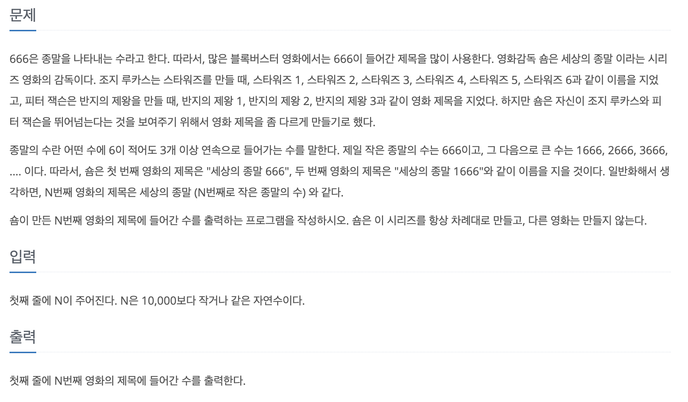




<https://www.acmicpc.net/problem/1436>

---

### <strong>문제</strong>

666은 종말을 나타내는 수라고 한다. 따라서, 많은 블록버스터 영화에서는 666이 들어간 제목을 많이 사용한다. 영화감독 숌은 세상의 종말 이라는 시리즈 영화의 감독이다. 조지 루카스는 스타워즈를 만들 때, 스타워즈 1, 스타워즈 2, 스타워즈 3, 스타워즈 4, 스타워즈 5, 스타워즈 6과 같이 이름을 지었고, 피터 잭슨은 반지의 제왕을 만들 때, 반지의 제왕 1, 반지의 제왕 2, 반지의 제왕 3과 같이 영화 제목을 지었다. 하지만 숌은 자신이 조지 루카스와 피터 잭슨을 뛰어넘는다는 것을 보여주기 위해서 영화 제목을 좀 다르게 만들기로 했다.

종말의 수란 어떤 수에 6이 적어도 3개 이상 연속으로 들어가는 수를 말한다. 제일 작은 종말의 수는 666이고, 그 다음으로 큰 수는 1666, 2666, 3666, .... 이다. 따라서, 숌은 첫 번째 영화의 제목은 "세상의 종말 666", 두 번째 영화의 제목은 "세상의 종말 1666"와 같이 이름을 지을 것이다. 일반화해서 생각하면, N번째 영화의 제목은 세상의 종말 (N번째로 작은 종말의 수) 와 같다.

숌이 만든 N번째 영화의 제목에 들어간 수를 출력하는 프로그램을 작성하시오. 숌은 이 시리즈를 항상 차례대로 만들고, 다른 영화는 만들지 않는다.

### <strong>입력</strong>

첫째 줄에 N이 주어진다. N은 10,000보다 작거나 같은 자연수이다.

### <strong>출력</strong>

첫째 줄에 N번째 영화의 제목에 들어간 수를 출력한다.

---

### <strong>코드</strong>

```cpp
#include <iostream>
#include <string>

using namespace std;

int main() {

    string part = "666";
    int num = 666, cnt = 0;

    int n;
    cin >> n;

    while (true) {
        string str = to_string(num);

        if (str.find(part) != string::npos) {
            cnt ++;
            if (cnt == n) {
                cout << num;
                break;
            }
        }

        num ++;
    }

    return 0;
}
```

### <strong>풀이</strong>

- part 변수에 문자열 "666" 을 저장한다.

- num 변수에 숫자 666을 저장한다. 이 숫자부터 시작해서 조건을 만족하는 숫자를 찾기 위함이다.

- cnt 변수는 조건을 만족하는 숫자를 발견한 횟수를 세는 변수이다.

- n 을 입력받는다. n 은 "666"이 연속으로 포함된 숫자들 중에서 몇 번째 숫자인지를 나타낸다.

- while (true) 루프를 사용하여 무한히 숫자를 증가시키면서 조건을 확인한다.

- to_string(num) 을 사용하여 "666"이 포함되어있는지 확인하기 위해 num 을 문자열로 변환한다.

- str.find(part) != string::npos 를 사용하여 문자열 str 에서 "666" 이라는 부분 문자열을 찾는다. "666"이 포함되어 있다면 find 함수는 인덱스 값을 반환하게 된다.

- cnt 가 n 과 같아지면, 현재의 num 이 조건을 만족하는 n 번째 숫자이므로, num 을 출력하고 루프를 종료한다.

