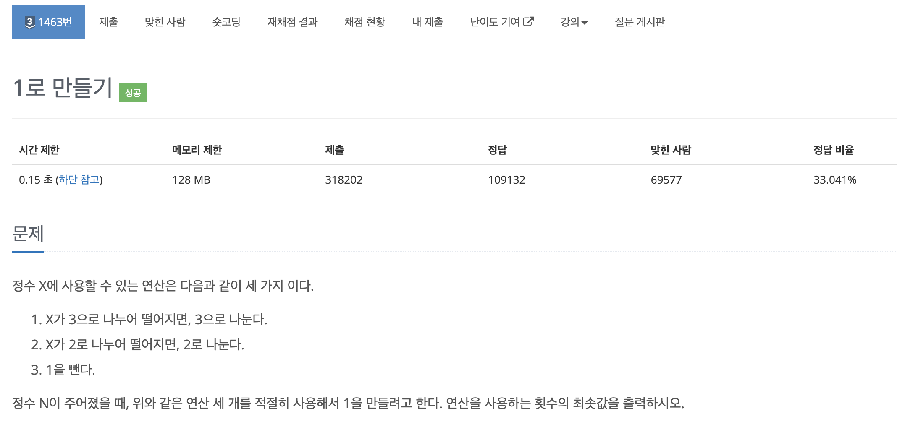




<https://www.acmicpc.net/problem/1463>

---

### <strong>문제</strong>

정수 X에 사용할 수 있는 연산은 다음과 같이 세 가지 이다.

1. X가 3으로 나누어 떨어지면, 3으로 나눈다.
2. X가 2로 나누어 떨어지면, 2로 나눈다.
3. 1을 뺀다.

정수 N이 주어졌을 때, 위와 같은 연산 세 개를 적절히 사용해서 1을 만들려고 한다. 연산을 사용하는 횟수의 최솟값을 출력하시오.

### <strong>입력</strong>

첫째 줄에 1보다 크거나 같고, 106보다 작거나 같은 정수 N이 주어진다.

### <strong>출력</strong>

첫째 줄에 연산을 하는 횟수의 최솟값을 출력한다.

---

### <strong>코드</strong>

```cpp
#include <iostream>
#include <vector>

using namespace std;

int main() {

    int n;
    cin >> n;

    vector<int> dp(n+1, n);

    dp[1] = 0;

    for (int i=2; i<=n; i++) {
        dp[i] = dp[i-1] + 1;
        if (i%2 == 0)
            dp[i] = min(dp[i], dp[i/2] + 1);
        if (i%3 == 0)
            dp[i] = min(dp[i], dp[i/3] + 1);
    }

    cout << dp[n];

    return 0;
}
```

### <strong>풀이</strong>

1. dp 벡터를 사용하여 각 n에 대한 최소 연산 횟수를 저장한다.

{: start="2"}
2. dp 벡터는 최대 연산 횟수인 n으로 초기화한다.

{: start="3"}
3. n이 1일 때의 최소 연산 횟수는 0으로 설정한다.

{: start="4"}
4. 숫자 i에 대해, 1을 빼는 경우, 2로 나누는 경우, 3으로 나누는 경우의 최소값을 계산한다.

{: start="5"}
5. 숫자 i가 n이 될 때까지 계산하여, n일 때의 최소 연산 횟수를 알아낸다.

---

### <strong>고찰</strong>

dp(동적 계획법, Dynamic Programming)에 대해 배웠으면 dp를 사용해야 하는데, 아직 사용이 미숙해서인지 처음 코드를 작성할 때 while문을 이용해 비효율적인 코드를 작성하였다. 계속 답이 다르게 나오고 시간 초과 문제도 나와, dp의 개념을 생각하며 처음부터 다시 코드를 작성하였더니 금방 해결되었다. 앞으로도 dp의 개념을 확실히 생각하여 문제에 접근해야겠다고 생각했다.

