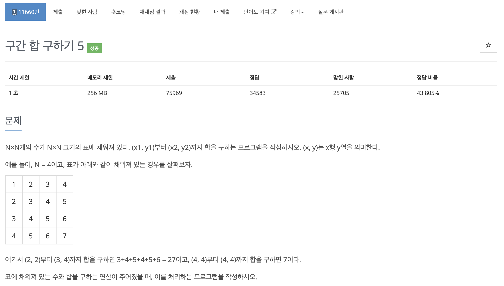




<https://www.acmicpc.net/problem/11660>

---

### <strong>문제</strong>

N×N개의 수가 N×N 크기의 표에 채워져 있다. (x1, y1)부터 (x2, y2)까지 합을 구하는 프로그램을 작성하시오. (x, y)는 x행 y열을 의미한다.

예를 들어, N = 4이고, 표가 아래와 같이 채워져 있는 경우를 살펴보자.

|  |  |  |  |
| --- | --- | --- | --- |
| 1 | 2 | 3 | 4 |
| 2 | 3 | 4 | 5 |
| 3 | 4 | 5 | 6 |
| 4 | 5 | 6 | 7 |

여기서 (2, 2)부터 (3, 4)까지 합을 구하면 3+4+5+4+5+6 = 27이고, (4, 4)부터 (4, 4)까지 합을 구하면 7이다.

표에 채워져 있는 수와 합을 구하는 연산이 주어졌을 때, 이를 처리하는 프로그램을 작성하시오.

### <strong>입력</strong>

첫째 줄에 표의 크기 N과 합을 구해야 하는 횟수 M이 주어진다. (1 ≤ N ≤ 1024, 1 ≤ M ≤ 100,000) 둘째 줄부터 N개의 줄에는 표에 채워져 있는 수가 1행부터 차례대로 주어진다. 다음 M개의 줄에는 네 개의 정수 x1, y1, x2, y2 가 주어지며, (x1, y1)부터 (x2, y2)의 합을 구해 출력해야 한다. 표에 채워져 있는 수는 1,000보다 작거나 같은 자연수이다. (x1 ≤ x2, y1 ≤ y2)

### <strong>출력</strong>

총 M줄에 걸쳐 (x1, y1)부터 (x2, y2)까지 합을 구해 출력한다.

---

### <strong>코드</strong>

```cpp
#include <iostream>
#include <vector>

using namespace std;

int main() {

    ios_base :: sync_with_stdio(false);
    cin.tie(NULL);
    cout.tie(NULL);

    int n, m;
    cin >> n >> m;

    vector<vector<int> > v(n, vector<int>(n));
    vector<vector<int> > prefix_sum(n+1, vector<int>(n+1, 0));

    for (int i=0; i<n; i++) {
        for (int j=0; j<n; j++) {
            cin >> v[i][j];
            prefix_sum[i+1][j+1] = prefix_sum[i+1][j] + prefix_sum[i][j+1] - prefix_sum[i][j] + v[i][j];
        }
    }

    for (int i=0; i<m; i++) {
        int x1, y1, x2, y2;
        cin >> x1 >> y1 >> x2 >> y2;

        int result = prefix_sum[x2][y2] - prefix_sum[x2][y1-1] - prefix_sum[x1-1][y2] + prefix_sum[x1-1][y1-1];
        cout << result << '\n';
    }
    return 0;
}
```

풀이

1. n과 m을 입력받고, 표를 벡터v에 입력받는다. 이와 동시에 누적합을 저장하기 위한 벡터prefix_sum도 업데이트한다. (prefix_sum은 0행 0열을 모두 0으로 설정하기 위해 처음 생성 때 모든 요소를 0으로 초기화 했음.)

{: start="2"}
2. x1, y1, x2, y2를 입력받고, (x1, y1) 에서 (x2, y2) 까지의 부분합을 계산해서 출력한다.

---

### <strong>고찰</strong>

처음에 벡터 v와 벡터 prefix_sum를 따로 이중반복문을 이용해서 작성하였는데 테스트케이스를 모두 통과했는데 시간 초과 문제가 난 것을 보고, 하나의 이중반복문으로 설정하였다. 그런데도 시간 초과 문제가 나자, c++의 빠른 입출력에 대해 찾아보았더니, 단 세 줄을 추가하면 속도가 빨라진다 하여 수정하였더니 문제가 해결되었다. 코딩테스트 문제를 풀 때, 제한시간은 정말 중요하기 때문에 앞으로 유용하게 사용해야겠다.

```cpp
ios_base :: sync_with_stdio(false);
cin.tie(NULL);
cout.tie(NULL);
```

추가로, 코딩테스트반 2주차 테스트 때도 시간 초과가 났었는데, 줄바꿈할때 endl 를 사용하는 것보다 '\n'을 사용하는 것이 더 시간을 줄여준다하여 유용하게 사용하고 있다.

