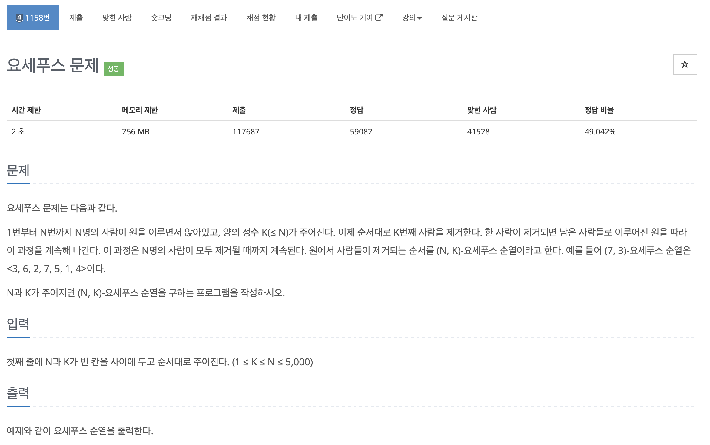




<https://www.acmicpc.net/problem/1158>

---

### <strong>문제</strong>

요세푸스 문제는 다음과 같다.

1번부터 N번까지 N명의 사람이 원을 이루면서 앉아있고, 양의 정수 K(≤ N)가 주어진다. 이제 순서대로 K번째 사람을 제거한다. 한 사람이 제거되면 남은 사람들로 이루어진 원을 따라 이 과정을 계속해 나간다. 이 과정은 N명의 사람이 모두 제거될 때까지 계속된다. 원에서 사람들이 제거되는 순서를 (N, K)-요세푸스 순열이라고 한다. 예를 들어 (7, 3)-요세푸스 순열은 &lt;3, 6, 2, 7, 5, 1, 4&gt;이다.

N과 K가 주어지면 (N, K)-요세푸스 순열을 구하는 프로그램을 작성하시오.

### <strong>입력</strong>

첫째 줄에 N과 K가 빈 칸을 사이에 두고 순서대로 주어진다. (1 ≤ K ≤ N ≤ 5,000)

### <strong>출력</strong>

예제와 같이 요세푸스 순열을 출력한다.

---

### <strong>코드</strong>

```cpp
#include <iostream>
#include <deque>

using namespace std;

int main() {
    int n, k;
    cin >> n >> k;
    cin.ignore();

    deque<int> dq;

    for (int i=1; i<=n; i++) {
        dq.push_back(i);
    }

    int cnt = k-1;

    cout << "<";
    while (!dq.empty()) {
        cnt = (cnt % dq.size());
        deque<int>::iterator it = dq.begin() + cnt;
        cout << *it;
        it = dq.erase(it);

        if (!dq.empty()) {
            cnt = (cnt + k - 1) % dq.size();
        }

        if (!dq.empty()) {
            cout << ", ";
        }
    }
    cout << ">";

    return 0;
}
```

### <strong>풀이</strong>

1. n과 k를 입력받고, 사람들의 번호를 저장할 deque에 1부터 n까지의 숫자를 추가한다.

{: start="2"}
2. 제거할 사람의 초기 인덱스를 설정한다. (0부터 시작하기 위해 cnt = k-1)

{: start="3"}
3. while 문을 deque이 비어있지 않은 동안 반복하며, 현재 cnt의 값을 deque의 크기로 나눈 나머지로 업데이트한다. 이는 deque의 크기에 맞게 인덱스를 조정하기 위함이다.

{: start="4"}
4. 'deque&lt;int&gt;::iterator it = q.begin() + cnt;' 제거할 사람의 위치를 나타내는 반복자를 얻고, 제거할 사람을 출력하고, deque에서 제거한다.

{: start="5"}
5. deque이 비어있지 않다면 다음 제거할 사람의 인덱스를 계산한다.

---

### <strong>고찰</strong>

처음 문제를 해결할 땐 제거하는 사람의 번호를 배열에 저장하려 했는데 시간 초과 문제가 일어났다. 군데군데 수정하면서 해결하려 하였지만 해결이 되지 않아, deque에서 erase() 함수로 요소를 제거하는 방식을 선택했다. 아직 반복자라는 개념이 익숙하지가 않아서 제거할 사람의 위치를 나타내는 반복자를 얻는 부분에서 애를 먹었지만, 점점 반복자의 개념에 익숙해져 가는 것 같다!

