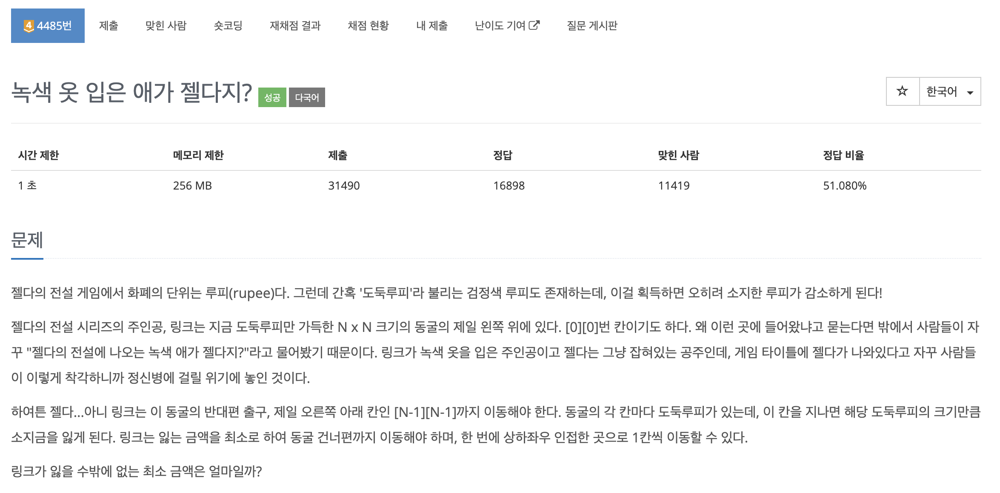




<https://www.acmicpc.net/problem/4485>

---

### <strong>문제</strong>

젤다의 전설 게임에서 화폐의 단위는 루피(rupee)다. 그런데 간혹 '도둑루피'라 불리는 검정색 루피도 존재하는데, 이걸 획득하면 오히려 소지한 루피가 감소하게 된다!

젤다의 전설 시리즈의 주인공, 링크는 지금 도둑루피만 가득한 N x N 크기의 동굴의 제일 왼쪽 위에 있다. [0][0]번 칸이기도 하다. 왜 이런 곳에 들어왔냐고 묻는다면 밖에서 사람들이 자꾸 "젤다의 전설에 나오는 녹색 애가 젤다지?"라고 물어봤기 때문이다. 링크가 녹색 옷을 입은 주인공이고 젤다는 그냥 잡혀있는 공주인데, 게임 타이틀에 젤다가 나와있다고 자꾸 사람들이 이렇게 착각하니까 정신병에 걸릴 위기에 놓인 것이다.

하여튼 젤다...아니 링크는 이 동굴의 반대편 출구, 제일 오른쪽 아래 칸인 [N-1][N-1]까지 이동해야 한다. 동굴의 각 칸마다 도둑루피가 있는데, 이 칸을 지나면 해당 도둑루피의 크기만큼 소지금을 잃게 된다. 링크는 잃는 금액을 최소로 하여 동굴 건너편까지 이동해야 하며, 한 번에 상하좌우 인접한 곳으로 1칸씩 이동할 수 있다.

링크가 잃을 수밖에 없는 최소 금액은 얼마일까?

### <strong>입력</strong>

입력은 여러 개의 테스트 케이스로 이루어져 있다.

각 테스트 케이스의 첫째 줄에는 동굴의 크기를 나타내는 정수 N이 주어진다. (2 ≤ N ≤ 125) N = 0인 입력이 주어지면 전체 입력이 종료된다.

이어서 N개의 줄에 걸쳐 동굴의 각 칸에 있는 도둑루피의 크기가 공백으로 구분되어 차례대로 주어진다. 도둑루피의 크기가 k면 이 칸을 지나면 k루피를 잃는다는 뜻이다. 여기서 주어지는 모든 정수는 0 이상 9 이하인 한 자리 수다.

### <strong>출력</strong>

각 테스트 케이스마다 한 줄에 걸쳐 정답을 형식에 맞춰서 출력한다. 형식은 예제 출력을 참고하시오.

---

### <strong>코드</strong>

```cpp
#include <iostream>
#include <vector>
#include <queue>
#define INF 987654321

using namespace std;

int dist[125][125];
vector<vector<int> > v;

int main() {
    int problem = 1;

    while (1) {
        int n;
        cin >> n;
        if (n==0) break;

        v = vector<vector<int> >(n, vector<int>(n));
        for (int i=0; i<n; i++) {
            for (int j=0; j<n; j++) {
                cin >> v[i][j];
            }
        }

        fill(&dist[0][0], &dist[0][0] + 125 * 125, INF);

        dist[0][0] = v[0][0];

        priority_queue<pair<int, pair<int, int> >, vector<pair<int, pair<int, int> > >, greater<pair<int, pair<int, int> > > > pq;
        pq.push(make_pair(dist[0][0], make_pair(0, 0)));

        while (!pq.empty()) {
            int cost = pq.top().first;
            int x = pq.top().second.first;
            int y = pq.top().second.second;
            pq.pop();

            if (cost > dist[x][y]) continue;

            for (int i = 0; i < 2; i++) {
                for (int j = -1; j <= 1; j += 2) {
                    int nx = x + (i == 0 ? j : 0);
                    int ny = y + (i == 1 ? j : 0);

                    if (nx >= 0 && ny >= 0 && nx < n && ny < n) {
                        int nextCost = cost + v[nx][ny];

                        if (nextCost < dist[nx][ny]) {
                            dist[nx][ny] = nextCost;
                            pq.push(make_pair(nextCost, make_pair(nx, ny)));
                        }
                    }
                }
            }
        }
        cout << "Problem " << problem++ << ": " << dist[n-1][n-1] << endl;

    }

    return 0;
}
```

### <strong>풀이</strong>

1. 먼저 n x n 크기의 2차원 벡터에 숫자를 입력받는다. 이 숫자는 해당 칸을 지나가는 비용을 의미한다.

{: start="2"}
2. 각 좌표에 도달하기 위한 최소 비용을 저장하는 배열인 dist를 INF로 초기화한다. 이는 도달할 수 없는 곳을 나타내기 위해 사용하는 매우 큰 숫자이다. 시작점은 좌표 (0, 0)에서의 비용을 의미하며, 이 위치의 비용을 초기 값으로 설정한다.

{: start="3"}
3. 다익스트라 알고리즘을 위해 우선순위 큐를 사용하여 최소 힙으로 구성한다. 시작점 (0, 0)을 큐에 추가하며, 이때 비용은 dist[0][0]이다.

{: start="4"}
4. 큐에서 가장 작은 비용을 가진 노드를 꺼내 상하좌우 인접 노드를 탐색한다. 인접 노드가 격자 범위 안에 있는지 확인 후, 새로 도달하는 비용을 계산한다. 새로 계산한 비용이 기록된 최소 비용보다 작다면, 비용을 갱신하고 우선순위 큐에 추가한다.

{: start="5"}
5. 목표 위치까지의 최소 비용을 출력한다. problem 번호를 함께 출력하며, 문제 번호를 1씩 증가시킨다.

