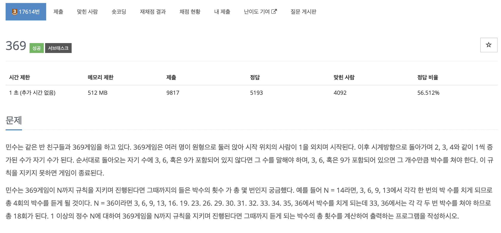


<https://www.acmicpc.net/problem/17614>



### <strong>문제</strong>

민수는 같은 반 친구들과 369게임을 하고 있다. 369게임은 여러 명이 원형으로 둘러 앉아 시작 위치의 사람이 1을 외치며 시작된다. 이후 시계방향으로 돌아가며 2, 3, 4와 같이 1씩 증가된 수가 자기 수가 된다. 순서대로 돌아오는 자기 수에 3, 6, 혹은 9가 포함되어 있지 않다면 그 수를 말해야 하며, 3, 6, 혹은 9가 포함되어 있으면 그 개수만큼 박수를 쳐야 한다. 이 규칙을 지키지 못하면 게임이 종료된다.

민수는 369게임이 N까지 규칙을 지키며 진행된다면 그때까지의 들은 박수의 횟수 가 총 몇 번인지 궁금했다. 예를 들어 N = 14라면, 3, 6, 9, 13에서 각각 한 번의 박 수를 치게 되므로 총 4회의 박수를 듣게 될 것이다. N = 36이라면 3, 6, 9, 13, 16. 19. 23. 26. 29. 30. 31. 32. 33. 34. 35, 36에서 박수를 치게 되는데 33, 36에서는 각 각 두 번 박수를 쳐야 하므로 총 18회가 된다. 1 이상의 정수 N에 대하여 369게임을 N까지 규칙을 지키며 진행된다면 그때까지 듣게 되는 박수의 총 횟수를 계산하여 출력하는 프로그램을 작성하시오.

### <strong>입력</strong>

첫 번째 줄에 정수 N이 주어진다 (1 ≤ N ≤ 106).

### <strong>출력</strong>

박수의 총 횟수를 정수로 출력한다.

---

### <strong>코드</strong>

```python
n = int(input())
check1 = '3'
check2 = '6'
check3 = '9'
count = 0

for i in range(n+1):
    count += str(i).count(check1)
    count += str(i).count(check2)
    count += str(i).count(check3)

print(count)
```

### <strong>풀이</strong>

1. n을 입력받는다.

{: start="2"}
2. check123 변수에 개수를 세야 할 숫자인 3, 6, 9 문자열을 정의한다. 이 문자열을 사용하여 각 숫자들이 몇 번 나타나는지 체크한다.

{: start="3"}
3. 0부터 n까지의 숫자를 반복하며, 숫자 i를 문자열로 변환 후,  그 문자열 안에 3이 몇 번 있는지 세어서 count 변수에 더한다.

{: start="4"}
4. 마찬가지로 6과 9도 반복한다.

{: start="5"}
5. 최종적으로 3, 6, 9가 몇 번 나왔는지 누적된 count 값을 출력한다.

---

### <strong>알게 된 것!</strong>

count() 함수는 파이썬에서 String 자료형의 메서드로, 특정 문자열이나 문자가 다른 문자열 안에 몇 번 포함되어 있는지를 반환하는 함수이다. 파이썬은 넘 간단하고 편리한 것 같다... 굿!!

예시!

```python
text = "hello world"
count_l = text.count('l')  # 'l'이 몇 번 나타나는지 계산
print(count_l)  # 출력 3
```

