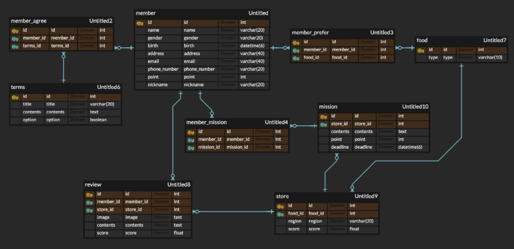


대망의 UMC 스터디가 시작되었는데 1주차부터 너무 말이 안 되는 눈물만 나오는 내용들이라 천천히 정리를 하며 써보기 위해 블로그를 켰다..

1주차 주제는 백엔트 서버의 핵심인 데이터베이스를 어떻게 설계하는 것이 좋을까? + 이런 상황에서 어떻게 설계를 하는 것이 좋을까? 인데, 나는 DB에 대한 사전 지식이 0인 데다가 그나마 의존할 수 있는 참고 자료들이 백만개이기 때문에 그 내용들부터 오늘 천천히 이해해 보려고 한다.

### <strong>SQL</strong>

SQL은 Structured Query Langauge로  관계형 데이터베이스를 다룰 때 사용되는 표준 언어라고 한다. 관계형 데이터베이스의 특징은 데이터를 표로 표시한다는 것이라는데,,, 다른 형태의 데이터베이스가 존재하는 것인가..? 난 아직 감자라 잘 모르겠다..

RDBMS(Realational DataBase Management System)는 관계형 데이터베이스를 관리하는 시스템을 말한다고 한다. 그 중 대표적인 것이 MySQL이다.

SQL 문법은 따로 정리하진 않겠다!!

---

### <strong>ERD</strong>

ERD란 Entity Realationship Diagram로 데이터베이스 구조를 한눈에 알아보기 위해서 쓰인다. ERD의 핵심은 세 가지 인데, "Entity", "Realationship", "Attribute"이다.

#### <strong>Entity(개체)</strong>

Entity는 관리하고자 하는 정보의 실체이며, 사람, 객체 혹은 개념이라고 이해하면 된다. 데이터베이스를 설계할 때, 테이블이 Entity로 정의될 수 있다.모든 Entity는 하나 이상의 식별자(UID)를 지녀야 한다고 한다.

#### <strong>Attribute(속성)</strong>

Attribute는 Entity를 구성하고 있는 구성 요소이다. 데이터 타입을 반드시 같이 명시해줘야 하며, Key Attribute, Composite Attribute, Multi-Valued Attribute, Derived Attribute로 나뉘어 있다.

- Key Attribute : 다른 객체들과 중복되지 않는 고유한 값을 가진 Attribute로, 객체를 식별하는 데 사용됨.
- Composite Attribute : 독립적인 Attribute들이 모여서 생성된 Attribute를 의미하는데, 예를 들어 강릉시 홍제동 **아파트 등의 독립적인 Attribute가 모여 생성된 주소 Attribute는 복합 Attribute라고 할 수 있음.
- Multi-Valued Attribute : 하나의 Attribute가 여러 개의 값을 가지는 Attribute를 의미함. 예를 들어, 하나의 영상물에 로맨스, SF, 호러 등 여러 가지 장르가 공통적으로 존재할 수 있음.
- Derived Attribute : 다른 Attribute가 갖고 있는 값으로부터 유도된 속성을 의미함. 예를 들어 상품의 가격 Attribute, 상품의 개수 Attribute를 곱해서 계산된 값인 total이 됨.

#### <strong>Relationship</strong>

Entity 간의 관계를 의미함. 두 Entity 간에 선을 긋고, 관계 명칭을 기록하게 됨.

---

ERD 그리기!

데이터베이스의 테이블이 엔티티로 표현된다고 보면 됨.

엔티티에는 개체가 갖고있는 속성(Attribute)을 포함함. 테이블의 각 필드(컬럼)들이 엔티티의 속성이라고 보면 됨.

도메인은 속성의 값, 타입, 제약사항 등에 대한 값의 범위를 표현함. 사용자의 기호에 따라 속성 타입만 그릴 수도 있고, 가독성을 위해서 생략할 수도 있음. 이때 데이터 타입을 명시할 때, 데이터베이스가 지원하는 타입에 맞게 해야 함.

엔티티는 저장하는 데이터 정보 주제에 따라 종류가 다양함. 이 엔티티 분류 구분을 잘 해주어야 데이터베이스 설계에 있어 각 데이터 주제에 맞게 모델링을 구축할 수 있음.

음.. 하다보니 정리하는 걸 까먹음.

어찌어찌해서 탄생한 나의 첫 erd.

member 테이블을 기준으로 하여 회원가입 시 약관 동의 테이블인 member_agree, 회원가입 시 사용자의 선호 음식 종류 테이블인 member_prefer, 사용자의 미션을 알 수 있는 테이블인 member_mission, 사용자가 작성한 리뷰 테이블인 review 를 붙임!

피그마 WF을 보면서 작업하다보니, 가게 페이지에서도 사람들이 작성한 리뷰를 볼 수가 있고, 사용자가 작성한 리뷰 페이지에서도 가게들의 리뷰를 볼 수 있어 처음엔 둘을 양쪽으로 연결했었다 ㅋㅋ.

이후 지인에게 한 번 봐달라고 했는데, ‘화면과 테이블을 구분해라’ 라는 답변을 얻었다!! 테이블은 저장되는 정보이고, 화면에는 테이블의 이렇고 저런 정보들이 보여지는 것이므로! ‘(멤버) 일 대 다 (리뷰) 다 대 일 (가게)’ 로 수정하라는 조언도 받아 수정하였다!

이런 다 대 다 의 상황에서는 중간에 테이블을 하나 더 두어 (테이블) 일 대 다 (테이블) 다 대 일 (테이블) 의 식으로 해야 한다고 한다!!

예를 들어, 나는 지금 (store) 다 대 일 (food) 로 하였는데, 음식의 종류에 따라 여러 가게들이 등록될 수 있음을 생각하여 설정하였다. 근데 한 가게에서 음식의 종류가 2개 이상이 된다면?? 이런 경우를 생각하면 다 대 다 가 되므로 가운데에 food_store 라는 테이블을 하나 더 두어 설정하면 된다! ~~그치만 난 이 부분은 고려하지 않았다….~~

수정이 조금 필요하지만 천천히 해야징

다음 주 주제는 '어떤 쿼리를 작성해야 할까?' 인데 기대가 된당 ^_^

처음에는 워크북 보며 눈물만 나왔고(사실안나옴) 공부 할 때는 넘나 어렵지만 그 과정도 넘 즐겁다...킄 어쩌면 적성에 넘 잘 맞는 듯..

블로그도 넘 얼레벌레 쓴 듯! 다음 주 부터 재정비 해야겠당.

그럼안뇽


