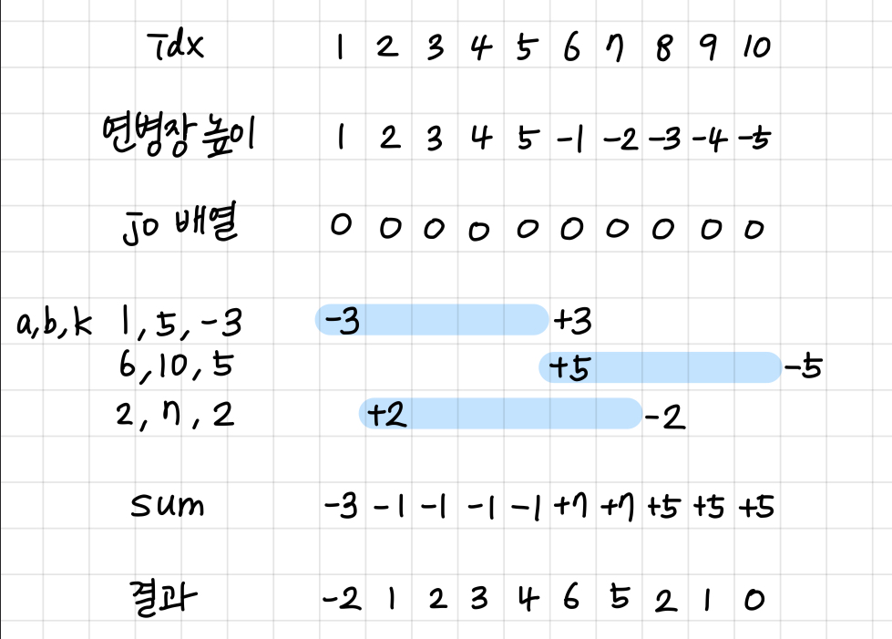


<https://www.acmicpc.net/problem/19951>


### <strong>문제</strong>

2020년 5월 14일 논산훈련소에 입대한 태상이는 첫 총기 훈련에서 가스 조절기를 잃어버리는 중대한 실수를 범했다. 그로 인해, 태상이는 조교들에게 눈총을 받게 되었다. 조교들은 태상이에게 연병장(운동장)의 흙을 옮기는 일을 주고 제대로 수행하지 못하면 징계를 내리려고 한다.

연병장은 일렬로 이어진 N개의 칸으로 이루어져 있으며 각 칸마다 높이를 가지고 있고, 첫 번째 칸부터 순서대로 1번, 2번, 3번, ..., N번 칸으로 명칭이 붙어있다. 조교들은 총 M명이 있으며, 각 조교들은 태상이에게 a번 칸부터 b번 칸까지 높이 k만큼 흙을 덮거나 파내라고 지시한다. 흙은 주변 산에서 얼마든지 구할 수 있으므로 절대로 부족하지 않다.

태상이는 각 조교의 지시를 각각 수행하면, 다른 조교의 지시로 흙을 덮어둔 칸을 다시 파내기도 하는 비효율적인 일이 발생하는 것을 깨달았다. 그래서 태상이는 각 조교의 지시를 모아 연병장 각 칸의 최종 높이를 미리 구해 한 번에 일을 수행하려고 한다.

불쌍한 태상이를 위해 조교들의 지시를 모두 수행한 뒤 연병장 각 칸의 높이를 구하자.

### <strong>입력</strong>

첫 줄에 연병장의 크기 N과 조교의 수 M이 주어진다.

둘째 줄에 연병장 각 칸의 높이 Hi가 순서대로 N개 주어진다.

셋째 줄부터 M개의 줄에 각 조교의 지시가 주어진다.

각 조교의 지시는 세 개의 정수 a, b, k로 이루어져 있다.

- k ≥ 0인 경우 a번 칸부터 b번 칸까지 높이가 각각 |k| 만큼 늘어나도록 흙을 덮어야 한다.
- k &lt; 0인 경우 a번 칸부터 b번 칸까지 높이가 각각 |k| 만큼 줄어들도록 흙을 파내야 한다.

### <strong>출력</strong>

모든 지시를 수행한 뒤 연병장 각 칸의 높이를 공백을 사이에 두고 출력한다.

---

### <strong>코드</strong>

```python
n, m = map(int, input().split())

ground = [*map(int, input().split())]
jo = [0]*(n+2)

for i in range(m):
    a, b, k = map(int, input().split())
    jo[a] += k
    jo[b+1] -= k

sum = 0
for i in range(n):
    sum += jo[i+1]
    ground[i] += sum

print(*ground)
```

### <strong>풀이</strong>

1. 연병장의 크기 n과 조교의 수 m을 입력받는다.

{: start="2"}
2. 연병장 각 칸의 높이를 배열 ground로 입력받는다.

{: start="3"}
3. 조교의 지시를 한 번에 합치기 위해 n+2 크기의 배열을 0으로 초기화한다. (n+2 크기의 배열로 초기화한 이유는 ground는 0~n-1 의 인덱스를 가지고 있고, 조교가 지시하는 a, b는 1~n 인덱스이기 때문에 우선 n+1로 하였다. n+2 는 아랫줄에 설명)

{: start="4"}
4. a, b, k를 입력받고, 조교 배열에 지시 시작인 a 인덱스에 k를 더하고, 지시 끝인 b 인덱스의 +1 에 k를 뺀다. 이를 m번 반복한다. (연병장의 제일 끝이 b면 n+1이 b인데 b+1을 해야하므로, 조교 배열을 n+2로 초기화한 것이다.)

{: start="5"}
5. sum 변수를 0으로 초기화하고, 인덱스에 맞춰서 조교 배열의 값을 더해서 ground 배열에 더한다.

{: start="6"}
6. 최종 연병장 높이를 출력한다.



