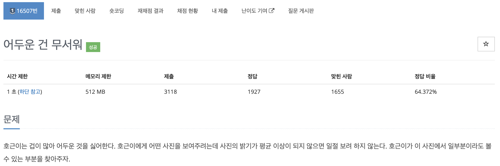
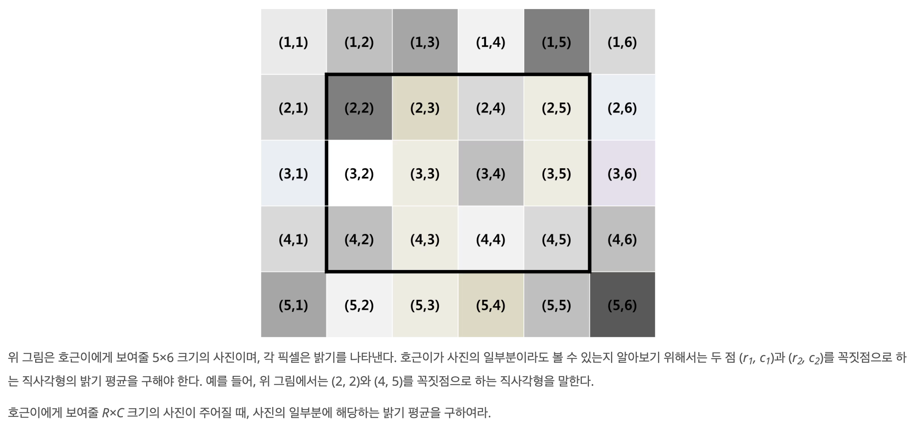


<https://www.acmicpc.net/problem/16507>




### <strong>문제</strong>

호근이는 겁이 많아 어두운 것을 싫어한다. 호근이에게 어떤 사진을 보여주려는데 사진의 밝기가 평균 이상이 되지 않으면 일절 보려 하지 않는다. 호근이가 이 사진에서 일부분이라도 볼 수 있는 부분을 찾아주자.

위 그림은 호근이에게 보여줄 5×6 크기의 사진이며, 각 픽셀은 밝기를 나타낸다. 호근이가 사진의 일부분이라도 볼 수 있는지 알아보기 위해서는 두 점 (r1, c1)과 (r2, c2)를 꼭짓점으로 하는 직사각형의 밝기 평균을 구해야 한다. 예를 들어, 위 그림에서는 (2, 2)와 (4, 5)를 꼭짓점으로 하는 직사각형을 말한다.

호근이에게 보여줄 R×C 크기의 사진이 주어질 때, 사진의 일부분에 해당하는 밝기 평균을 구하여라.

### <strong>입력</strong>

첫 번째 줄에는 사진의 크기를 의미하는 정수 R, C (1 ≤ R, C ≤ 1,000)와 사진 일부분의 밝기 평균을 알아볼 개수를 의미하는 정수 Q (1 ≤ Q ≤ 10,000)가 주어진다.

다음 R개의 줄에 걸쳐 R×C 크기의 사진 정보가 주어지며, 사진의 각 픽셀에는 밝기를 의미하는 정수 K (1 ≤ K ≤ 1,000)가 주어진다.

다음 Q개의 각 줄에는 사진의 일부분을 나타내기 위한 두 꼭짓점을 의미하는 정수 r1, c1, r2, c2 (1 ≤ r1 ≤ r2 ≤ R, 1 ≤ c1 ≤ c2 ≤ C)가 주어진다.

### <strong>출력</strong>

Q개의 각 줄에 주어진 사진에서 두 점 (r1, c1)과 (r2, c2)를 꼭짓점으로 하는 직사각형의 밝기 평균을 출력한다. 평균은 정수 나눗셈으로 몫만 취한다.

---

### <strong>코드</strong>

```python
r, c, q = map(int, input().split())

mat = [list(map(int, input().split())) for _ in range(r)]
smat = [[0] * (c+1) for _ in range(r+1)]
for i in range(1, r+1):
    for j in range(1, c+1):
        smat[i][j] = smat[i-1][j] + smat[i][j-1] + mat[i-1][j-1] - smat[i-1][j-1]

for i in range(q):
    r1, c1, r2, c2 = map(int, input().split())
    result = smat[r2][c2] - smat[r2][c1-1] - smat[r1-1][c2] + smat[r1-1][c1-1]
    avg = result // ((r2-r1+1) * (c2-c1+1))
    print(avg)
```

### <strong>풀이</strong>

1. r, c, q 를 입력받는다.

{: start="2"}
2. 사진의 밝기를 2차원 배열 mat 에 입력받는다.

{: start="3"}
3. 누적합을 이용하기 위해서 smat 배열을 0으로 초기화한다. r1과 c1의 범위가 1부터 시작되기 때문에 (r+1, c+1) 크기로 설정하였다.

{: start="4"}
4. 이중 반복문을 통해 smat 배열에 각 자리의 누적합을 구한다.

{: start="5"}
5. r1, c1, r2, c2를 입력받고 범위에 포함되는 밝기들의 합 result를 구한다.

{: start="6"}
6. 밝기의 평균을 구하고 출력한다. 이를 q번 반복!

