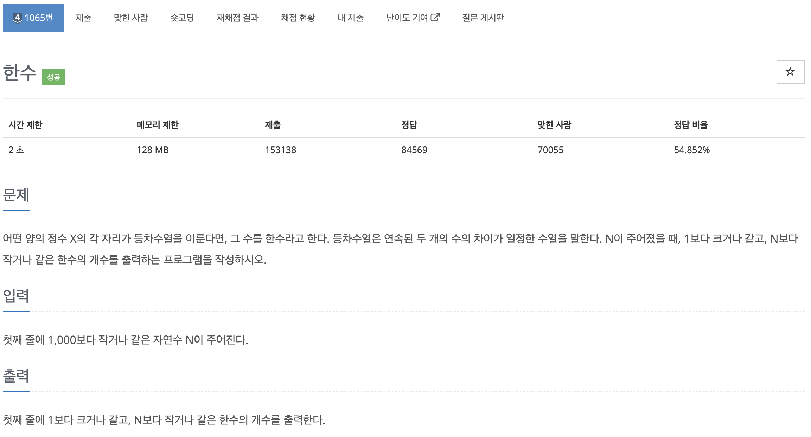


<https://www.acmicpc.net/problem/1065>



---

### <strong>문제</strong>

어떤 양의 정수 X의 각 자리가 등차수열을 이룬다면, 그 수를 한수라고 한다. 등차수열은 연속된 두 개의 수의 차이가 일정한 수열을 말한다. N이 주어졌을 때, 1보다 크거나 같고, N보다 작거나 같은 한수의 개수를 출력하는 프로그램을 작성하시오.

### <strong>입력</strong>

첫째 줄에 1,000보다 작거나 같은 자연수 N이 주어진다.

### <strong>출력</strong>

첫째 줄에 1보다 크거나 같고, N보다 작거나 같은 한수의 개수를 출력한다.

---

### <strong>코드</strong>

```python
def is_hansu(x):
    if x < 100:
        return True
    else:
        digits = list(map(int, str(x)))
        return (digits[0] - digits[1]) == (digits[1] - digits[2])

def count_hansu(N):
    count = 0
    for i in range(1, N + 1):
        if is_hansu(i):
            count += 1
    return count

N = int(input())
print(count_hansu(N))
```

### <strong>풀이</strong>

1. is_hansu 함수 - 입력 숫자 x를 문자열로 반환하고, 각 자리를 리스트에 저장한다. 첫 번째 자리와 두 번째 자리의 차이와, 두 번째 자리와 세 번째 자리의 차이가 같은지 비교하여 한수 여부를 판단한다.

{: start="2"}
2. count_hansu 함수 - 1부터 N까지 반복하여 is_hansu 함수를 통해 한수를 판별하고, 한수인 경우 개수를 중지한다.

{: start="3"}
3. N을 입력 받고, count_hansu(N)의 결과를 출력한다.

