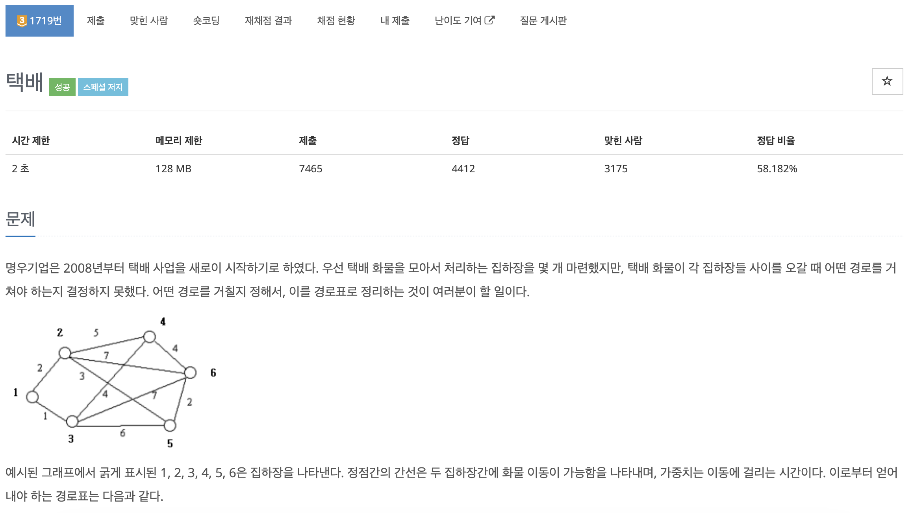
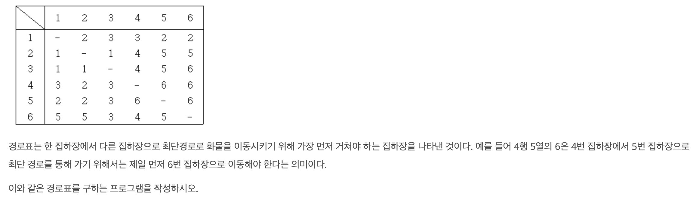


<https://www.acmicpc.net/problem/1719>




### <strong>입력</strong>

첫째 줄에 두 수 n과 m이 빈 칸을 사이에 두고 순서대로 주어진다. n은 집하장의 개수로 200이하의 자연수, m은 집하장간 경로의 개수로 10000이하의 자연수이다. 이어서 한 줄에 하나씩 집하장간 경로가 주어지는데, 두 집하장의 번호와 그 사이를 오가는데 필요한 시간이 순서대로 주어진다. 집하장의 번호들과 경로의 소요시간은 모두 1000이하의 자연수이다.

### <strong>출력</strong>

예시된 것과 같은 형식의 경로표를 출력한다.

---

### <strong>코드</strong>

```python
import sys
input = sys.stdin.readline

n, m = map(int, input().split())

INF = float('inf')
dist = [[INF] * (n + 1) for _ in range(n + 1)]
next_node = [[-1] * (n + 1) for _ in range(n + 1)]

for i in range(1, n + 1):
    dist[i][i] = 0

for _ in range(m):
    a, b, c = map(int, input().split())
    dist[a][b] = c
    dist[b][a] = c
    next_node[a][b] = b
    next_node[b][a] = a

for k in range(1, n + 1):
    for i in range(1, n + 1):
        for j in range(1, n + 1):
            if dist[i][j] > dist[i][k] + dist[k][j]:
                dist[i][j] = dist[i][k] + dist[k][j]
                next_node[i][j] = next_node[i][k]

for i in range(1, n + 1):
    for j in range(1, n + 1):
        if i == j:
            print("-", end=" ")
        else:
            print(next_node[i][j], end=" ")
    print()
```

