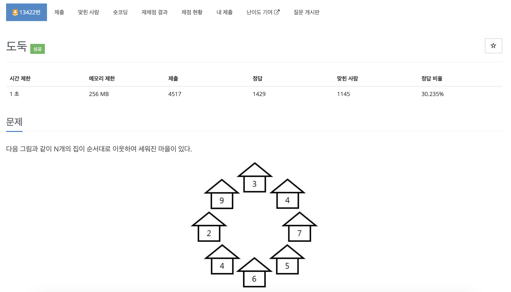
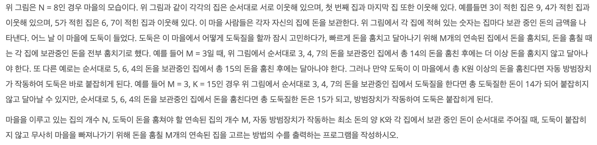


<https://www.acmicpc.net/problem/13422>




### <strong>입력</strong>

입력 데이터는 표준 입력을 사용한다. 입력은 T개의 테스트 데이터로 구성된다. 입력의 첫째 줄에 테스트 케이스의 개수를 나타내는 자연수 T가 주어진다. 각각의 테스트 케이스의 첫째 줄에 마을에 있는 집의 개수 N(1 ≤ N ≤ 100,000), 도둑이 돈을 훔칠 연속된 집의 개수 M(1 ≤ M ≤ N), 자동 방범 장치가 작동하는 최소 돈의 양 K(1 ≤ K ≤ 1,000,000,000, K는 정수)가 공백으로 구분되어 주어진다. 테스트 케이스의 둘째 줄에는 N개의 집에서 각각 보관중인 돈의 양이 시계방향 순서대로 공백으로 구분되어 주어진다. 돈의 양은 각 집이 이웃해 있는 순서대로 주어진다. 첫 번째 집과 마지막 집 또한 이웃하기 위해 입력의 첫 번째와 마지막이 서로 연결되어 있다고 가정하며, 각 집에서 보관 중인 돈의 양은 1이상 10,000이하의 정수이다.

### <strong>출력</strong>

출력은 표준 출력을 사용한다. 입력 받은 데이터에 대해, 도둑이 자동 방범장치에 붙잡히지 않도록 연속된 M개의 집에서 돈을 훔치는 방법의 가짓수를 한 줄에 1개씩 출력한다.

---

### <strong>코드</strong>

```python
t = int(input())

def mod(n, m):
    return n % m

for l in range(t):
    n, m, k = map(int, input().split())
    money = list(map(int, input().split()))

    left, right = 0, m-1
    money_sum = sum(money[0:m])

    count = 0
    if n == m:
        if money_sum < k:
            count += 1
    else:
        for _ in range(n):
            if money_sum < k:
                count += 1

            money_sum -= money[left]
            left = mod(left + 1, n)
            right = mod(right + 1, n)
            money_sum += money[right]

    print(count)
```

### <strong>풀이</strong>

1. 모듈러 연산을 편하게 사용하기 위해 mod() 함수를 정의하였다.

{: start="2"}
2. n, m, k를 입력받고 집에서 각각 보관중인 돈을 리스트로 입력받았다.

{: start="3"}
3. 투포인터를 이용해 풀기 위해 left와 right를 초기화하였다.

{: start="4"}
4. m개의 집에 있는 돈의 합을 저장해둘 money_sum을 0~m-1까지의 돈의 합으로 초기화하였다. 횟수를 저장해둘 count로 0으로 초기화하였다.

{: start="5"}
5. n == m 일 경우 반복문에 들어가 오답이 나오는 것을 방지하기 위해 따로 if문을 선언해주었다. 이 경우 money_sum이 k보다 작으면 count가 1이 되도록 +=1 해주었다.

{: start="6"}
6. n!=m 일 경우 집 개수만큼 순회하면서 money_sum 값과 k값을 비교하고 count를 업데이트한다. left와 right를 증가시키면서 진행한다.

{: start="7"}
7. 방법의 가짓수 count를 출력한다.

