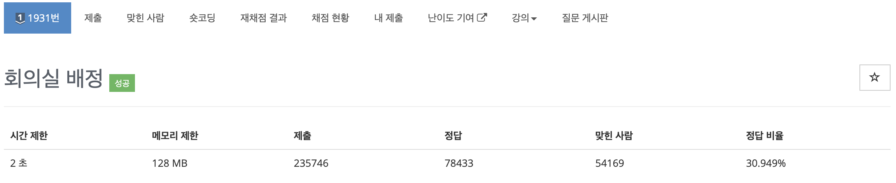


<https://www.acmicpc.net/problem/1931>



### <strong>문제</strong>

한 개의 회의실이 있는데 이를 사용하고자 하는 N개의 회의에 대하여 회의실 사용표를 만들려고 한다. 각 회의 I에 대해 시작시간과 끝나는 시간이 주어져 있고, 각 회의가 겹치지 않게 하면서 회의실을 사용할 수 있는 회의의 최대 개수를 찾아보자. 단, 회의는 한번 시작하면 중간에 중단될 수 없으며 한 회의가 끝나는 것과 동시에 다음 회의가 시작될 수 있다. 회의의 시작시간과 끝나는 시간이 같을 수도 있다. 이 경우에는 시작하자마자 끝나는 것으로 생각하면 된다.

### <strong>입력</strong>

첫째 줄에 회의의 수 N(1 ≤ N ≤ 100,000)이 주어진다. 둘째 줄부터 N+1 줄까지 각 회의의 정보가 주어지는데 이것은 공백을 사이에 두고 회의의 시작시간과 끝나는 시간이 주어진다. 시작 시간과 끝나는 시간은 231-1보다 작거나 같은 자연수 또는 0이다.

### <strong>출력</strong>

첫째 줄에 최대 사용할 수 있는 회의의 최대 개수를 출력한다.

---

### <strong>코드</strong>

```python
n = int(input())

array = []
for _ in range(n):
    row = list(map(int, input().split()))
    array.append(row)

array.sort(key=lambda x: (x[1], x[0]))

result = 1
time = array[0][1]

for i in range(1, n):
    if array[i][0] >= time:
        result += 1
        time = array[i][1]
    else:
        continue

print(result)
```

### <strong>풀이</strong>

1. 회의 시간을 2차원 리스트에 저장해두기 위해 리스트 array를 초기화하고, n번 반복하여 회의 시간을 입력해주었다.

{: start="2"}
2. 이 문제의 풀이 방법은 끝나는 시간이 빠른 회의들을 고르면 답이 나오는 문제이므로, 인덱스 1번을 우선으로 하여 0번까지 오름차순으로 정렬하였다.

{: start="3"}
3. 답을 저장할 변수 result를 1로 초기화하였고, 1로 초기화한 이유는 이 문제의 답은 무조건 가장 빨리 끝나는 회의를 포함하고 있기 때문이다. (알고리즘해석및설계 시간에 배웠다. 써먹어서 뿌듯 &gt;,&lt;)

{: start="4"}
4. 끝나는 시간과 다음 회의 시작 시간을 비교하기 위해 time 변수에 첫 회의의 끝나는 시간을 저장해두었다.

{: start="5"}
5. 반복문을 n-1번 반복하면서 시간을 비교한다. 다음 회의의 시작 시간이 앞 회의의 끝나는 시간보다 빠르면 안되므로, time보다 크거나 같으면 result를 +1 해주었다. 2번에서 이미 오름차순으로 정렬했기에 별다른 조건은 없었다. time 변수도 조건을 만족하는 회의의 끝나는 시간으로 바꿔주면 끝!

{: start="6"}
6. 결과 result를 출력한다.

