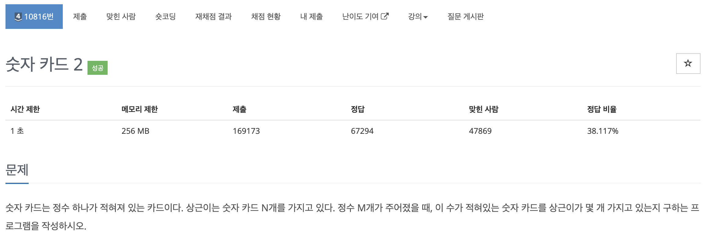


<https://www.acmicpc.net/problem/10816>



---

### <strong>문제</strong>

숫자 카드는 정수 하나가 적혀져 있는 카드이다. 상근이는 숫자 카드 N개를 가지고 있다. 정수 M개가 주어졌을 때, 이 수가 적혀있는 숫자 카드를 상근이가 몇 개 가지고 있는지 구하는 프로그램을 작성하시오.

### <strong>입력</strong>

첫째 줄에 상근이가 가지고 있는 숫자 카드의 개수 N(1 ≤ N ≤ 500,000)이 주어진다. 둘째 줄에는 숫자 카드에 적혀있는 정수가 주어진다. 숫자 카드에 적혀있는 수는 -10,000,000보다 크거나 같고, 10,000,000보다 작거나 같다.

셋째 줄에는 M(1 ≤ M ≤ 500,000)이 주어진다. 넷째 줄에는 상근이가 몇 개 가지고 있는 숫자 카드인지 구해야 할 M개의 정수가 주어지며, 이 수는 공백으로 구분되어져 있다. 이 수도 -10,000,000보다 크거나 같고, 10,000,000보다 작거나 같다.

### <strong>출력</strong>

첫째 줄에 입력으로 주어진 M개의 수에 대해서, 각 수가 적힌 숫자 카드를 상근이가 몇 개 가지고 있는지를 공백으로 구분해 출력한다.

---

### <strong>코드</strong>

```python
import sys
from bisect import bisect_left, bisect_right

input = sys.stdin.readline

n = int(input())
card = list(map(int, input().split()))
card.sort()

m = int(input())
sanggeun = list(map(int, input().split()))

result = []

for i in range(m):
    left_idx = bisect_left(card, sanggeun[i])
    right_idx = bisect_right(card, sanggeun[i])

    result.append(right_idx - left_idx)

print(" ".join(map(str, result)))
```

### <strong>풀이</strong>

1. 주어진 입력을 받는다.

{: start="2"}
2. 첫번째로 입력받는 카드 정보인, 상근이가 가지고 있는 카드는 오름차순으로 정렬한다.

{: start="3"}
3. bisect_left 함수를 통해 card에서 sanggeun[i]보다 작거나 같은 값이 들어갈 왼쪽 인덱스를 찾는다.

{: start="4"}
4. bisect_right 함수를 통해 card에서 sanggeun[i]보다 작은 값이 들어갈 오른쪽 인덱스를 찾는다. 이 값은 sanggeun[i]가 들어갈 수 있는 바로 뒤의 인덱스이다.

{: start="5"}
5. 따라서 right_idx - left_idx는 sanggeun[i]가 배열에 등장하는 횟수가 되어, result 리스트에 담고 모든 요소를 공백을 기준으로 출력한다.

