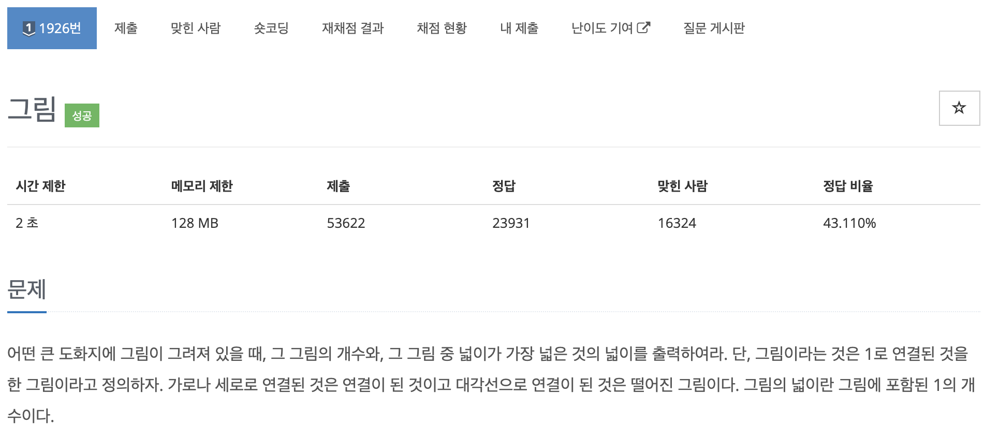


<https://www.acmicpc.net/problem/1926>



### <strong>입력</strong>

첫째 줄에 도화지의 세로 크기 n(1 ≤ n ≤ 500)과 가로 크기 m(1 ≤ m ≤ 500)이 차례로 주어진다. 두 번째 줄부터 n+1 줄 까지 그림의 정보가 주어진다. (단 그림의 정보는 0과 1이 공백을 두고 주어지며, 0은 색칠이 안된 부분, 1은 색칠이 된 부분을 의미한다)

### <strong>출력</strong>

첫째 줄에는 그림의 개수, 둘째 줄에는 그 중 가장 넓은 그림의 넓이를 출력하여라. 단, 그림이 하나도 없는 경우에는 가장 넓은 그림의 넓이는 0이다.

---

### <strong>코드</strong>

```python
from collections import deque
dx, dy = [1, -1, 0, 0], [0, 0, 1, -1]

n, m = map(int, input().split())

arr = []
for i in range(n):
    row = list(map(int, input().split()))
    arr.append(row)

check = [[0] * m for _ in range(n)]
val = 1
max_count = 0

q = deque()

for i in range(n):
    for j in range(m):
        if check[i][j] == 0 and arr[i][j] == 1:
            check[i][j] = val
            q.append((i, j))
            count = 1

            while q:
                x, y = q.popleft()
                for k in range(4):
                    nx, ny = x + dx[k], y + dy[k]
                    if 0 <= nx < n and 0 <= ny < m and arr[nx][ny] == 1 and not check[nx][ny]:
                        check[nx][ny] = val
                        count += 1
                        q.append((nx,ny))
            val += 1
            max_count = max(max_count, count)

print(val - 1)
print(max_count)
```

### <strong>풀이</strong>

1. 도화지의 세로, 가로 길이를 입력받고, arr 리스트에 각 행을 리스트로 입력받아 2차원 배열로 도화지를 저장한다.

{: start="2"}
2. 방문 여부를 저장하기 위해 check 리스트를 0으로 초기화한다.

{: start="3"}
3. 각 구역을 구분하는 번호를 부여하기 위해 val 변수를 1로 초기화한다.

{: start="4"}
4. bfs 탐색을 하기 위해 큐 q 를 이용한다.

{: start="5"}
5. 배열 내 모든 위치를 탐색하면서 아직 방문하지 않은 위치 중에 arr[i][j] 값이 1인 영역을 찾는다. 새로운 구역을 발견하게 되면, 현재 위치를 val 로 방문처리하고, 큐에 추가하고, 현재 구역의 크기 count 를 1로 초기화한다.

{: start="6"}
6. 그리고 큐가 빌 때까지 연결된 1들을 탐색한다. 상하좌우로 탐색하며 배열의 범위를 벗어나지 않도록 하고, arr[nx][ny] 값이 1이어야 하고, 아직 방문하지 않은 노드여야 한다. 조건을 만족하게 되면, 방문 처리를 하고, 구역 크기 count 를 1 증가시키고, 큐에 추가한다.

{: start="7"}
7. 탐색이 끝난 후, 구역 번호 val 를 1 증가시키고, 현재 구역의 크기를 확인하고 최대 크기를 갱신한다.

