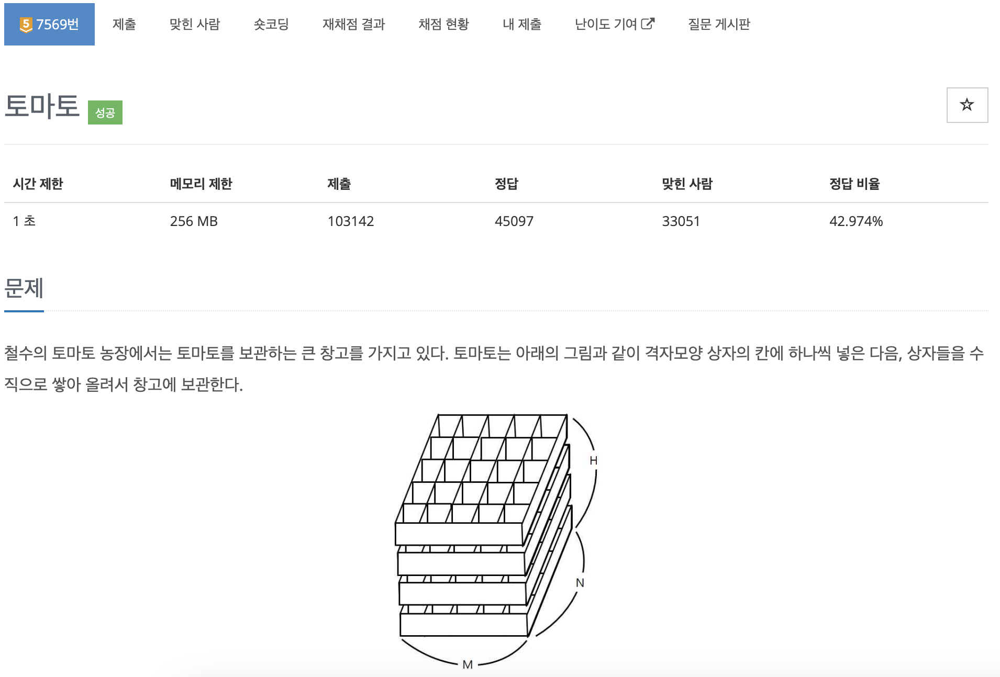
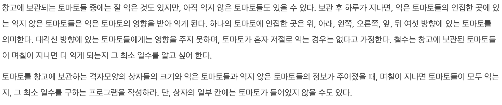


<https://www.acmicpc.net/problem/7569>




### <strong>입력</strong>

첫 줄에는 상자의 크기를 나타내는 두 정수 M,N과 쌓아올려지는 상자의 수를 나타내는 H가 주어진다. M은 상자의 가로 칸의 수, N은 상자의 세로 칸의 수를 나타낸다. 단, 2 ≤ M ≤ 100, 2 ≤ N ≤ 100, 1 ≤ H ≤ 100 이다. 둘째 줄부터는 가장 밑의 상자부터 가장 위의 상자까지에 저장된 토마토들의 정보가 주어진다. 즉, 둘째 줄부터 N개의 줄에는 하나의 상자에 담긴 토마토의 정보가 주어진다. 각 줄에는 상자 가로줄에 들어있는 토마토들의 상태가 M개의 정수로 주어진다. 정수 1은 익은 토마토, 정수 0 은 익지 않은 토마토, 정수 -1은 토마토가 들어있지 않은 칸을 나타낸다. 이러한 N개의 줄이 H번 반복하여 주어진다.

토마토가 하나 이상 있는 경우만 입력으로 주어진다.

### <strong>출력</strong>

여러분은 토마토가 모두 익을 때까지 최소 며칠이 걸리는지를 계산해서 출력해야 한다. 만약, 저장될 때부터 모든 토마토가 익어있는 상태이면 0을 출력해야 하고, 토마토가 모두 익지는 못하는 상황이면 -1을 출력해야 한다.

---

### <strong>코드</strong>

```python
from collections import deque
dx, dy, dz = [1, -1, 0, 0, 0, 0], [0, 0, 1, -1, 0, 0], [0, 0, 0, 0, 1, -1]

m, n, h = map(int, input().split())

flag = 1
arr = []
q = deque()
zero = 0

for i in range(h):
    layer = []
    for j in range(n):
        layer.append(list(map(int, input().split())))
        for k in range(m):
            if layer[j][k] == 1:
                q.append((i, j, k))
                flag = 0
            elif layer[j][k] == -1:
                flag = 0
            else:
                zero += 1
    arr.append(layer)

q.append((-1, -1, -1))
count = 0

while q:
    x, y, z = q.popleft()
    if (x, y, z) == (-1, -1, -1):
        if len(q) == 0:
            break
        q.append((-1, -1, -1))
        count += 1
    else:
        for k in range(6):
            nx, ny, nz = x + dx[k], y + dy[k], z + dz[k]
            if 0 <= nx < h and 0 <= ny < n and 0 <= nz < m and arr[nx][ny][nz] == 0:
                arr[nx][ny][nz] = 1
                q.append((nx, ny, nz))
                zero -= 1

if zero != 0:
    print(-1)
elif flag:
    print(0)
else:
    print(count)
```

### <strong>풀이</strong>

1. 초기 변수 설정

- dx, dy, dz: 3차원 공간에서 6개의 방향으로 이동하기 위한 델타 배열
- m, n, h: 상자의 크기 (m: 가로, n: 세로, h: 높이)
- flag: 상자에 익은 토마토와 벽(-1)만 있는 경우를 확인하기 위한 플래그
- arr: 3차원 배열로 상자의 상태를 저장
- q: BFS를 위한 큐
- zero: 익지 않은 토마토(0)의 개수를 카운트

{: start="2"}
2. 상자 상태 입력

- 각 높이(h), 행(n), 열(m)에 대해 값을 입력받아 arr에 저장한다.
- 익은 토마토(1)는 BFS 큐(q)에 추가한다.
- 빈 칸(-1)은 처리만 하고 카운트하지 않는다.
- 익지 않은 토마토(0)는 zero를 증가시켜 전체 개수를 추적한다.

{: start="3"}
3. BFS 초기화

- BFS 레벨을 구분하기 위해, 각 레벨의 마지막에 (-1, -1, -1)를 삽입한다.
- count: 익는 데 걸린 일수를 기록한다.

{: start="4"}
4. BFS 탐색

- (-1, -1, -1)을 만났을 때는 현재 레벨 탐색이 끝난 상태로, 날짜(count)를 증가시킨다.
- 6방향 탐색을 통해 범위 내에 있는 익지 않은 토마토(0)를 익힌 후, 큐에 추가한다.
- 익은 토마토로 바꾼 후 zero를 감소시켜 남아 있는 익지 않은 토마토의 수를 업데이트한다.

{: start="5"}
5. 결과 출력

- zero != 0: 익지 않은 토마토가 남아 있으면 -1 출력한다.
- flag: 처음부터 모두 익어있으면 0 출력한다.
- count: 모든 토마토가 익는 데 걸린 날짜를 출력한다.

