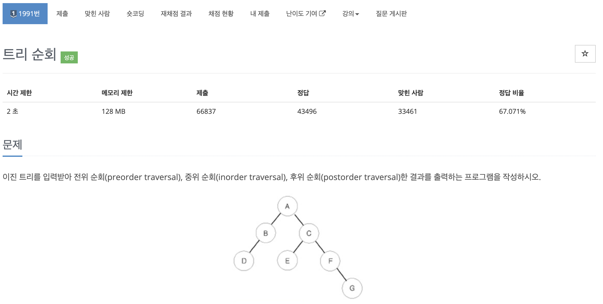


<https://www.acmicpc.net/problem/1991>




### <strong>입력</strong>

첫째 줄에는 이진 트리의 노드의 개수 N(1 ≤ N ≤ 26)이 주어진다. 둘째 줄부터 N개의 줄에 걸쳐 각 노드와 그의 왼쪽 자식 노드, 오른쪽 자식 노드가 주어진다. 노드의 이름은 A부터 차례대로 알파벳 대문자로 매겨지며, 항상 A가 루트 노드가 된다. 자식 노드가 없는 경우에는 .으로 표현한다.

### <strong>출력</strong>

첫째 줄에 전위 순회, 둘째 줄에 중위 순회, 셋째 줄에 후위 순회한 결과를 출력한다. 각 줄에 N개의 알파벳을 공백 없이 출력하면 된다.

---

### <strong>코드</strong>

```python
import sys

n = int(sys.stdin.readline().strip())
tree = {}

for i in range(n):
    root, left, right = sys.stdin.readline().strip().split()
    tree[root] = [left, right]

def preorder(root):
    if root != '.':
        print(root, end='')
        preorder(tree[root][0])
        preorder(tree[root][1])

def inorder(root):
    if root != '.':
        inorder(tree[root][0])
        print(root, end='')
        inorder(tree[root][1])

def postorder(root):
    if root != '.':
        postorder(tree[root][0])
        postorder(tree[root][1])
        print(root, end='')

preorder('A')
print()
inorder('A')
print()
postorder('A')
```

