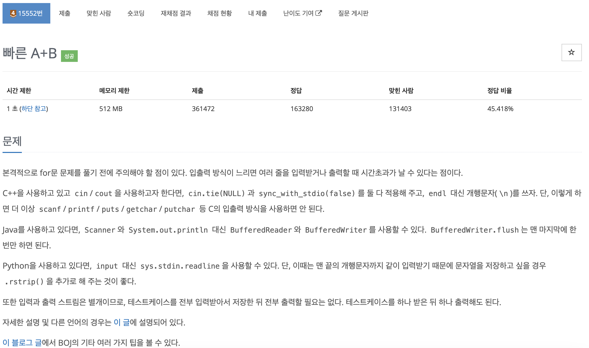


<https://www.acmicpc.net/problem/15552>



### <strong>입력</strong>

첫 줄에 테스트케이스의 개수 T가 주어진다. T는 최대 1,000,000이다. 다음 T줄에는 각각 두 정수 A와 B가 주어진다. A와 B는 1 이상, 1,000 이하이다.

### <strong>출력</strong>

각 테스트케이스마다 A+B를 한 줄에 하나씩 순서대로 출력한다.

---

### <strong>코드</strong>

```python
import sys

t = int(sys.stdin.readline().strip())

for i in range(t):
    a, b = map(int, sys.stdin.readline().strip().split())
    print(a+b)
```

---

### <strong>Python 빠른 입출력</strong>

#### 입력

n = sys.stdin.readline().strip()

#### 출력

sys.stdout.write(answer)

