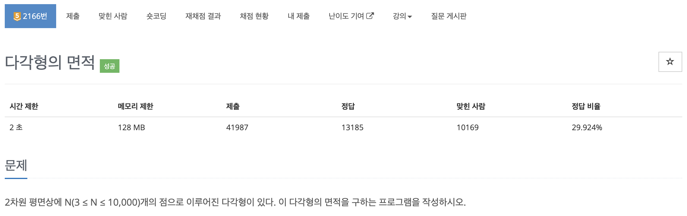


<https://www.acmicpc.net/problem/2166>



### <strong>입력</strong>

첫째 줄에 N이 주어진다. 다음 N개의 줄에는 다각형을 이루는 순서대로 N개의 점의 x, y좌표가 주어진다. 좌표값은 절댓값이 100,000을 넘지 않는 정수이다.

### <strong>출력</strong>

첫째 줄에 면적을 출력한다. 면적을 출력할 때에는 소수점 아래 둘째 자리에서 반올림하여 첫째 자리까지 출력한다.

---

### <strong>코드</strong>

```python
n = int(input())

arr = []
for i in range(n):
    arr.append(tuple(map(int, input().split())))

area = 0
for i in range(n):
    x1, y1 = arr[i]
    x2, y2 = arr[(i + 1) % n]
    area += (x1 * y2) - (x2 * y1)

print(round(abs(area) / 2, 2))
```

