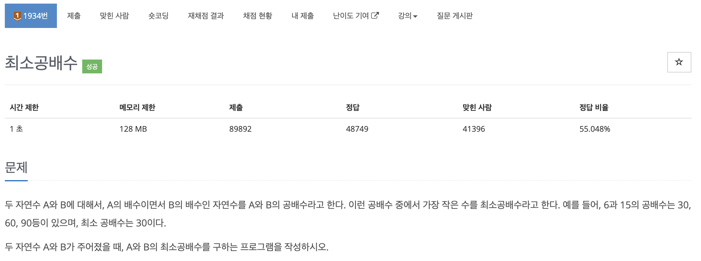


<https://www.acmicpc.net/problem/1934>



### <strong>입력</strong>

첫째 줄에 테스트 케이스의 개수 T(1 ≤ T ≤ 1,000)가 주어진다. 둘째 줄부터 T개의 줄에 걸쳐서 A와 B가 주어진다. (1 ≤ A, B ≤ 45,000)

### <strong>출력</strong>

첫째 줄부터 T개의 줄에 A와 B의 최소공배수를 입력받은 순서대로 한 줄에 하나씩 출력한다.

---

### <strong>코드</strong>

```python
def gcd(m, n):
    while n != 0:
        t = m%n
        m, n = n, t
    return abs(m)

t = int(input())

for _ in range(t):
    a, b = map(int, input().split())

    print((a * b) // gcd(a, b))
```

---

## <strong>유클리드 호제법</strong>

- 2개의 자연수의 최대공약수(GCD, Greatest Common Divisor)를 구하는 알고리즘
- 큰 수를 작은 수로 나누는 <strong>나머지 연산을 반복</strong>하면서 GCD를 찾아냄.

#### 🔹 <strong>유클리드 호제법 원리</strong>

두 정수 a 와 b 가 있을 때:

1. a 를 b 로 나눈 나머지를 구한다: r = a mod  b
2. a 를 b 로, b 를 r 로 바꾼다: (a, b) ← (b, r)
3. r=0 이 될 때까지 반복한다.
4. r=0 이 되었을 때, <strong>그때의 b 가 최대공약수(GCD)!</strong>

#### ✅ <strong>확장: 최소공배수(LCM) 구하기</strong>

최소공배수(LCM)는 다음 공식으로 구할 수 있음!

LCM(a, b) = ∣a×b∣ / GCD(a ,b)​

