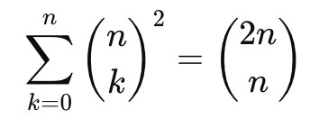
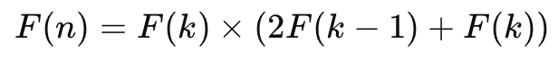
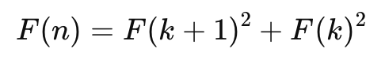


<https://www.acmicpc.net/problem/11444>


### <strong>입력</strong>

첫째 줄에 n이 주어진다. n은 1,000,000,000,000,000,000보다 작거나 같은 자연수이다.

### <strong>출력</strong>

첫째 줄에 n번째 피보나치 수를 1,000,000,007으로 나눈 나머지를 출력한다.

---

### <strong>코드</strong>

```python
from collections import defaultdict

n = int(input())
dp = defaultdict(int)

dp[0] = 0
dp[1] = 1
dp[2] = 1

def fibonacci(n):
    if not dp[n]:
        if n % 2 == 0:
            fn = fibonacci(n//2)
            fn_1 = fibonacci(n//2 - 1)
            dp[n] = (fn * (fn + 2 * fn_1)) % 1000000007
        else:
            fn1 = fibonacci(n//2 + 1)
            fn = fibonacci(n//2)
            dp[n] = ((fn1 * fn1) + (fn * fn)) % 1000000007
    return dp[n]

print(fibonacci(n))
```

---

## <strong>도가뉴 항등식</strong>



1. 짝수 n = 2k 일 때



{: start="2"}
2. 홀수 n = 2k + 1 일 때



이 방식은 <strong>분할 정복을 이용한 피보나치 수 계산 (Fast Doubling Fibonacci)</strong> 이므로,
거듭제곱을 계산하는 방식처럼 <strong>O(log n)</strong> 의 시간 복잡도를 가짐.

즉, <strong>100경(10¹⁸) 이상의 피보나치 수도 빠르게 계산할 수 있음!</strong>

지피티의 내 코드에 대한 한줄평..ㅋㅋㅋ



