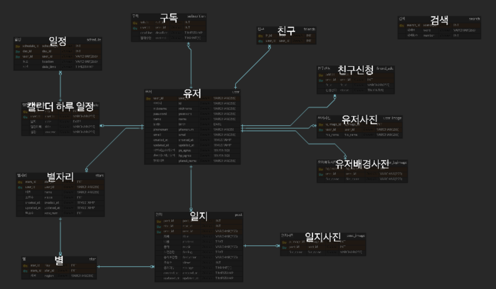
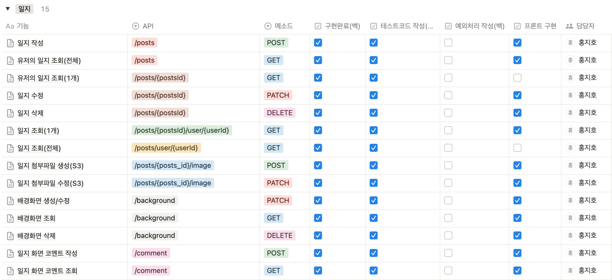
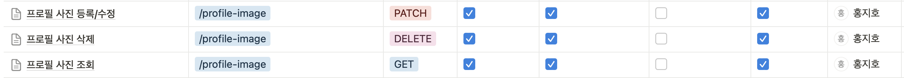
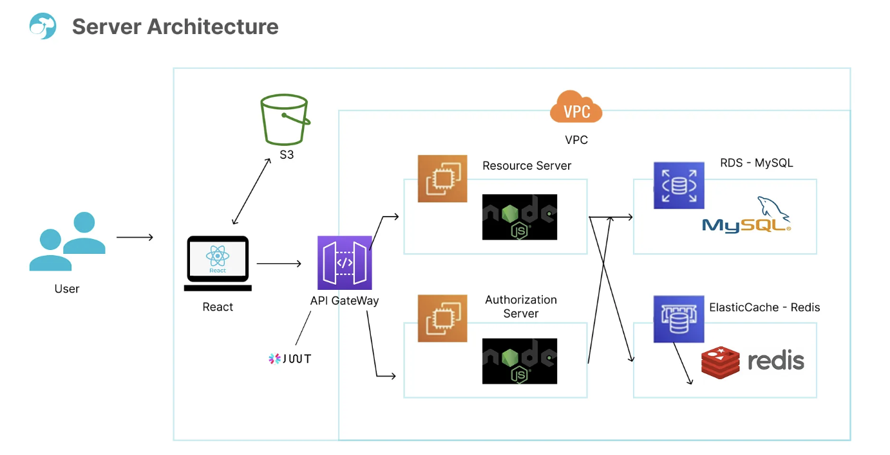
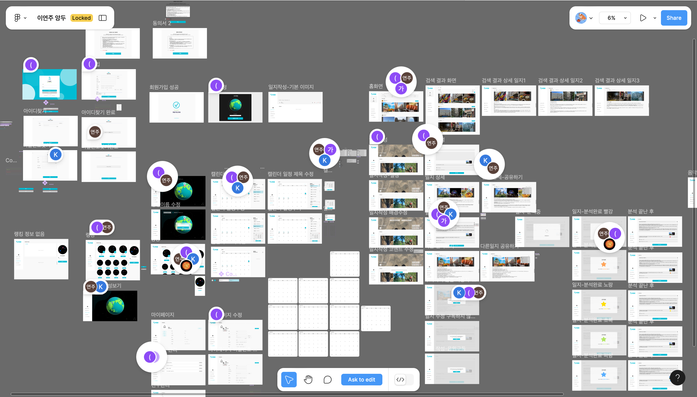
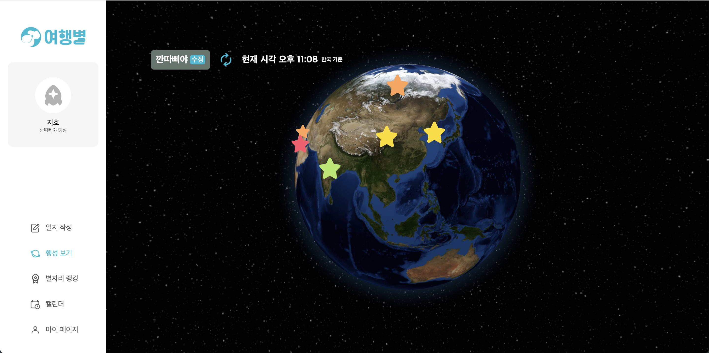
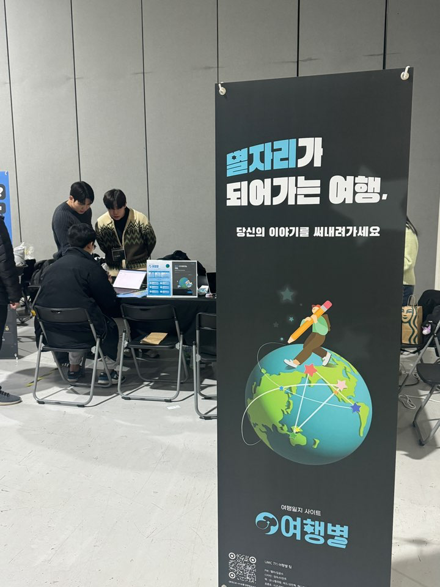
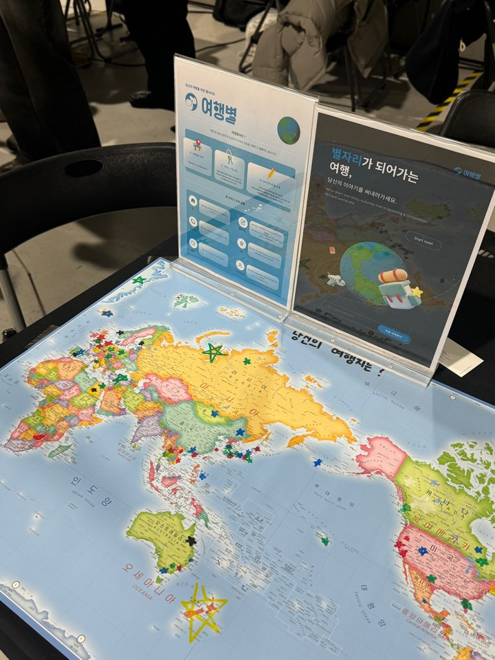
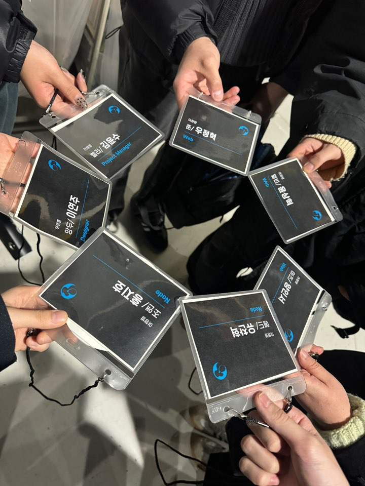


2025년 1-2월 동안 연합동아리에서 프로젝트를 진행하였다! 첫 프로젝트 였던 만큼 초반에 걱정도 많았고, 진행하면서 얻어가는 것도 많았다. 프로젝트는 PM(1명), 디자이너(1명), 백엔드(Node.JS 4명), 프론트엔드(WEB 4명) 이렇게 10명이서 진행하였다.

프로젝트 전 스터디하는 동안 어떻게든 미션을 해가려고 아득바득 열심히 했지만 정작 프로젝트 할 때는 알고있는 게 없었고, 스터디 때 배운 게 0.5라고 하면 프로젝트 하면서 배운 게 10인 것 같다!!! 그래서 스터디 도중에 블로그에 정리하려고 노력했지만, 한 번은 거의 다 작성했던 블로그가 날아가버려서..... 그 후로 기록을 하지 못했다.

2일 전에 끝난(아직안끝나긴했는데) 아주 따끈따끈한 프로젝트 과정을 돌아봐 정리하려고 한다!

---

### <strong>1. 프로젝트 소개</strong>

<https://makeus-challenge.notion.site/9130aad098074aa3bfa5560595ebc52f>

- 프로젝트: 여행 일지를 간편하게 작성하며 추억과 감정을 기억하고 공유하는 서비스
- 깃허브: <https://github.com/UMC-TravelStar>

🔗 [TravelStar](https://github.com/UMC-TravelStar)

- 기술스택:
  - BackEnd: Node.js, Express, Prisma, MySQL, Redis
  - FrontEnd: React

---

### <strong>2. 프로젝트 과정</strong>

- ERD

초반에 작성했던 ERD는 이것과 좀 다른데, 구현을 하는 중 수정해야하는 부분이 꽤 많이 생겨서 내가 새롭게 다시 작성하였다.

내가 프로젝트 시작 기간에 여행이랑 겹쳐서 다른 분께서 작성한 ERD를 자세히 안 보고 그냥 개발을 진행했었는데, 처음에 제대로 봤으면 다시 작성하는 일이 없지 않았을까 하고 아쉬웠다ㅜㅜ

- API 명세서

API 명세서는 굉장히굉장히 길어서 내 파트만 가져왔다! 이 많은 API 중에 일지 작성은 정말... 프로젝트 시작부터 끝까지 수도없이 수정한 것 같다.. 매번 수정하면서 이번이 마지막이길 바라며.. 수정했던 것 같다ㅋㅋ 프론트 구현이 안 된 2개는 다른 API로 대체 가능했다!

사실 첫 프로젝트여서 처음엔 간단한 API도 구현하고 수정하기에 급급했기에.. 이제 기초만 다졌다. 조금 더 난이도 있는 무언가를 도전해볼 걸 그랬나 싶은 마음이 꽤 든다! 기능 중에 openAI의 API를 사용하는 기능이 있었는데 내가 할 걸 그랬다!! 다 경험인데..

- 아키텍쳐 구조

사실 난 아키텍쳐 구조를 잘 이해할 줄 모른다...허허 공부 더 열심히 해야겠다. S3는 내가 연결했는데 잘못 연결된 게 아닌지!

- 피그마

물론 나는 작업하지 않았고 디자이너 님이 작업하신거지만 추억하기 위해!

- 실제 화면 하나 첨부!

기여워서 맘에 드는 화면..

여행 일지를 작성하면서 여행에서 겪은 감정에 대한 이야기를 적고 분석을 하면 분석된 색상의 별이 여행 지역에 생긴다~~ 기여움

---

### <strong>3. 느낀점</strong>

 우선 Node.JS에 많은 애정이 생겼다... 만약 Node.JS를 사용하는 프로젝트를 한 번 더 한다면 정말 혼자서도 할 수 있을 것 같은 자신감이 생겼다!! 스터디랑 프로젝트까지 같이 한 팀원이 내가 막판에 다른 사람의 오류를 슉슉 잘 고치는 걸 보고 "너 정말 완벽히 깨달았구나...." 라고 했다 ㅋㅋㅋ 정말 그 정도로 웬만한 오류는 오류메세지만 보고 바로 고칠 수 있는 상태가 되었다!! 3-1에는 Spring을 공부해보려고 하는데 Node.JS 프로젝트를 한 번 더 할 수 있다면 좋은텐데.. 라는 생각도 든다!

 두번째로는, 웹도 배워보고 싶어졌다.. 프로젝트 처음부터 끝까지 정말 열정적인 웹 팀원들을 보며 대단하다고 생각했고, 솔직히는 멋있어서 반한건가.. 싶다!ㅋㅋㅋ 난 멋있으면 다 따라하고 싶어지기에.. 무엇보다 협업을 해야하는데 웹이 어떤 식으로 돌아가는지 몰라서 처음엔 웹 사람들이 날 답답해하진 않았을까ㅜㅜ? 싶다. 초반엔 나도 내 코드를 이해하지 못했기에.. 스웨거 문서랑 노션이랑 내용이 약간씩 차이가 났어서 웹 사람들이 많이 혼란스러웠을 것 같다. 무튼 웹을 배울 수 있는 기회가 있다면 한 번 쯤은 배워보고 싶다!

 나는 프로젝트를 진행하면서는 우리 웹에 대한 애정은 딱히 없었다. 워낙 그냥 API나 만들고 실제 웹 화면으로 테스트 해보는 게 아니었으니 피그마로 보는 화면이 끝이었다. 하지만 데모데이 때 어쩌다 보니 내가 부스에서 사람들한테 웹 설명을 많이 해줬는데, 우리 웹을 보면서 신기해하고 즐거워하는 사람들을 보면서!! 많이 애정이 생겼다! 그리고 우리는 대면회의는 한 번도 한 적이 없어서 우리학교인 팀원들 빼고는 데모데이 당일에 처음 봤었는데, 하루만에 다들 정말 많이 친해져서 진행 중에 몇 번 만나서 작업했어도 재밌었겠다~ 라고 생각했다! 이건 사담인데, 데모데이 끝나고 회식도 했는데, 나는 매주 디코 회의에서 프론트 사람들이 굉장히 딱딱하다고 느껴졌었는데, 실제로 만나보니 너무 재밌는 사람들이었어서 회식 중에 이 말을 했더니! 한 프론트 분께서 "아 나 이거 약간 억울한데?" 라고 하시면서 ㅋㅋㅋㅋ 오히려 백엔드 사람들은 말도 잘 안 해서 나랑 반대로 생각하고 있었다고 했다 ㅋㅋㅋㅋ 다시 기억을 떠올려보니 난 전체회의 때 거의 말을 0번했다.....ㅋㅋ 일부러 안 한 건 아니고, 아는 게 없어서!!!! 못했는데 다음엔 좀 더 열심히 참여해봐야겠다고 생각했다! 그리고 막판에 백엔드가 연락이 잘 안 됐었는데 내가 연락 제일 열심히 봐가지고(당연함. 백수임..) 정말 고마웠다고 했다. 다행 ㅜㅜ 이렇게 해피엔딩으로 프로젝트가 종료됐다~ 아직 구현이 안 됐거나 보완이 필요한 기능이 두세 개 있지만, 우선 데모데이는 끝났으니 회고록을 써보았다! 개강 전 남은 2월은 프로젝트 진행 중 알게 된 지식들을 정리하는 블로그를 쓰면서 보내야겠다~~


