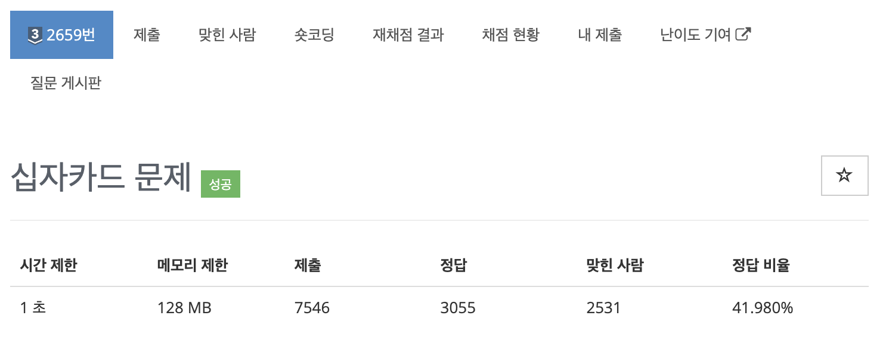
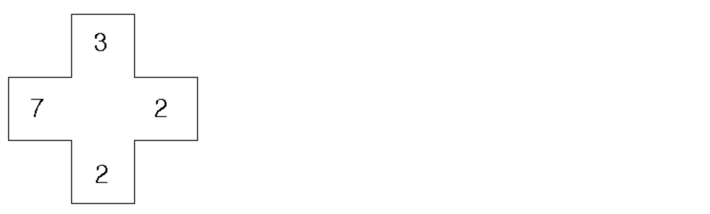
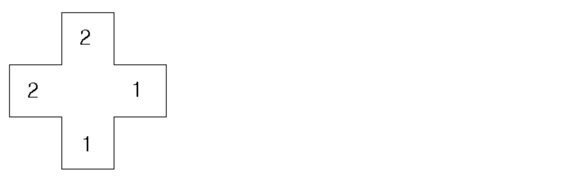


<https://www.acmicpc.net/problem/2659>



### <strong>문제</strong>



위와 같은 십자모양의 한 장의 카드에서, 네 모서리에 1 이상 9 이하의 숫자가 하나씩 씌여 있다. 이 네 개의 숫자 중에는 같은 숫자도 있을 수 있다.

모든 가능한 십자 카드가 주어질 때, 각각의 카드는 다음과 같은 '시계수'라는 번호를 가진다. 시계수는 카드의 숫자들을 시계 방향으로 읽어서 만들어지는 네 자리 수들 중에서 가장 작은 수이다. 위 그림의 카드는 시계방향으로 3227, 2273, 2732, 7322로 읽을 수 있으므로, 이 카드의 시계수는 가장 작은 수인 2273이다.

입력으로 주어진 카드의 시계수를 계산하여, 그 시계수가 모든 시계수들 중에서 몇 번째로 작은 시계수인지를 알아내는 프로그램을 작성하시오.

예를 들어서, 다음과 같은 십자 카드의 시계수는 1122이며, 이 시계수보다 작은 시계수들은 1111, 1112, 1113, 1114, 1115, 1116, 1117, 1118, 1119 뿐이므로 1122는 10번째로 작은 시계수다. (여기서 십자카드는 0 이 나타날 수 없으므로 1120은 시계수가 될 수 없다. 또한 1121 이 적혀있는 카드의 시계수는 1112이므로, 1121은 시계수가 될 수 없다.



### <strong>입력</strong>

입력은 한 줄로 이루어지며, 이 한 줄은 카드의 네 모서리에 씌여있는 1 이상 9 이하의 숫자 4개가 시계 방향으로 입력된다. 각 숫자 사이에는 빈칸이 하나 있다.

### <strong>출력</strong>

입력된 카드의 시계수가 모든 시계수들 중에서 몇 번째로 작은 시계수인지를 출력한다.

---

### <strong>코드</strong>

```python
def clock_num(n):
    s = str(n)
    rotations = [int(s[i:] + s[:i]) for i in range(4)]
    return min(rotations)

clock_number = set(clock_num(i) for i in range(1111, 10000) if '0' not in str(i))
clock_number = sorted(clock_number)

n = input().split()
n = int("".join(n))

result = clock_num(n)

print(clock_number.index(result)+1)
```

### <strong>풀이</strong>

1. <strong>clock_num</strong> 함수: 주어진 4자리 수에서 가능한 회전값을 생성하고, 그 중 가장 작은 값을 반환함.

{: start="2"}
2. <strong>clock_number</strong> 변수에 <strong>1111~9999</strong> 범위에서의 각 시계수를 저장하고 중복을 제거한 후 정렬함.

{: start="3"}
3. 입력받은 수의 시계수를 구하고, <strong>clock_number</strong> 리스트에서 몇 번째인지 확인함.

