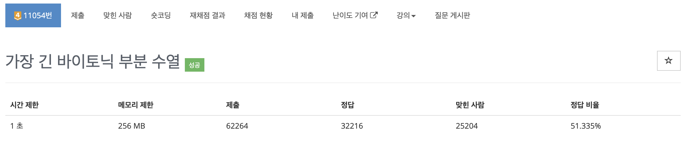


<https://www.acmicpc.net/problem/11054>



### <strong>문제</strong>

수열 S가 어떤 수 Sk를 기준으로 S1 &lt; S2 &lt; ... Sk-1 &lt; Sk &gt; Sk+1 &gt; ... SN-1 &gt; SN을 만족한다면, 그 수열을 바이토닉 수열이라고 한다.

예를 들어, {10, 20, <strong>30</strong>, 25, 20}과 {10, 20, 30, <strong>40</strong>}, {<strong>50</strong>, 40, 25, 10} 은 바이토닉 수열이지만, {1, 2, 3, 2, 1, 2, 3, 2, 1}과 {10, 20, 30, 40, 20, 30} 은 바이토닉 수열이 아니다.

수열 A가 주어졌을 때, 그 수열의 부분 수열 중 바이토닉 수열이면서 가장 긴 수열의 길이를 구하는 프로그램을 작성하시오.

### <strong>입력</strong>

첫째 줄에 수열 A의 크기 N이 주어지고, 둘째 줄에는 수열 A를 이루고 있는 Ai가 주어진다. (1 ≤ N ≤ 1,000, 1 ≤ Ai ≤ 1,000)

### <strong>출력</strong>

첫째 줄에 수열 A의 부분 수열 중에서 가장 긴 바이토닉 수열의 길이를 출력한다.

---

### <strong>코드</strong>

```python
n = int(input())
arr = list(map(int, input().split()))

inc = [1] * n
for i in range(n):
    for j in range(i):
        if arr[i] > arr[j]:
            inc[i] = max(inc[i], inc[j] + 1)

dec = [1] * n
for i in range(n - 1, -1, -1):
    for j in range(n - 1, i, -1):
        if arr[i] > arr[j]:
            dec[i] = max(dec[i], dec[j] + 1)

result = 0
for i in range(n):
    result = max(result, inc[i] + dec[i] - 1)

print(result)
```

### <strong>풀이</strong>

inc 배열: 왼쪽에서 오른쪽으로 진행하면서 <strong>가장 긴 증가하는 부분 수열(LIS)</strong> 길이 저장

dec 배열: 오른쪽에서 왼쪽으로 진행하면서 <strong>가장 긴 감소하는 부분 수열(LDS)</strong> 길이 저장

최종 결과: 각 자리에서 <strong>inc[i] + dec[i] - 1</strong> 값을 계산하고 최댓값을 반환

