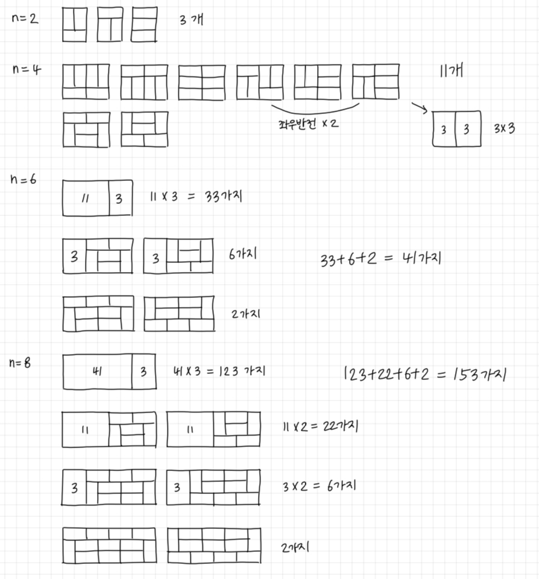


<https://www.acmicpc.net/problem/2133>


### <strong>문제</strong>

3×N 크기의 벽을 2×1, 1×2 크기의 타일로 채우는 경우의 수를 구해보자.

### <strong>입력</strong>

첫째 줄에 N(1 ≤ N ≤ 30)이 주어진다.

### <strong>출력</strong>

첫째 줄에 경우의 수를 출력한다.

---

### <strong>코드</strong>

```python
n = int(input())

dp = [1, 3, 11]
if n % 2 == 1:
    print(0)
elif n <= 4:
    print(dp[n//2])
else:
    for i in range(6, n+1, 2):
        i //= 2
        dp.append(dp[i-1] * dp[1])
        dp[i] += 2 * (sum(dp[0:i-1]))
    print(dp[n//2])
```

### <strong>풀이</strong>



위를 통해 dp[k] = dp[k-1] X dp[1] + 2 X (dp[0] + dp[1] + ... + dp[k-2]) 와 같은 점화식을 얻을 수 있었음.

n이 홀수일 때는 무조건 답이 0이므로 dp 리스트에 n//2 인덱스 자리에 저장함.

항상 2가지를 더해줘야 하므로 dp[0]엔 1을 저장해두었음.

