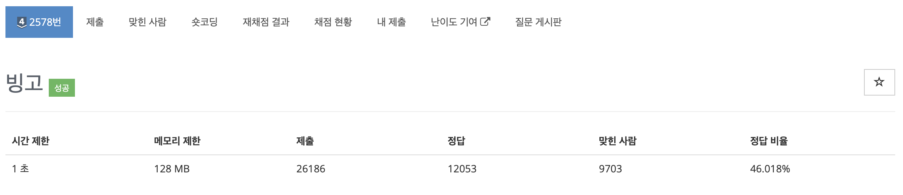
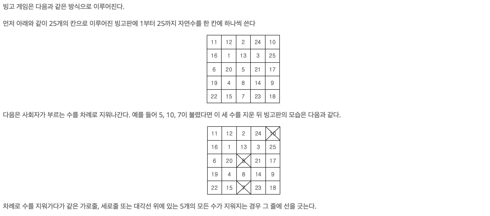
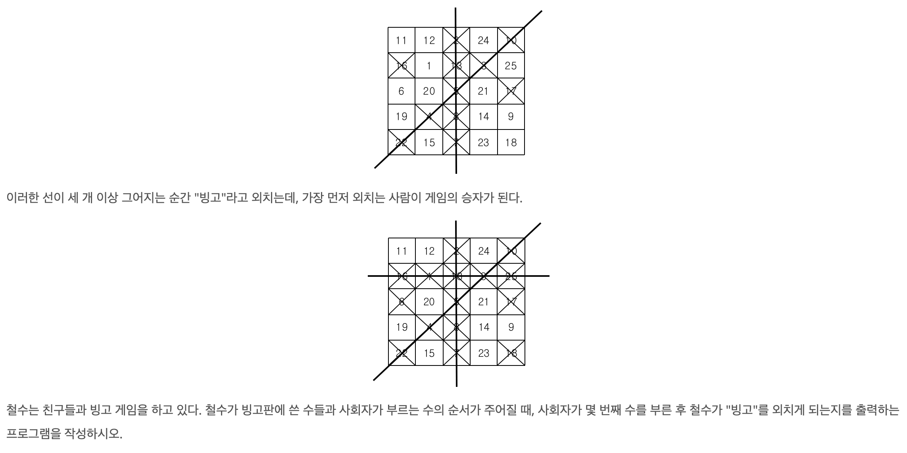


<https://www.acmicpc.net/problem/2578>



### <strong>문제</strong>




### <strong>입력</strong>

첫째 줄부터 다섯째 줄까지 빙고판에 쓰여진 수가 가장 위 가로줄부터 차례대로 한 줄에 다섯 개씩 빈 칸을 사이에 두고 주어진다. 여섯째 줄부터 열째 줄까지 사회자가 부르는 수가 차례대로 한 줄에 다섯 개씩 빈 칸을 사이에 두고 주어진다. 빙고판에 쓰여진 수와 사회자가 부르는 수는 각각 1부터 25까지의 수가 한 번씩 사용된다.

### <strong>출력</strong>

첫째 줄에 사회자가 몇 번째 수를 부른 후 철수가 "빙고"를 외치게 되는지 출력한다.

---

### <strong>코드</strong>

```python
def check_bingo(board):
    count = 0

    for row in board:
        if all(x == 0 for x in row):
            count += 1

    for col in range(5):
        if all(board[row][col] == 0 for row in range(5)):
            count += 1

    if all(board[i][i] == 0 for i in range(5)):
        count += 1

    if all(board[i][4 - i] == 0 for i in range(5)):
        count += 1

    return count

bingo_board = [list(map(int, input().split())) for _ in range(5)]
calls = [list(map(int, input().split())) for _ in range(5)]

position = {}
for i in range(5):
    for j in range(5):
        position[bingo_board[i][j]] = (i, j)

called_count = 0
for row in calls:
    for number in row:
        called_count += 1
        if number in position:
            x, y = position[number]
            bingo_board[x][y] = 0

        if check_bingo(bingo_board) >= 3:
            print(called_count)
            exit()
```

### <strong>풀이</strong>

1. check_bingo 함수: 현재 빙고판에서 빙고 줄 개수를 반환함

{: start="2"}
2. 빙고판과 사회자가 부르는 숫자를 입력받을 후, 숫자 위치 매핑을 편하게 하기 위해 딕셔너리를 사용함

{: start="3"}
3. 사회자가 부르는 숫자를 하나씩 확인하며, 빙고판에서 해당 숫자를 0으로 변경함

{: start="4"}
4. 숫자를 지울 때마다 빙고 개수를 확인하여 3줄 이상이 되면 즉시 결과를 출력하고 종료함

