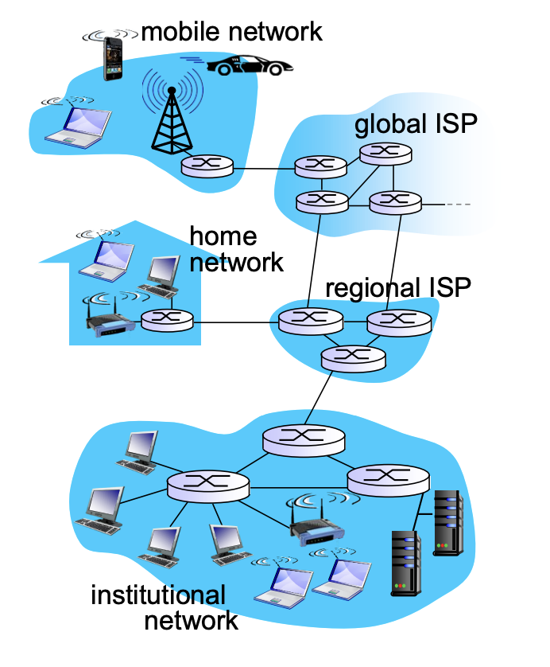


본 내용은 컴퓨터 네트워크 - 하향식 접근 책을 바탕으로 정리하였습니다.

## <strong>인터넷이란 무엇인가?</strong>

### <strong>1. 구성요소로 본 인터넷</strong>

인터넷: 전 세계적으로 수십억 개의 컴퓨팅 장치를 연결하는 컴퓨터 네트워크

1. <strong>host</strong>: 인터넷에 연결되어있는 수많은 컴퓨팅 디바이스들 ( = end system)

{: start="2"}
2. <strong>link</strong>: host들을 연결하는 매개체. 광섬유, 구리선, 전파, 인공위성 등등

- 각각의 link들은 다양한 전송률(링크 대역폭, <strong>bandwidth</strong>)을 이용하여 데이터를 전송하며, 전송률은 초당 비트 수를 의미하는 <strong>bps</strong>(bit per second)를 이용함.

{: start="3"}
3. <strong>packet switch</strong>: 입력 통신 링크의 하나로, 도착하는 패킷을 받아서 출력 통신 링크의 하나로 그 패킷을 전달함.

- <strong>라우터</strong>(router)와 <strong>링크 계층 스위치</strong>(link-layer switch)가 있음.
- 패킷이 송신 종단 시스템에서 수신 종단 시스템에 도달하는 동안 거쳐 온 일련의 통신 링크와 패킷 스위치들을 네트워크상의 경로(router or path)라고 함.

{: start="4"}
4. end system은 <strong>ISP</strong>(Internet Service Provider)를 통해 인터넷에 접속함.

- 지역 케이블 혹은 가정 ISP ~ 셀룰러 데이터 ISP를 포함함.

{: start="5"}
5. end system, packet switch, 인터넷의 다른 구성요소는 인터넷에서 정보 송수신을 제어하는 여러 <strong>프로토콜</strong>(protocol)을 수행함.

- TCP(Transmission Control Protocol), IP(Internet Protocol), THHP, Shype, 802.11 등이 있음.

{: start="6"}
6. <strong>인터넷 표준</strong>(Internet standard): 각각의 프로토콜 또는 모든 프로토콜이 무엇은 수행하는지에 대해 합의하는 것도 매우 중요하므로 정함.

- IETF(Internet Engineering Task Force): IETF 2016에서 개발
- RFCs(Request for comments): IETF 표준 문서 (TCP, IP, HTTP, SMTP 같은 프로토콜 정의)

### <strong>2. 서비스 측면에서 본 인터넷</strong>

인터넷: 애플리케이션에 서비스를 제공하는 인프라 구조

- 전자메일, 웹 서핑과 같은 전동적인 응용 뿐만 아니라, 인터넷 메시징, 실시간 도로 교통 정보를 반영한 지도 서비스, 클라우드로부터의 음악 스트리밍, 영화 및 텔레비전 스트리밍, 온라인 소셜 네트워크 등을 포함함.
- 애플리케이션은 서로 데이터를 교환하는 많은 종단 시스템을 포함하고 있기 때문에 <strong>분산 애플리케이션</strong>(distributed application) 이라고 함.

### <strong>3. 프로토콜이란 무엇인가?</strong>

<strong>protocol</strong>: 둘 이상의 통신 개체 간에 교환되는 메시지 포맷과 순서뿐 아니라, 메시지의 송수신과 다른 이벤트에 따른 행동들을 정의함.


