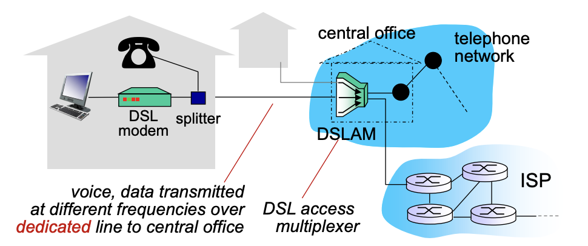
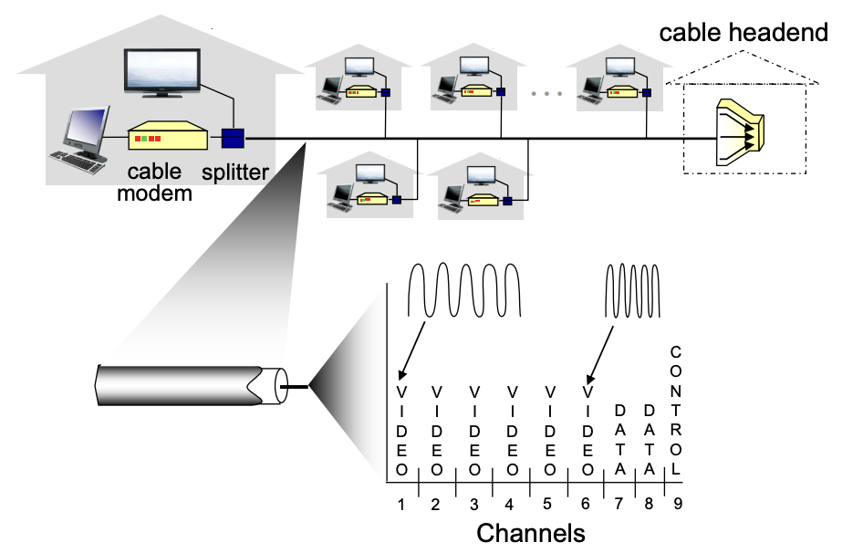
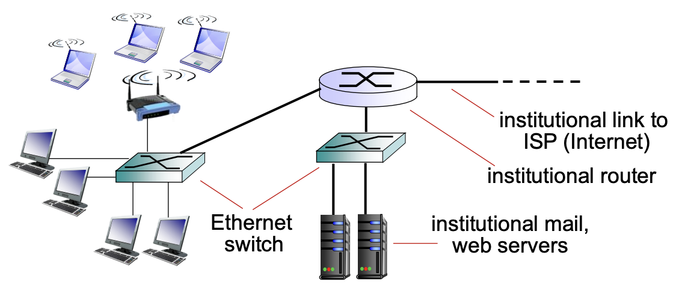
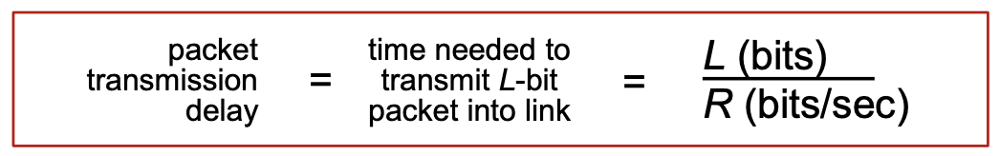


본 내용은 컴퓨터 네트워크 - 하향식 접근 책을 바탕으로 정리하였습니다.

## <strong>network edge</strong>

### <strong>1. 접속 네트워크</strong>

network edge: 한 end system으로부터 다른 end system까지의 경로상에 있는 첫 번재 라우터에 연결하는 네트워크

- host는 client와 server로 구분됨.
- client: 데스크톱, 모바일PC, 스마트폰 등을 의미
- server: 웹 페이지를 저장하고 분배하고, 비디오를 스트림하며, 전자메일을 릴레이 함. 대부분의 서버들은 커다란 데이터 센터 내에 있음.

### <strong>2. 연결 네트워크과 physical media</strong>

end system이 edge router에 어떻게 연결이 될까

- residential access nets (주거용 접속 네트워크)
- institutional access networks (school, company)
- mobile access networks

연결 네트워크에서 중요한 개념: bandwidth(대역폭, 초 당 비트 전송률), shared or dedicated(공용인지 전용인지)

### <strong>3. 연결 네트워크과 DSL</strong>

DSL(Digital Subscriber Line): 전화선을 이용한 인터넷 연결 기술

- 각 가정의 DSL modem은 지역 중앙국에 위치한 DSLAM(digital subscriber line access multiplexer)로부터 디지털 데이터를 받아서 고주파 신호로 변환한다.
- 가정에 있는 splitter는 데이터와 전화 신호를 분리하고 데이터 신호를 DSL modem으로 전송한다.
- upstream 채널은 2.5Mbps 이하
- downstream 채널은 24Mbps 이하
- upstream과 downstream의 차이는 집에서 인터넷으로 보내는, 인터넷에서 집으로 받는 으로 이해하면 된다!

### <strong>4. 연결 네트워크와 케이블 인터넷 접속</strong>

케이블 TV 회사의 기존 케이블 TV 기반구조를 이용한다.

- 가정에서 케이블 TV 회사로부터 인터넷 접속 서비스를 받을 때, 동축케이블이 사용되는데, 광케이블과 동축케이블을 흔히 HFC(hybrid fiber coax)라고 부름.
- FTTH(fiber to the home): 가정까지 직접 광섬유 경로를 제공해 초고속 인터넷을 제공하는 기술
- DSL modem과 비슷하게 cable modem을 통해 인터넷 접속을 하는데, cable modem은 보통 외장형 장치이고, 이더넷 포트를 통해 가정 PC에 연결됨.
- frequency division multiplexing(주파수 분할 다중화): 아래 사진에서 볼 수 있듯이 splitter를 거치면 1-6은 티비로 가고, 7-8은 cable modem으로 감.

### <strong>5. 이더넷</strong>

기업과 대학, 가정 환경에서 LAN(local area network)은 일반적으로 end system을 가장자리 라우터에 연결하기 위해 사용됨. 여러 유형의 LAN 기술이 있지만 이더넷 기술이 가장 널리 사용되는 접속 기술이다!

- 이더넷은 이더넷 스위치에 연결하기 위해 꼬임쌍선을 이용함.
- 이더넷 스위치들의 네트워크는 더 큰 인터넷으로 연결됨.

### <strong>6. Wireless 연결 네트워크</strong>

LAN, WAN 등이 있다.

### <strong>7. 호스트의 데이터 패킷 전송률</strong>

패킷 하나를 보내는 데 얼마나 많은 시간이 걸리는지 구하는 방법이다.

- L: 데이터 양, R: 속력

### <strong>8. Pysical media</strong>

용어 정리

- bit: 각 송신기-수신기 사이 전파되는 데이터
- physical link: 송신기에서부터 수신기까지 연결되어있는 링크
- guided media: 유선 link, 광섬유 케이블, 꼬임쌍선, 동축케이블 등
- ungided media: 무선, LAN, 인공위성 등
- twisted pair(TP): 이웃하는 쌍들 간에 전기 간섭을 줄이기 위해 2개의 선을 꼬아서 만들어짐. 꼬여있지 않으면 noise가 발생하여 스파크가 튀게 되기 때문에 두 선이 동일하게 영향을 받게 하기 위해 선을 꼬아둠.

### <strong>9. coax, fiber</strong>

coaxial cable

- 동축 케이블. 꼬임쌍선처럼 2개의 구리선으로 되어 있음. (동심원 형태)
- 여러 end system은 케이블에 직접 연결할 수 있고 다른 end system이 전송하는 모든 것을 수신함.

fiber optic cable

- 유리로 이루어져 있음.
- 데이터를 엄청 많이 실어나를 수 있음.
- 둥글게 말려있음.

### <strong>10. radio</strong>

radio link types

- 지상 마이크로파(terrestrial microwave)
- LAN (WIFI)
- wide-area: 이동 통신에서 제공하는 셀룰러 망 같은 것
- 인공위성

