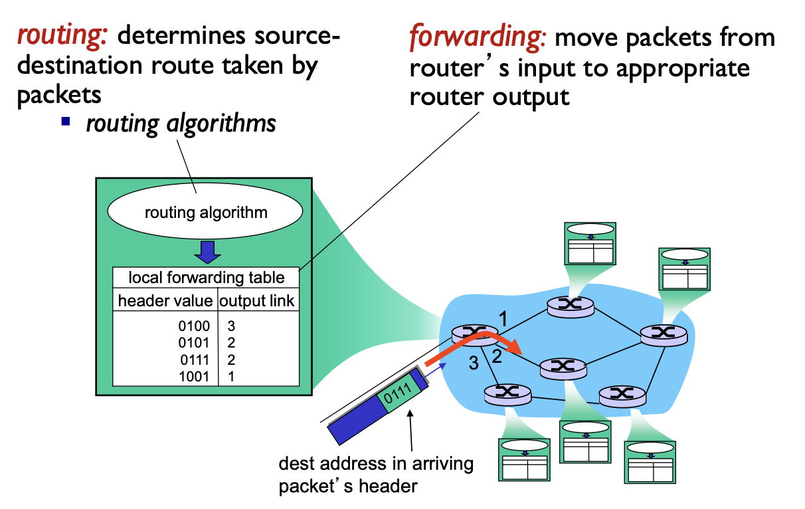
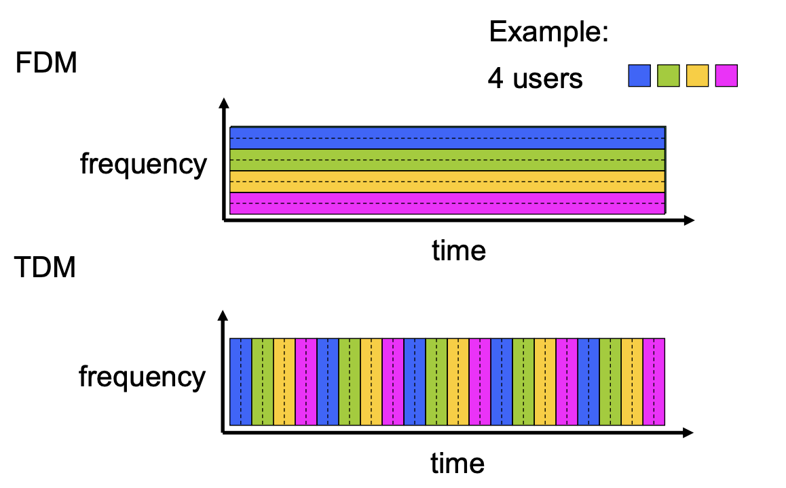
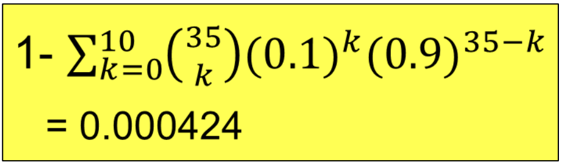
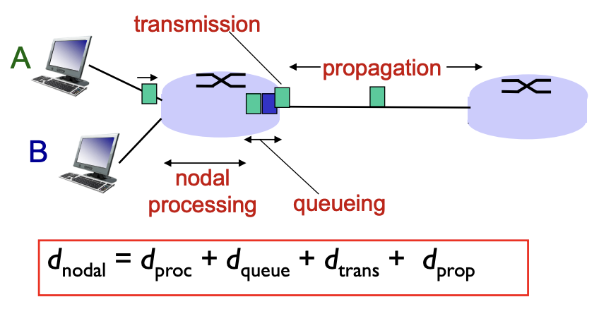
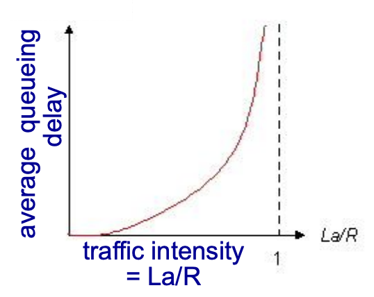
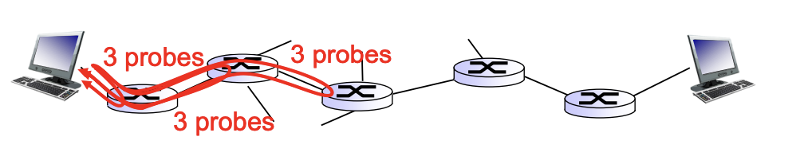
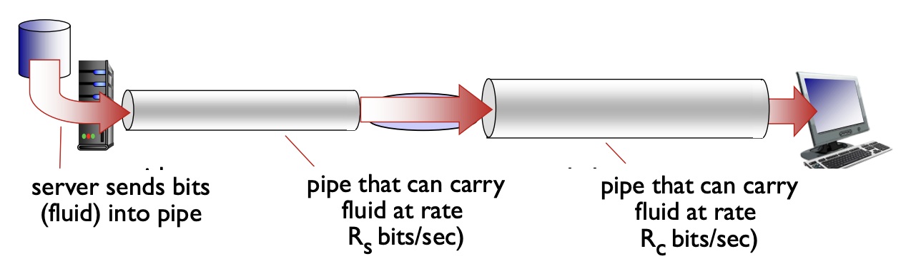


본 내용은 컴퓨터 네트워크 - 하향식 접근 책을 바탕으로 정리하였습니다.

## <strong>network core</strong>

### <strong>1. network core</strong>

인터넷의 end system을 연결하는 패킷 스위치들과 링크들의 연결망

### <strong>2. packet switching</strong>

송신 end system에서 긴 메세지를 패킷(packet)이라고 하는 작은 데이터 덩어리로 분할하고, 각 패킷은 통신 링크와 패킷 스위치를 거치고 수신 end system에 도착하게 된다.

대부분의 패킷 스위치는 저장-후-전달 전송(store-and-forward transmission) 방식이다.

홉(hop): 출발지에서 라우터 까지의 경로를 말한다.

### <strong>3. queueing delay, loss</strong>

각 링크에 대해 패킷 스위치는 출력 버퍼(출력 큐)를 가지고 있으며 그 링크로 송신하려고 하는 패킷을 저장하고 있다.

그 링크가 다른 패킷을 전송하고 있다면, 도착하는 패킷은 출력 버퍼에서 대기해야 한다. 따라서 패킷은 출력 버퍼에서 큐잉 지연(queueing delay)을 겪게 된다.

버퍼 공간의 크기가 유한하기 때문에 다른 패킷들로 꽉 차 있는 경우에 패킷 손실(packet loss)이 발생한다.

### <strong>4. network-core의 2가지 중요한 기능</strong>

routing: 송신기에서 수신기까지 어느 길이 적합한지 찾아주는 걸 말한다. routing algorithm을 통해 정해진다.

forwarding: routing 과정에서 forwarding table이 만들어지는데, 그 테이블 대로 링크를 찾아 보내는 걸 말한다.

### <strong>5. circuit switching</strong>

링크과 스위치의 네트워크를 통해 데이터를 이동시키는 방법에는 회선 교환(circuit switching)과 패킷 교환(packet switching)이 있다.

circuit switching

circuit: 송신자가 수신자 간의 경로에 있는 스위치들이 해당 연결 상태를 유지해야 하는 연결을 말한다.

circuit switching: 네트워크 링크에 일정한 전송률을 예약하고, 연결이 지속되는 동안 한 링크를 점유하는 것을 말한다.

- dedicated resource: 링크를 공유하지 않음.
- guaranteed performance: 보장된 일정 전송률로 데이터를 보낼 수 있음.

### <strong>6. circuit switching에서의 다중화 FDM, TDM</strong>

circuit switching은 주파수-분할 다중화(frequency-division multiplexing, FDM) 혹은 시-분할 다중화(time-division multiplexing. TDM)로 구현된다.

FDM

- 연결되는 동안 링크는 각 연결에 대해 주파수 대역을 고정으로 제공함. 이 대역의 폭을 대역폭(bandwidth)이라고 함!

TDM

- 시간을 일정 주기의 프레임으로 구분하고 고정된 수의 시간 슬롯으로 나눔.
- 네트워크가 링크를 통해 하나의 연결을 설정할 때, 네트워크는 모든 프레임에서 시간 슬롯 1개를 그 연결에 할당함.

### <strong>7. packet switching vs circuit switching</strong>

사용자가 1Mbps 링크를 공유한다고 가정. 한 사람 당 100kbps의 일정 속도로 데이터를 생산. 전체 시간에서 10%만 활동.

- circuit switching: 각각의 사용자에 100kbps만큼 예약되어야 함. -&gt; 동시에 최대 10명의 유저만 수용 가능
- packet switching: 만약 35명의 사용자가 있다면, 11명 이상의 사용자가 동시에 활동할 확률은 약 0.0004. 만약 10명 이하의 동시 사용자가 있다면 데이터의 통합 도착률은 1Mbps보다 작거나 같다. 따라서 10명 이하의 동시 사용자가 있을 때, 지연 없이 링크를 통과한다. 10명 이상의 동시 사용자가 있다며 패킷의 통합 도착률이 링크의 출력 용량을 초과하므로 출력 큐가 커지기 시작한다. 근데 10명 이상의 동시 사용자가 있을 확률은 매우 적으므로 패킷 교환은 항상 회선 교환보다 대등한 지연 성능을 가지면서도, 사용자 수에 있어서 거의 3배 이상을 허용함!!!

### <strong>8. pakcet delay의 4가지 원인</strong>

전체 노드 지연(total nodal delay) = 노드 처리 지연 + 큐잉 지연 + 전송 지연 + 전파 지연

노드 처리 지연(nodal processing delay)

- 패킷 헤더를 조사하고 그 패킷을 어디로 보낼지 결정하는 시간

큐잉 지연(queueing delay)

- 큐에서 링크로 전송되기를 기다리는 시간

전송 지연(transmission delay)

- 패킷의 모든 비트를 링크로 밀어내는 데 필요한 시간
- 패킷의 길이 L 비트, 링크의 전송률을 R bps(10Mbps 이더넷 링크의 경우 R = 10 Mbps) 이라 할 때 전송 지연은 L/R이다.

전파 지연(propagation delay)

- 비트가 링크에 전해지고, 링크의 처음부터 라우터까지 전파되는 데 필요한 시간

### <strong>9. Queueing delay</strong>

트래픽 강도(traffic intensity)가 1에 접근할수록 평균 큐잉 지연은 급속히 증가한다.

### <strong>10. traceroute</strong>

Traceroute: 컴퓨터 네트워크에서의 지연을 느끼기 위해 사용하는 진단 프로그램

- ttl(time to live)을 하나씩 늘려가면서 시간을 잼.

### <strong>11. Throughput</strong>

평균 처리율(시간 당 데이터 전송량)

- 병목 링크의 전송율이 처리율이 됨!


