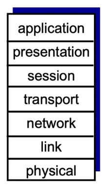
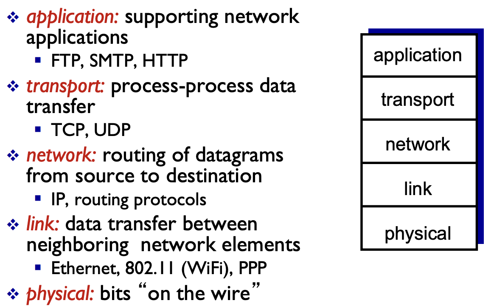


본 내용은 컴퓨터 네트워크 - 하향식 접근 책을 바탕으로 정리하였습니다.

## <strong>protocol layers, service models</strong>

### <strong>1. ISO/OSI reference model</strong>

1. application

네트워크 애플리케이션과 애플리케이션 계층 프로토콜이 있음. (HTTP, FTP, SMTP)

{: start="2"}
2. presentation

통신하는 애플리케이션들이 교환되는 데이터의 의미를 해석하도록 하는 서비스 제공.

{: start="3"}
3. session

데이터 교환의 경계와 동기화는 제공.

{: start="4"}
4. transport

클라이언트와 서버 간에 애플리케이션 계층 메시지를 전송하는 서비스 제공. (TCP, UDP)

{: start="5"}
5. network

한 호스트에서 다른 호스트로 데이터그램(datagram)을 라우팅을 책임짐. (IP, routing protocols)

{: start="6"}
6. link

출발지와 목적지 간 일련의 패킷 스위치(라우터)를 통해 데이터그램을 라우트함. (Ethernet, 802.11)

{: start="7"}
7. physical - 프레임 내부의 각 비트를 한 노드에서 다음 노트로 이동시킴.

### <strong>2. Internet protocol stack</strong>

Internet protocol stack 에서는 2번 presentation과 3번 session 계층을 뺀 5 계층으로 구성된다.

## <strong>History</strong>

인터넷을 최초로 만든 Cerf와 Kahn의 원칙

1. 간결화

{: start="2"}
2. 자율성

{: start="3"}
3. 탈 중앙화

{: start="4"}
4. 무상태의 프로토콜

