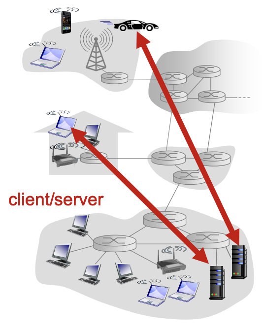
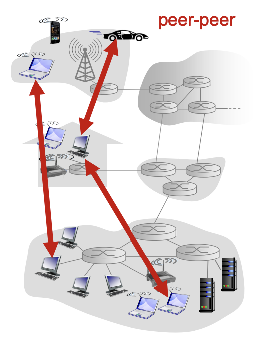
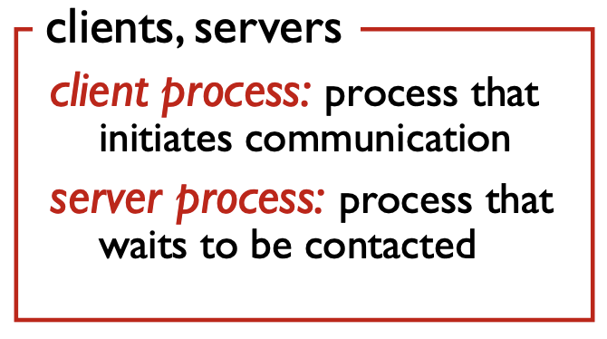
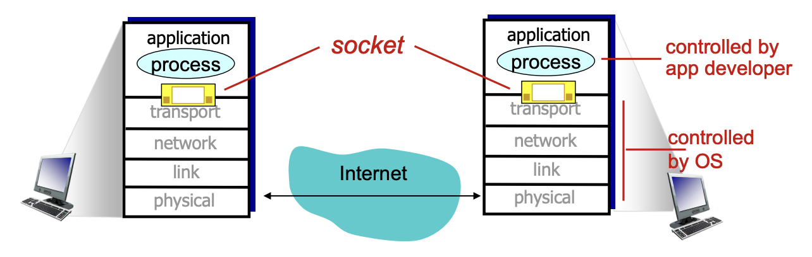
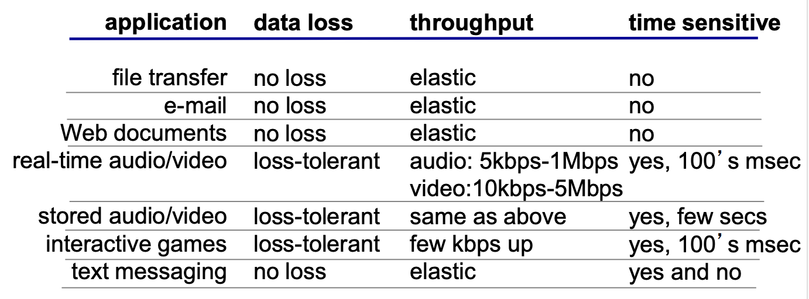
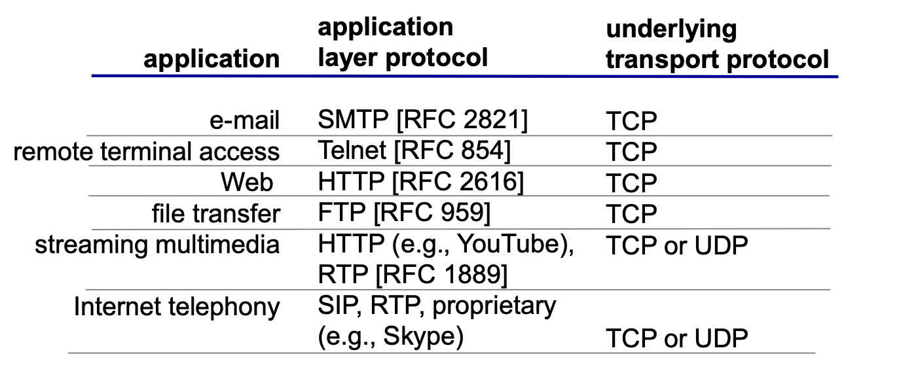


본 내용은 컴퓨터 네트워크 - 하향식 접근 책을 바탕으로 정리하였습니다.

## <strong>Principles of network applications</strong>

### <strong>1. 애플리케이션 구조</strong>

클라이언트-서버 구조(client-server architecture)

- server
  - 항상 켜져 있는 호스트
  - 고정 IP 주소를 통해 클라이언트가 접속함.
  - 하나의 서버 호스트가 모든 요청에 응답하는 건 불가능하므로 많은 수의 호스트를 갖춘 데이터 센터(data center)를 흔히 사용함. (data center for scaling)server
- client
  - 항상 켜져 있지 않아도 됨.
  - IP 주소가 바껴도 상관 없음.
  - 클라이언트끼리 직접 통신하지 않음.

### <strong>2. P2P 구조</strong>

P2P 구조(peer-to-peer, P2P)

- 특정 서버를 통하지 않고, 피어(peer)라는 간헐적으로 연결된 호스트 쌍이 서로 직접 통신하게 한다.
- 자가 확장성(self scalability): 예를 들어, P2P 파일 공유 애플리케이션에서 각 피어들이 파일을 요구함. 각 피어들은 파일을 다른 피어들에게 분배함으로써 그 시스템에 서비스 능력을 추가함.
- 고도의 분산 구조 특성으로 인해 보안, 성능, 신뢰성은 큰일..

### <strong>3. 프로세스 간 통신</strong>

프로세스(process): end system에서 실행되는 프로그램

동일한 호스트에서 프로세스가 여러 개 돌 수 있는데, 걔네끼리 통신하는 걸 IPC(inter-process communication)라고 함.

다른 호스트의 프로세스끼리는 메세지를 주고 받으면서 이루어짐!

### <strong>4. 소켓</strong>

소켓(sochet)

- 프로세스가 집이면 소켓은 출입구로 비유됨. 프로세스가 메시지를 다른 호스트의 프로세스로 보내고 싶을 때, 출입구(소켓) 바깥 네트워크로 메시지를 밀어넣음.

### <strong>5. 프로세스 주소 배정</strong>

수신 프로세스 식별을 위해 명시돼야 할 두 가지 정보 (1) 호스트의 주소 (2) 목적지 호스트 내의 수신 프로세스를 명시하는 식별자

(1) 호스트의 주소는 IP 주소이다. (IPv4는 32비트)

(2) 식벽자를 목적지 포트 번호(port number)가 사용된다. (포트 번호는 16비트)

### <strong>6. 애플리케이션 레이어 프로토콜</strong>

애플리케이션 레이어 프로토콜엔 다음과 같은 내용이 정의되어 있다.

- 메세지 교환의 타입
  - request, response
- 메세지 구문
- 메세지 의미
- 규칙
  - 언제 어떻게 주고받을지
- open protocols (표준)
  - RFC(Request for Comments)
  - HTTP, SMTP
- Skype: 인터넷 전화에 사용되는 독점 프로토콜

### <strong>7. 애플리케이션이 이용 가능한 트랜스포트 서비스</strong>

1. 신뢰적 데이터 전송(data integrity)

- 전자메일, 파일 전송, 원격 호스트 접속, 웹 문서 전송 등과 같은 애플리케이션의 경우 데이터 손실을 위험함!
- 따라서 신뢰적 데이터 전송은 중요함.
- 손실 허용 애플리케이션(loss-tolerant application): 어느 정도의 데이터 손실을 참아낼 수 있는 실시간 오디오/비디오 혹은 저장 오디오/비디오와 같은 멀티미디어 애플리케이션. 이들에겐 품질에 약간의 영향을 미칠 수 있음.

{: start="2"}
2. 처리량(throughput)

- 애플리케이션은 r bits/sec의 보장된 처리율을 요구할 수 있음. 이런 처리율 요구 사항을 갖는 애플리케이션은 대역폭 민감 애플리케이션(bandwidth-sensitive application)이라고 함.
- 탄력적 애플리케이션(elastic application): 전자메일, 파일 전송, 웹 전송과 같은 융통성 있는 애플리케이션

{: start="3"}
3. 시간(timing)

- 송신자가 내보내는 모든 비트가 수신자의 소켓에 100 msec 내에 도착하도록 하는 것.
- 인터넷 전화, 가상 환경, 원격회의, 다자간 게임 같은 상호 작용 실시간 애플리케이션에서 중요함.

{: start="4"}
4. 보안(security)

- 송신 프로세스가 전송하는 모든 데이터를 암호화할 수 있고, 수신 호스트에서 트랜스포트 프로토콜은 그 데이터를 수신 프로세스로 전달하기 전에 데이터의 암호를 해독할 수 있음.

### <strong>8. 인터넷 전송 프로토콜이 제공하는 서비스</strong>

TCP(Transmiccion Control Protocol) 서비스

- 송수신자 간의 신뢰적인 전송
- 흐름 제어: 네트워크가 혼잡 상태에 이르면 프로세스 속도를 낮춤
- 데이터 보전 (시간, 처리량, 보안은 제공 X)
- 서버 - 클라이언트 간 연결 설정 단계를 거침(3-Way Handshake)

UDP(User Datagram Protocol) 서비스

- 비신뢰적인 데이터 전송
- 흐름 제어, 시간, 처리량, 보안 등 전부 제공 X

### <strong>9. 각 프로토콜의 범용성</strong>

### <strong>10. 보안 TCP</strong>

TCP, UDP는 모두 함호화를 제공하지 않는다.

SSL(Secure Sockets Layer): TCP의 역할을 모두 하고 암호화, 데이터 무결성, 종단 인증을 포함한 프로토콜이다.

- 애플리케이션 계층에서 구현된 것으로, SSL 서비스를 이용하고자 하면 인증키를 가지고 해독해야함.

