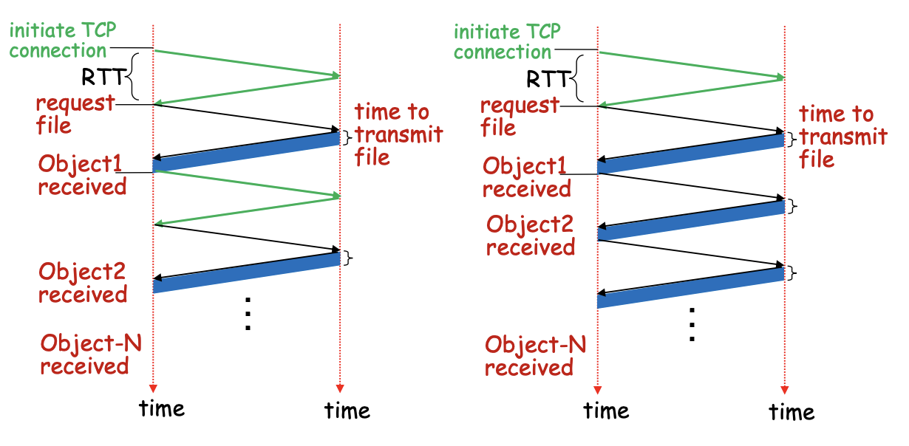
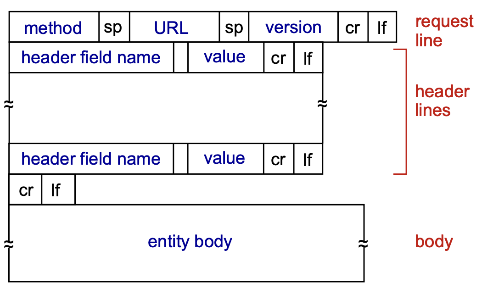
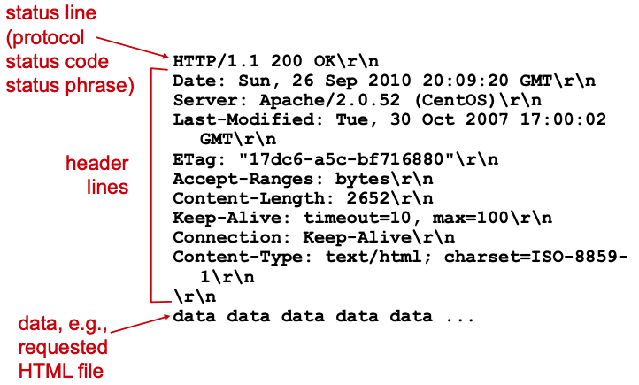
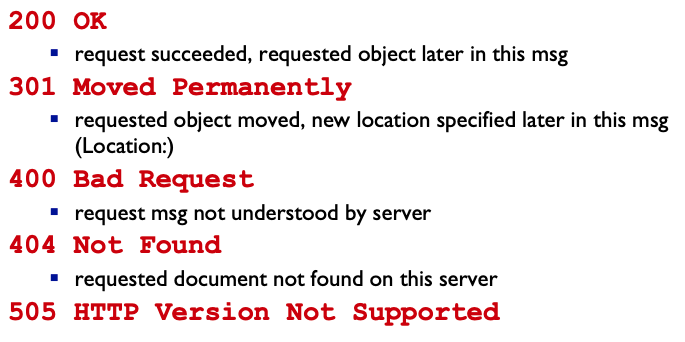
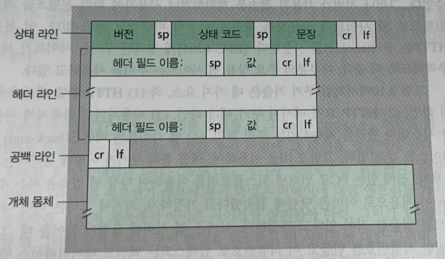
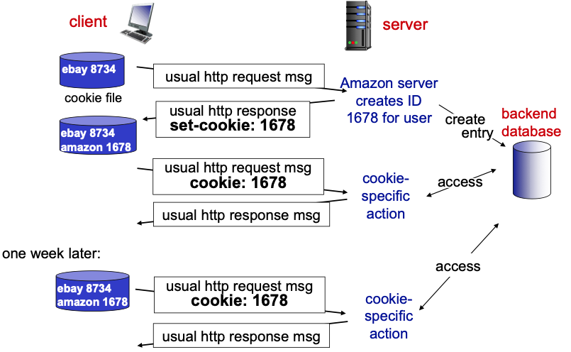
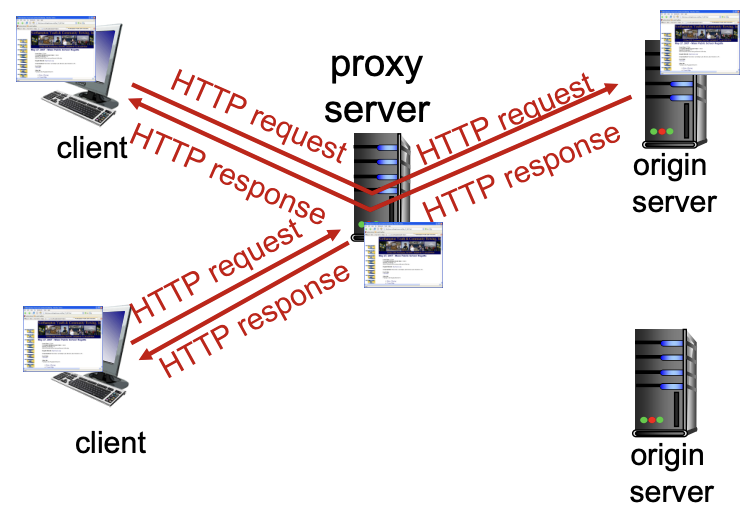


본 내용은 컴퓨터 네트워크 - 하향식 접근 책을 바탕으로 정리하였습니다.

## <strong>Web and HTTP</strong>

### <strong>1. HTTP 개요</strong>

HTTP: hypertext transfer protocol

- 웹의 애플리케이션 계층 프로토콜
- HTTP는 클라이언트 프로그램과 서버 프로그램으로 구현됨.

HTTP는 TCP를 전송 프로토콜로 사용한다.

- 클라이언트가 서버에세 TCP 연결 요청
- 서버는 요청을 수락
- HTTP 메세지가 브라우저(HTTP 클라이언트)와 웹 서버(HTTP 서버) 사이에서 교환
- TCP 연결 종료

HTTP는 stateless

- 서버가 클라이언트에게 요청 파일을 보낼 때, 서버는 클라이언트에 관한 어더한 상태 정보고 저장하지 않음.

### <strong>2. HTTP 연결</strong>

RTT(round trip time): 작은 패킷이 클라이언트로부터 서버까지 가고, 다시 클라이언트로 되돌아오는 데 걸리는 시간

non-persistent HTTP

- 비지속 연결
- 서버가 객체를 보낸 수에 각 TCP 연결이 끊어짐.(다른 객체를 위해 유지되지 않음)
- (2RTT + 파일 전송 시간) * N 을 필요로 함(TCP 연결 설정에 1 RTT + 객체를 요청하고 받는 데 1 RTT + file transmission time)

persistent HTTP

- 지속 연결
- 서버가 응답을 보낸 후에 TCP 연결을 그대로 유지함.
- 같은 서버에 있는 여러 웹 페이지들은 하나의 지속 연결을 통해 보낼 수 있음.
- RTT + (RTT + file transmission time) * N

### <strong>3. HTTP 요청 메시지</strong>

- 메시지가 일반 ASCII 텍스트로 쓰여 있어 사람들이 읽을 수 있음.
- 각 줄은 CR과 LF(carriage reture & line feed)로 구별됨.
- HTTP 요청 메시지의 첫 줄은 요청 라인(request line)이라 부르고 이 후 줄들은 헤더 라인(header line)이라고 부름.
  - 요청 라인은 3개의 필드, 방식(method), URL, HTTP 버전
  - 헤더 라인은 객체가 존재하는 호스트를 명시

### <strong>4. HTTP 응답 메시지</strong>

- 상태 라인, 헤더 라인, 개체 몸체(entity body)로 나뉨.
  - 상태 라인은 3개의 필드, 프로토콜 버전 필드, 상태 코드, 해당 상태 메시지로 이루어짐.
  - 개체 몸체는 요청 객체를 포함함.

### <strong>5. 사용자와 서버 간의 상호작용: 쿠키</strong>

HTTP 서버는 상태를 유지하지 않아 사이트가 사용자를 추적할 수 있도록 해주는 쿠키(cookie)를 사용한다.

위 사진에서 볼 수 있듯이 쿠키 기술은 4가지 요소를 가지고 있다.

- HTTP 응답 메시지 쿠키 헤더 라인
- HTTP 요청 메시지 쿠키 헤더 라인
- 사용자의 브라우저에 사용자 end system과 관리를 지속시키는 쿠키 파일
- 웹 사이트의 백엔드 데이터 베이스

state를 유지하는 법

- 프로토콜 엔드포인트: 여러 트랜잭션에 대해 송수신자의 상태 유지
- 쿠키: http 메시지가 상태 운반

쿠키와 프라이버시

- 쿠키는 사이트가 사용자에 대해 많은 것을 알 수 있게 하고, 사이트에 이름과 이메일을 제공할 수 있음.

### <strong>6. 웹 캐싱</strong>

웹 캐시(Web cache; 프록시 서버(proxy server)): 웹 서버를 대신하여 HTTP 요구를 충족시키는 네트워크 개체. 자체의 저장 디스크를 갖고 있어 최근 호출된 객체의 사본을 저장 및 보존함.

1. 브라우저는 웹 캐시와 TCP 연결을 설정하고 웹 캐시에 있는 객체에 대한 HTTP에 대한 요청을 보낸다.

{: start="2"}
2. 웹 캐시는 객체의 사본이 저장되어 있는지 확인하고, 저장되어 있다면 클라이언트 브라우저로 HTTP 응답 메시지와 함게 객체를 전송한다.

{: start="3"}
3. 만약 웹 캐시가 객체를 가지고 있지 않다면, 웹 캐시는 원출처의 서버로 TCP 연결을 설정한다. 그리고 웹 캐시는 캐시와 서버 간의 TCP 연결로 객체에 대한 HTTP 요청을 보낸다. 서버는 웹 캐시로 HTTP 응답 메시지와 함께 객체를 보낸다.

{: start="4"}
4. 웹 캐시가 객체를 수신할 때, 객체를 local 저장장치에 복사하고 클라이언트 브라우저에 HTTP 응답 메시지와 함께 객체의 사본을 보낸다.

일반적으로 웹 캐시는 ISP가 구입하고 설치한다.

웹 캐시를 사용하는 이유

- 클라이언트의 요구에 대한 응답 시간을 줄일 수 있다.
  - 특히 클라이언트와 원출처 서버 사이의 병목 대역폭이 클라이언트와 캐시 사이의 병목 대역폭에 비해 매우 작을 때 더 효과적
- 한 기관에서 인터넷으로 접속하는 링크상의 웹 트래픽을 대폭으로 줄일 수 있다.

예시

평균 객체의 크기가 1 Mbit이고 기관 브라우저로부터 원출처 서버에 대한 평균 요청비율이 15/sec, 인터넷 부분의 라우터가 HTTP 요청을 전달하고 응답을 받을 때까지 평균 소요 시간이 2초라고 가정.

- 총 응답 시간은 LAN 지연과 접속 지연, 인터넷 지연의 합과 같다.
  - LAN의 트래픽 강도: (15요청/초) * (1 Mbit/요청) / (100 Mbps) = 0.15
  - 접속 회선의 트래픽 강도: (15요청/초) * (1 Mbit/요청) / (15 Mbps) = 1
  - 일반적으로 LAN의 트래픽 강도 0.15는 많아야 수십msec의 지연을 야기하므로 LAN 지연은 무시할 수 있다.
  - 그러나 트래픽 강도가 1에 가까워지면 회선의 지연은 매우 커지고 한없이 증가한다.
  - 아아잘모르겟다 공부하고다시정리

### <strong>7. 조건부 GET</strong>

웹 캐싱이 응답 시간을 줄일 수 있지만, 캐시 내부에 있는 객체의 복사본이 새것이 아닐 수 있다는 새로운 문제를 야기한다!!!

조건부 GET(conditional GET): HTTP가 모든 객체들이 최신의 것임을 확인하면서 캐싱하는 방식

- IF-Modified-Since: 헤더 라인을 포함하고 있다면 그것은 조건부 GET 메시지!
- 동작 방식
  - 브라우저의 요청을 대신해 프록시 캐시는 요청 메시지를 웹 서버로 보낸다.
  - 웹 서버는 캐시에게 객체를 가진 응답 메시지를 보낸다.
  - 캐시는 요청하는 브라우저에게 객체를 보내 주고 자신에게도 객체를 저장한다. 근데!! 여기서 캐시가 객체와 마지막으로 수정된 날짜를 함께 저장한다!
  - 일주일 후에 다른 브라우저가 같은 객체를 캐시에게 요청하면, 브라우저는 조건부 GET으로 갱신 조사를 수행한다.
  - IF-Modified-Since: 헤어 라인의 값이 전에 서버가 보냈던 Last-Modified: 헤더 라인의 값과 정확히 일치하며, 이 조건부 GET은 서버에게 그 객체가 명시된 날짜 이후에 수정된 경우에만 그 객체를 보내라는 뜻!
  - 변경되지 않았다면 웹 서버를 클라이언트에세 Not Modified 라는 메시지를 담은 응답 메시지를 보낸다!

