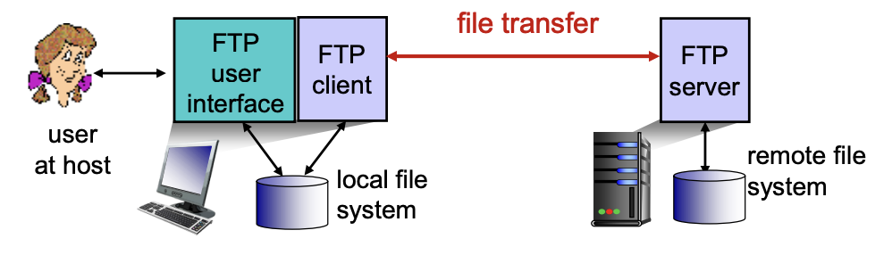
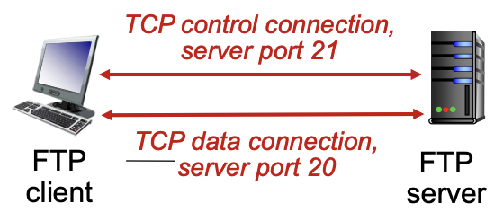
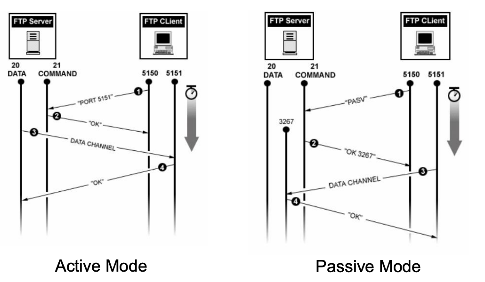
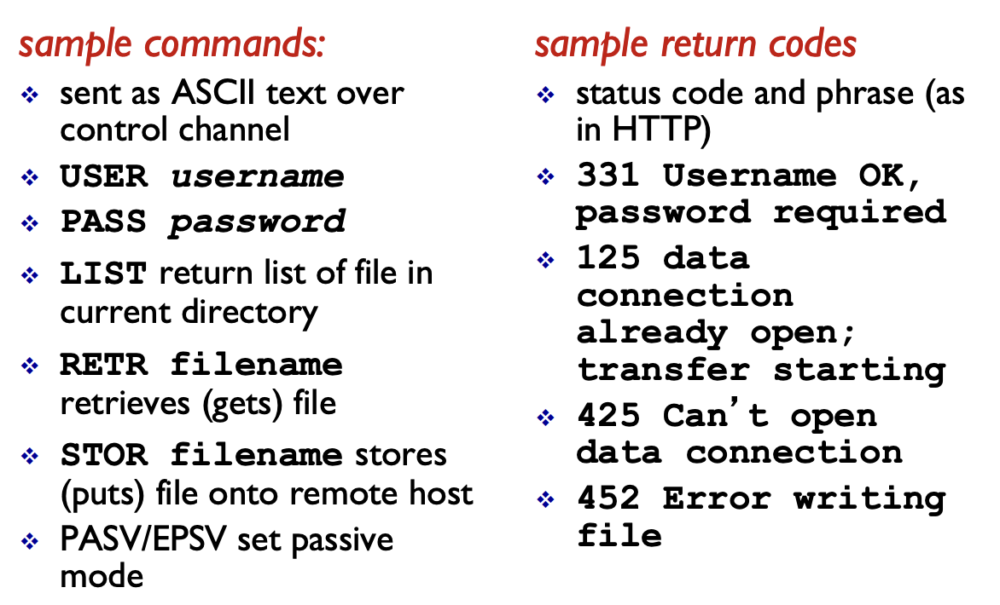
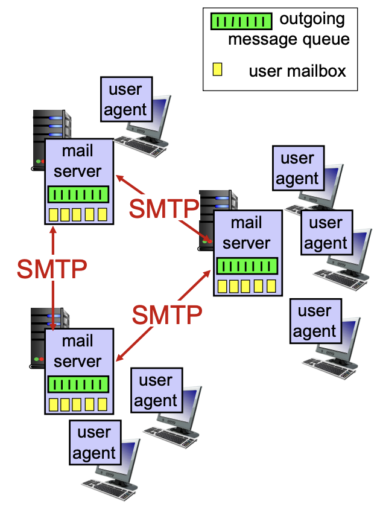
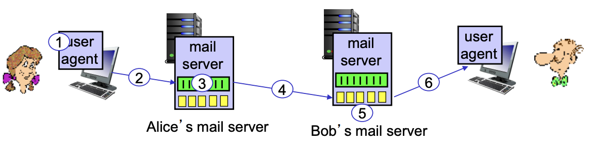
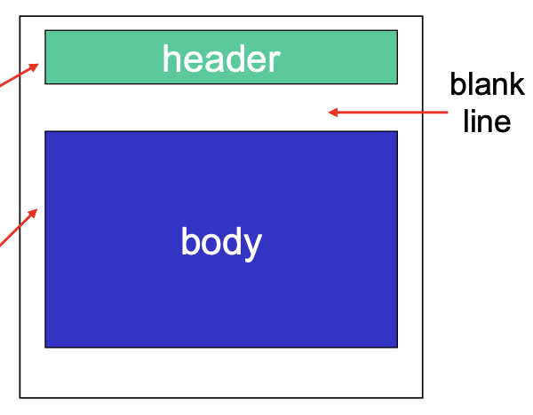
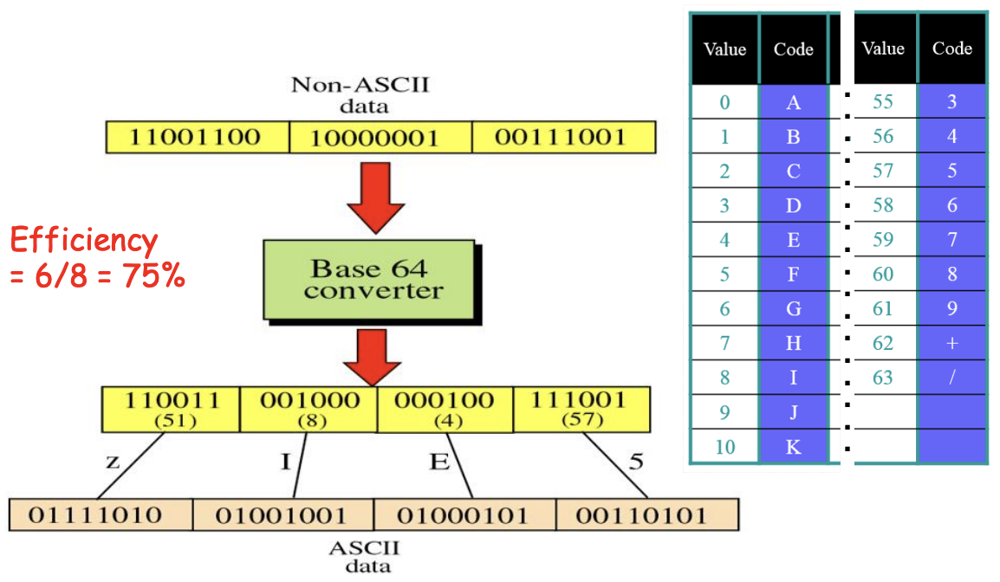


본 내용은 컴퓨터 네트워크 - 하향식 접근 책을 바탕으로 정리하였습니다.

## <strong>FTP</strong>

### <strong>1. FTP: the file transfer protocol</strong>

FTP: TCP로 동작하는 파일을 주고받기 위한 프로토콜

### <strong>2. FTP 제어와 데이터 연결의 분리</strong>

TCP는 제어 연결을 위해 21번 포트를 사용하고, 데이터 전송을 위해 20번 포트를 사용한다.

- 클라이언트가 제어 연결을 통해 커맨드를 전송한다.
- 서버가 파일 전송 커맨드를 받으면 클라이언트에 2번째 TCP 데이터 연결을 연다.
- 하나의 파일 전송이 끝나고 나면, 서버는 제어 연결을 닫는다.

이러한 FTP의 제어 연결을 out of band라고 하는데, 기존 제어 포트에서 벗어났다고 말한다!

FTP 서버는 state를 유지한다. (현재 디렉토리 - 사용자가 어느 폴더에 있는지, 이전에 완료된 인증 - 사용자 로그인 정보 를 다 기억함!)

### <strong>3. FTP: Active Mode vs Passive Mode</strong>

Active Mode

- 서버 입장에서 active 하다 -&gt; 서버가 모든 걸 한다 -&gt; 클라이언트가 데이터 포트를 열어두고 기다림

Passive Mode

- 클라이언트가 패시브 명령을 주면 서버가 포트를 열어 데이터를 주고받는 방식

### <strong>4. FTP commands, response</strong>

## <strong>electronic mail</strong>

### <strong>1. electronic mail</strong>

기본 컴포넌트

- user agents
- mail servers
- SMTP(simple mail transfer protocol)

### <strong>2. User Agent</strong>

- mail reader
- composing, editing, reading mail messages 가능
- 발신,수신 메세지가 서버에 저장됨.

### <strong>3. mail servers</strong>

- mailbox: 유저에게 오는 메일들을 저장 (100명이면 100박스)
- message queue: 유저가 메일을 보낼 때 전송이 되도록 기다리는 공간
- SMTP protocol: 보내는 서버와 받는 서버 간의 프로토콜

### <strong>4. SMTP</strong>

클라이언트와 서버 간에 신뢰성 있는 메일 교환을 위해 TCP를 사용한다. (25포트)

메일 교환은 3가지 단계를 거친다

- handshaking (greeting)
- 메세지 주고받기
- closure (종료)

command는 ASCII text이고, response는 상태 코드이다.

메시지는 반드시!!! 7비트 아스키코드로 이루어져야 함!!

1. 엘리스는 유저에이전트를 써서 메일 서버에 접속! bob@someschool.edu로 메일을 보내려고 함
2. 엘리스의 유저에이전트가 메일 서버에 메일을 보냄 → 메세지가 메세지 큐로 들어감
3. SMTP로 밥의 메일 서버와 TCP 연결을 함!
4. SMTP 클라이언트는 엘리스의 메세지를 TCP 연결을 통해 보냄
5. 밥의 메일 서버는 밥의 메일 박스에 메세지를 넣음
6. 밥이 유저 에이전트를 사용해서 메세지를 읽음

SMTP는 지속성 있는 연결을 한다.

메세지의 끝을 결정하기 위해 CRLF.CRLF 을 사용한다.

HTTP와 비교 했을 때!

- HTTP는 뭔가를 인터넷에서 땡겨옴(pull). 반면에 SMTP는 보냄(push)!
- 둘 다 ASCII command/response interaction, status codes
- HTTP의 각각의 객체들은 메세지 안에 캡슐화 되어있음.
- SMTP는 여러 객체들을 multipart로 보냄.

### <strong>5. Mail message format</strong>

헤더 라인에 있어야 하는 것

- To:
- From:
- Subject:

body에는 메시지(아스키)가 있다! (MIME: 이메일과 웹에서 사용되는 파일의 형식과 성격을 나타내는 표준)

### <strong>6. MIME(Multipurpose Internet Mail Extensions)</strong>


