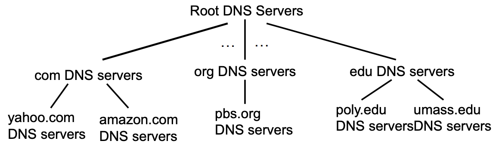
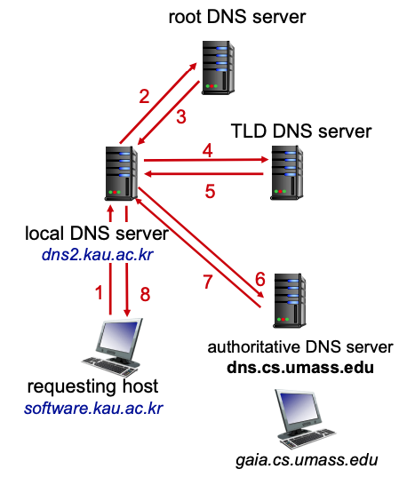
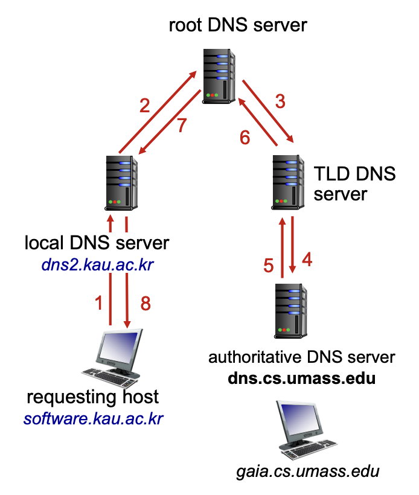
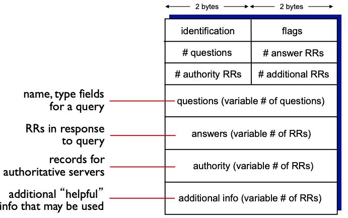


본 내용은 컴퓨터 네트워크 - 하향식 접근 책을 바탕으로 정리하였습니다.

## <strong>DNS</strong>

### <strong>1. DNS: domain name system</strong>

인터넷 호스트에 대한 식별자

- 호스트 네임(hostname)
- IP 주소

 DNS (domain name system)

- DNS 서버들의 계층구조로 구현된 분산 데이터베이스 (세계 곳곳에 분산해서 갖고 있음)
- 호스트가 분산 데이터베이스로 질의하도록 허락하는 애플리케이션 계층 프로토콜

### <strong>2. DNS가 제공하는 서비스</strong>

- host name을 IP 주소로 변환
- 호스트 엘리어싱(host aliasing)
  - 복잡한 호스트 네임(정식 호스트 네임)을 가진 호스트는 하나 이상의 별명을 가질 수 있음.
  - DNS는 호스트의 IP 주소뿐만 아니라 제시한 별칭 호스트 네임에 대한 정식 호스트 네임을 얻기 위해 이용됨.
- 메일 서버 엘리어싱(mail server aliasing)
  - 호스트의 IP 주소뿐만 아니라 제공된 별칭 호스트 네임에 대한 정식 호스트 네임을 얻기 위해 수행됨.
- 부하 분산(load distribution)
  - 중복 웹 서버의 경우, 여러 IP 주소가 하나의 정식 호스트 네임과 연관되어 있고, DNS 데이터베이스는 이 IP 주소 집합을 갖고 있음.
  - 클라이언트가 주소 집합으로 매핑하는 호스트 네임에 대한 DNS 질의를 하면, 서버는 IP 주소를 순환식으로 보냄. -&gt; 트래픽 분산!

분산하는 이유

- 서버의 고장: 이 네임 서버가 고장나면 전체 인터넷이 작동하지 않음
- 트래픽 양: 단일 DNS 서버가 모든 DNS 질의를 처리해야 함
- 먼 거리의 중앙 집중 데이터베이스: 단일 서버를 뉴욕에 둔다면, 호주로부터의 모든 질의는 느리고 혼잡한 링크를 거쳐 지구 반대편까지 여행해야 함. -&gt; 심각한 지연!
- 유지관리: 단일 네임 서버는 모든 인터넷 호스트에 대한 레코드를 유지해야 함. 이 중앙 집중 데이터베이스는 거대해지고 모든 새로운 호스트를 반하기 위해 자주 갱신해야 함.
- 결론적으로 확장성이 전혀 없음!

### <strong>3. 분산 계층 데이터베이스</strong>

- 루트 DNS 서버
- 최상위 레벨 도메인 네임(TLD, top-level domain) DNS 서버
  - 책임 DNS 서버들에 대한 IP 주소들 제공
- 책임(authoritative) DNS 서버
  - 대학이나 큰 기업들에 있음(또는 ISP)

어떤 DNS 클라이언트가 호스트 네임 [www.amazon.com 의](http://www.amazon.com의) IP 주소를 결정하길 원한다고 가정

- 루트 서버 중 하나에 접속
- 루트 서버는 최상위 레벨 도메인 com을 갖는 TLD 서버에 IP 주소를 보냄
- 클라이언트는 이 TLD 서버 중 하나에 접속하고, 서버는 도메인 amazom.com을 가진 책임 서버의 IP 주소를 보냄
- 클라이언트는 amazon.com의 책임 서버 중 하나로 접속
- 서버는 www.amazon.com의 IP 주소를 보냄

### <strong>4. local DNS name server</strong>

- 계층 구조에 속하지는 않지만, DNS 구조의 중심에 있다.
- ISP들은 로컬 DNS 서버를 가진다. 호스트가 ISP에 연결될 때, 그 ISP는 로컬 DNS 서버로부터 IP 주소를 호스트에게 제공한다.

### <strong>5. 반복적 질의(iterated query)</strong>

- 호스트 software.kau.ac.kr가 gaia.cs.umass.edu의 IP 주소를 원한다고 가정하자.
  1. 호스트가 먼저 자신의 로컬 DNS 서버 dns2.kau.ac.kr에게 DNS 질의 메시지를 보낸다.
  2. 로컬 DNS 서버는 질의 메시지를 루트 DNS 서버에 전달한다.
  3. 루트 DNS는 edu를 인식하고 edu에 대한 책임을 가진 TLD 서버의 IP 주소 지스트를 로컬 DNS 서버에 보낸다.
  4. 로컬 DNS 서버는 질의 메시지를 TLD 서버로 보낸다.
  5. TLD 서버는 umass.edu를 인식하고 dns.umass.edu로 이름 지어진 책인 DNS로 질의 메시지를 다시 보내고, gaia.cs.umass.edu의 IP 주소로 응답한다.

### <strong>6. 재귀적 질의(recursive query)</strong>

- root DNS server가 알아서 저리하고 local DNS server에 알려준다.
  - 단점은 서버가 끝날 때까지 자원을 가지고 있어야 하기 때문에 쿼리가 한꺼번에 몰리면 취약함!

### <strong>7. DNS 캐싱</strong>

질의 사슬에서 DNS 서버가 DNS 응답을 받았을 때, 로컬 메모리에 응답에 대한 정보를 저장한다.

- 호스트 네임과 IP 주소 쌍이 DNS 서버에 저장되고, 다른 호스트 네임으로부터 같은 질의가 DNS 서버로 도착한다면, DNS 서버는 호스트 네임에 대한 책임이 없어도 원하는 IP 주소 제공 가능!
- 영구적인 것이 아니므로 DNS 서버는 어떤 기간(흔히 2일) 이후 저장된 정보를 제거함.

### <strong>8. DNS records</strong>

DNS 서버들은 호스트 네임을 IP 주소로 매핑하기 위한 자원 레코드(resource record, RR)를 저장한다.

각 DNS는 하나 이상의 자원 레코드를 가진 메시지도 응답한다.

자원 레코드는 (Name, Value, Type, TTL) 과 같은 필드를 포함하는 4개의 튜플로 되어 있다.

- Type=A -&gt; name = hostname, value = IP주소
- Type=NS -&gt; name = domain, value = 책임 DNS 서버의 hostname
- Type=CNAME -&gt; name = alias name, value = canonical name
- Type=MX -&gt; value = 메일 서버 name

### <strong>9. DNS 프로토콜, 메시지</strong>

쿼리와 응답 모두 같은 메시지 형식을 가진다.

- 메시지 헤더
  - identification: 질의를 식별하는 16비트 숫자, 응답 메시지에 복사되어 질의와 응답 간의 일치를 식별하게 함.
  - flags: 질의(0)인지 응담(1)인지 구별하는 책임 플래그
  - #이 붙은 것들: 개수
  - 실제 데이터

### <strong>10. DNS 공격</strong>

DDoS 공격: 대역폭 플러딩(flooding) 공격. 다량의 패킷을 각 DNS 루트 서버로 보내려는 등, 정상적인 많은 DNS 질의들이 응답을 받을 수 없게 됨.

Man-in-middle(중간자 공격): 공격자는 호스트로부터 질의를 가로채어 가짜 응답을 리턴함.

DNS poisoning(DNS 중독 공격): DNS 서버로 가짜 응답을 보내어, 그 서버가 자신의 캐시에 가짜 레코드를 받아들이도록 속임수를 씀.

