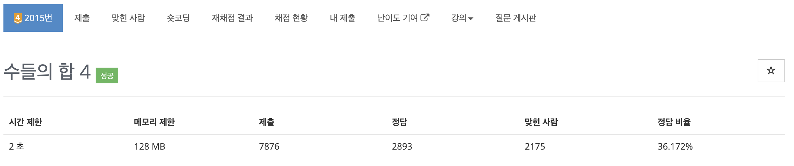


<https://www.acmicpc.net/problem/2015>



### <strong>문제</strong>

A[1], A[2], ..., A[N]의 N개의 정수가 저장되어 있는 배열이 있다. 이 배열 A의 부분합이란 1 ≤ i ≤ j ≤ N인 정수 i와 j에 대해 A[i]부터 A[j]까지의 합을 말한다.

N과 A[1], A[2], ..., A[N]이 주어졌을 때, 이러한 N×(N+1)/2개의 부분합 중 합이 K인 것이 몇 개나 있는지를 구하는 프로그램을 작성하시오.

### <strong>입력</strong>

첫째 줄에 정수 N과 K가 주어진다. (1 ≤ N ≤ 200,000, |K| ≤ 2,000,000,000) N과 K 사이에는 빈칸이 하나 있다. 둘째 줄에는 배열 A를 이루는 N개의 정수가 빈 칸을 사이에 두고 A[1], A[2], ..., A[N]의 순서로 주어진다. 주어지는 정수의 절댓값은 10,000을 넘지 않는다.

### <strong>출력</strong>

첫째 줄에 합이 K인 부분합의 개수를 출력한다.

---

### <strong>코드</strong>

```python
import sys
from collections import defaultdict

input = sys.stdin.readline

n, k = map(int, input().split())
arr = list(map(int, input().split()))

count = 0
prefix_sum = 0
prefix_count = defaultdict(int)
prefix_count[0] = 1

for a in arr:
    prefix_sum += a
    count += prefix_count[prefix_sum - k]
    prefix_count[prefix_sum] += 1

print(count)
```

### <strong>풀이</strong>

아이디어 - 누적합이 현재 값 - K였던 적이 있다면, 그때부터 지금까지의 합이 K! 을 해시맵으로 기억하면서 찾는다!

- count: 조건을 만족하는 부분합의 개수를 셀 변수
- prefix_sum: 현재까지의 누적합
- prefix_count: 누적합 값들이 몇 번 나왔는지를 저장하는 딕셔너리
  (예: prefix_sum이 3이었던 횟수를 저장)
- prefix_count[0] = 1: 누적합이 처음부터 K인 경우를 처리하기 위한 초기값
  (예: prefix_sum == K일 때, prefix_sum - K == 0을 맞추기 위해)

반복문

- 만약 prefix_sum == 10이고 k == 5라면,
  prefix_sum - k == 5
  → 이전에 prefix_sum == 5였던 순간이 몇 번 있었는지 찾는 것!

