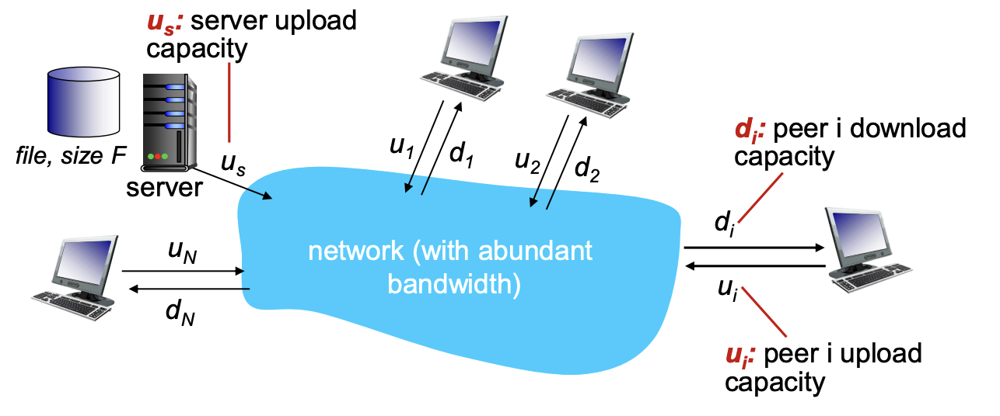
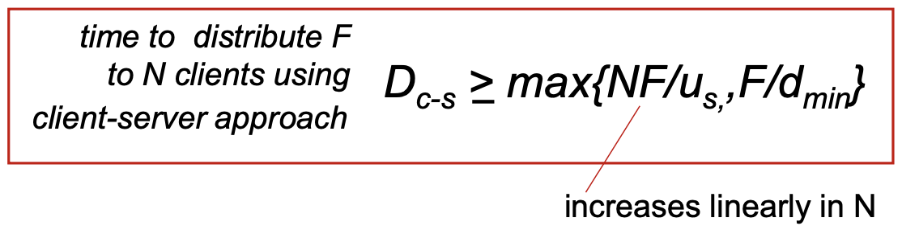
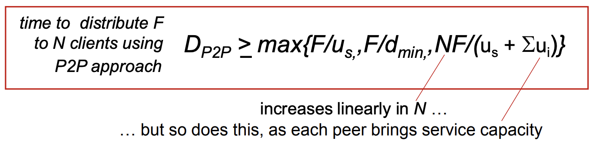
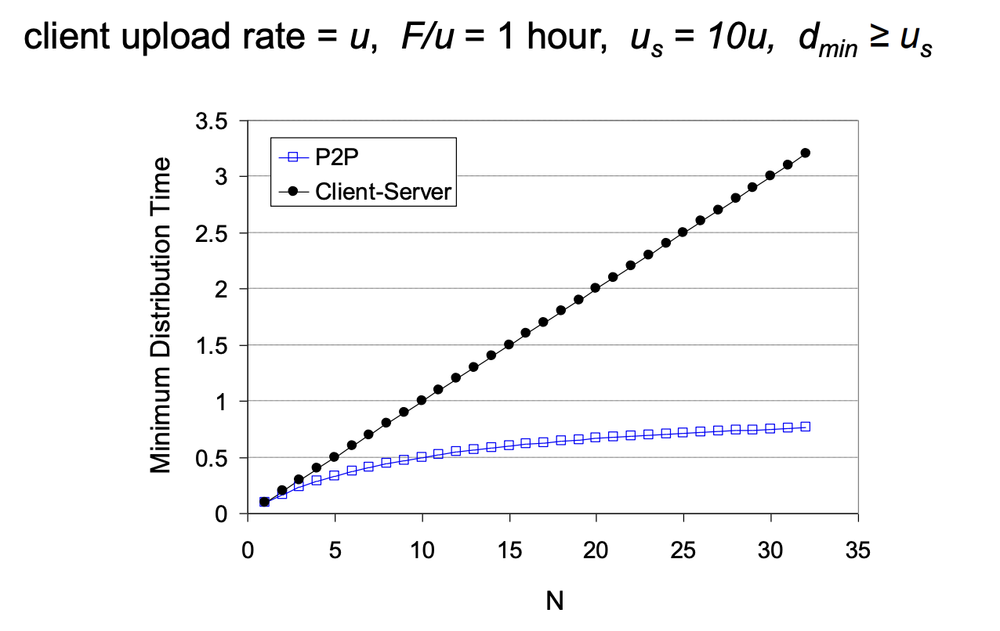
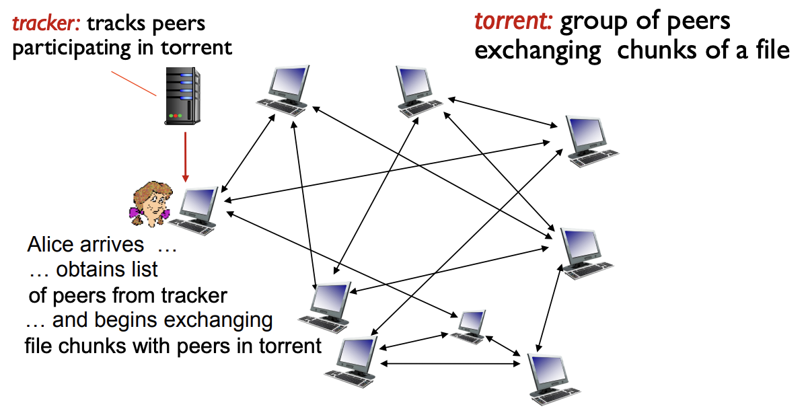


본 내용은 컴퓨터 네트워크 - 하향식 접근 책을 바탕으로 정리하였습니다.

## <strong>P2P applications</strong>

### <strong>1. Pure P2P architecture</strong>

P2P 구조: 피어(peer)라는 간헐적으로 연결된 호스트 쌍이 서로 직접 통신하는 방식.

- 피어는 서비스 제공자가 소유하지 않고, 사용자들이 제어하는 데스크톱과 랩톰임.
- 한 피어가 서버 역할을 하기도 하고, 클라이언트 역할을 하기도 함.

### <strong>2. File distribution: client-server vs P2P</strong>

- u_s: 서버의 접속 링크 업로드 속도
- u_i: i번째 피어의 접속 링크 업로드 속도
- d_i: i번째 피어의 접속 링크 다운로드 속도
- F: 분배되는 파일의 크기
- N​: 파일의 복사본을 얻고자 하는 피어들의 수

클라이언트-서버

- N개의 피어에게 업로드 속도 u_s로 파일을 분배하는 시간 -&gt; NF/u_s
- d_min이 가장 낮은 다운로드 속도를 가진 피어의 다운로드 속도를 나타낸다고 할 때, 최소 분배 시간 -&gt; F/d_min

P2P

- 서버만이 갖고있는 파일이 피어 커뮤니티에 도달할 수 있도록 하기 위해, 서버는 적어도 한 번 접속 링크로 파일의 각 비트를 보내야 함.
  - 최소 분배 시간 -&gt; F/u_s
- 클라이언트-서버 구조와 마찬가지고 최소 분배 시간 -&gt; F/d_min
- 시스템의 전체 업로드 용량 = 서버의 업로드 속도 + 각 피어들의 업로드 속도
  - NF/(u_s + u_1 + ... + u_N)

F/u = 1, u_s = 10u, d_min &gt;= u_s 로 설정하면

클라이언트-서버 구조 -&gt; NF/u_s = N/10

P2P 구조 -&gt; NF/(u_s + u_1 + ... + u_N) = N/10+N

### <strong>3. BitTorrent</strong>

BitTorrent: 파일 분배를 위한 인기 있는 P2P 프로토콜

- 토렌트(torrent): 특정 파일의 분배에 참여하는 모든 피어들의 모임
- 청크(chunk): 토렌트에 참여하는 피어들이 서로에게서 같은 크기의 청크를 다운로드함.
- 트랙커(tracker): 각 토렌트는 트랙커라고 부르는 기반구조 노드를 갖고 있음. 각 피어가 토렌트에 가입할 때 트랙커에 자신을 등록하고 주기적으로 토렌트에 있음을 알림으로써, 트랙커는 토렌트에 참여하는 피어들을 추적함.
- 과정
  - 새로운 피어 A가 토렌트에 가입할 때 트렉커는 참여하고 있는 피어 집합에서 임의로 피어들의 부분 집합을 선택하여 이들 피어들의 IP 주소를 A에게 보냄.
  - 이 피어들의 리스트를 얻고 나서, A는 이 리스트에 있는 모든 피어들과 동시에 TCP연결을 설정함. 성공적으로 TCP 연결을 설정한 모든 피어들을 "이웃 피어"라고 함.
  - A는 이웃 피어들에게 그들이 갖고 있는 청크 리스트를 요구하고 주고 받음.
- 어떤 청크를 요구할 것인가?
  - 가장 드문 것 먼저(rarest first) - 이웃들 중에 가장 적은 반복 복사본을 가진 청크. -&gt; 가장 드문 청크들은 더 빨리 재분배 될 수 있음!
- selfishly, altruistically
  - selfishly: 한 피어가 전체 파일을 얻으면 토렌트를 (이기적으로) 떠남.
  - altruistically: (이타적으로) 토렌트에 남아서 다른 피어들로 청크를 계속해서 업로드 함.
- unchocked, optimistically unchocked
  - A가 비트를 수신하는 속도를 측정하고 가장 빠르게 전송(highest rate)하는 4개의 피어들을 결정함. 그리고 나서 A는 4개의 피어들에게 청크를 보냄. 매 10초마다 재계산해서 4개의 피어 집합을 수정함.
  - 이 4개의 피어들을 활성화(unchocked)라고 함!
  - 30초마다 임의로 하나의 피어를 추가로 선택해 그것에게 청크를 보냄. 이렇게 선택된 피어를 낙관적으로 활성화(optimistically unchocked)되었다고 함!
- tit-for-tat
  - "가는 말이 고와야 오는 말이 곱다!" 라는 말과 같음!
  - 위에 적은 교역을 위한 보상 방식

