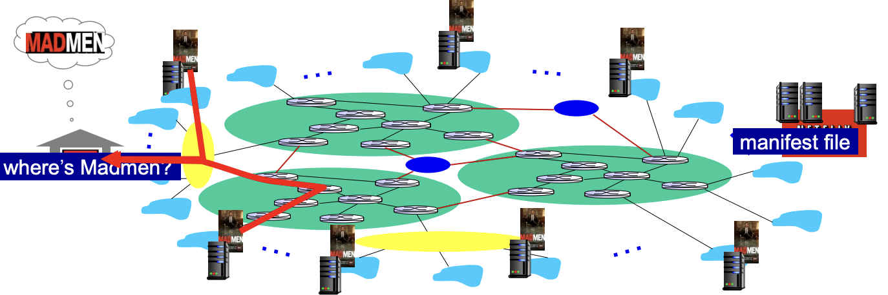
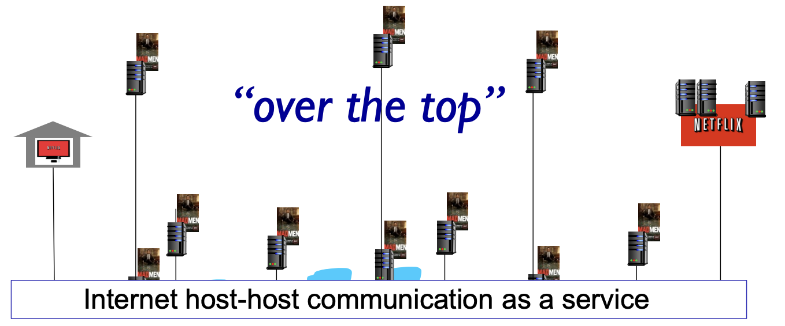
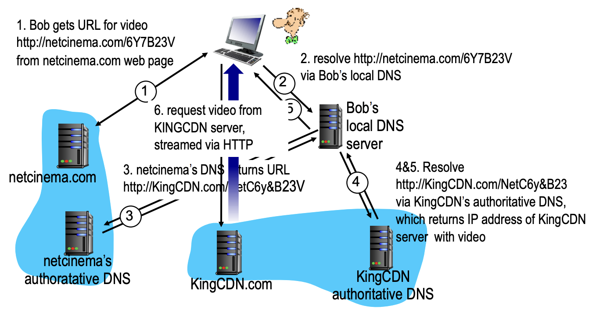
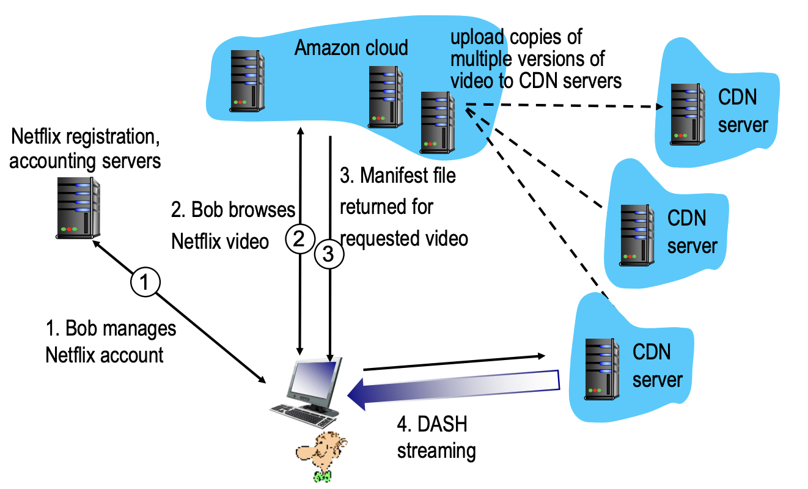


본 내용은 컴퓨터 네트워크 - 하향식 접근 책을 바탕으로 정리하였습니다.

## <strong>video streaming</strong>

### <strong>1. 인터넷 비디오</strong>

Video = 이미지들의 연속

- 영상은 짧은 시간 간격으로 여러 이미지(프레임)를 보여주는 것
- 영화는 보통 1초에 24장(프레임)의 이미지를 보여줌 -&gt; 24 fps

디지털 이미지

- 디지털 영상 속의 각 프레임은 픽셀(pixel)로 이루어져 있음.
- true color: RGB 각각 8비트씩 해서 24비트로 색깔을 표현함.

Coding (압축/인코딩)

- Spatical Redundancy (공간적 중복)
  - 한 이미지 내에서 비슷한 부분이 많을 경우
  - 비슷한 픽셀들을 압축해서 저장
- Temporal Redundancy (시간적 중복)
  - 연속된 이미지(프레임)들 사이에 비슷한 부분이 있을 경우 (ex. 움직이지 않는 배경)
  - 이전 프레임과 비교해서 변화된 부분만 저장

비디오 인코딩 방식: CBR vs VBR

- CBR (Coonstant Bit Rate) - 고정 비트레이트
  - 항상 동일한 속도로 인코딩됨
  - 장점: 네트워크 전송 시 예측이 쉬움
  - 단점: 복잡한 장면에서도 동일한 비트레이트 사용 -&gt; 화질 손실 가능성
- VBR (Variable Bit Rate) - 가변 비트레이트
  - 장면 복잡도에 따라 비트레이트가 달라짐
    - 정적인 장면: 낮은 비트레이트
    - 복잡한 장면: 높은 비트레이트
  - 장점: 전체적으로 더 나은 화질, 용량 절약
  - 단점: 전송 속도 예측이 어려움

### <strong>2. DASH</strong>

HTTP 스트리밍에서 비디오는 HTTP 서버 내의 특정 URL을 갖는 일반적인 파일로 저장되고, 사용자가 비디오 시청을 원하면 클라이언트는 서버에게 TCP 연결을 설립하고 해당 URL에 대한 HTTP GET 요청을 발생시키고 서버는 전송한다. 이 HTTP 스트리밍의 중요한 문제점은, 모든 클라이언트들이 그들 사이의 가용 대역폭의 차이에도 불구하고 똑같이 인코딩된 비디오를 전송받는다는 것이다. 이를 해결하기 위해 DASH라는 방식이 개발되었다.

DASH(Dynamic Adaptive Streaming over HTTP)

- 비디오가 여러 개의 다른 버전으로 인코딩되며, 각 버전은 서로 다른 비트율과 품질 수준을 갖는다.

서버에서 하는 일

- 비디오 파일을 여러 개의 청크(chunk)로 나눔 -&gt; 보통 몇 초 단위의 작은 조각들
- 각 청크는 여러 가지 화질(인코딩 속도)로 저장됨
- 매니페스트(manifest) 파일 제공 -&gt; 각각의 화질/청크 파일의 URL 목록을 담고 있음(클라이언트가 이걸 보고 요청!)

클라이언트에서 하는 일

- 현재 인터넷 속도(대역폭)를 계속 측정함
- 매니페스트를 참고해서, 한 번에 한 청크씩 요청함
- 어떤 화질의 청크를 요청?
  - 속도가 느려지면 -&gt; 낮은 화질 청크 선택
  - 속도가 빨라지면 -&gt; 높은 화질 청크 선택
- 지능(Intelligence)은 클라이언트에게 있음! -&gt; 언제 청크를 요청할지(버퍼 부족, 넘침 조절), 어떤 화질의 청크를 받을지(속도가 빠르면 고화질, 느리면 저화질), 어디서 청크를 받을지(가가운 서버나 더 빠른 서버에서 받아오기도 함) 모두 스스로 판단!

수백만 개의 동영상을 수십만 명의 사용자에게 동시에 끊김 없이 스트리밍하려면?

- 옵션 1: 하나의 대형 서버(mega-server) 사용
  - 문제 많음!
  - 서버 하나가 죽으면 전체 서비스 중단
  - 네트워크 혼잡 발생
  - 멀리 있는 사용자에게는 느림
  - 같은 영상이 여러 번 전송됨
  - =&gt; 확장성 부족! 이 방식은 실제로 쓰이지 않음
- 옵션 2: 여러 지역에 서버를 분산 배치 (CDN)
  - CDN(Content Delivery Network): 사용자 근처에 동영상 복사본을 저장해두는 서버 네트워크
  - Enter Deep
    - CDN 서버를 많은 통신망 깊숙한 곳까지 배치
    - 사용자와 매우 가까움
  - Bring Home
    - 수십 개의 큰 데이터센터를 주요 거점(POP)에 배치
    - 통신망에는 직접 들어가지 않음 (약간 떨어진 위치)

### <strong>3. 콘텐츠 분배 네트워크(CDN)</strong>

CDN(Content Delivery Network): 동영상, 이미지, 웹페이지 같은 콘텐츠 복사본을 전 세계 여러 서버(CDN 노드)에 미리 저장해 두는 시스템

위 그림은 CDN을 설명하는 그림이다. 각 컴퓨터 모양들이 CDN에 해당하고, 왼쪽 집이 클라이언트, 오른쪽이 DASH에 대한 manifest file에 해당한다.

클라이언트는 파일을 받을 때 가장 가까운 CDN을 택하고, 그 CDN에 파일이 없거나 혼잡이 심할 경우 다른 CDN을 선택한다.

over the top 방식

- 특정 플랫폼에 독립적으로 서비스를 커뮤니케이션하는 방식
- 컨텐츠 업체가 유저와 직접 관계를 맺어 인터넷 호스트와 호스트 간의 서비스를 주고받는 방식
- CDN의 혼잡을 피할 수 있음!

콘텐츠 파일 요청 과정

1. 클라이언트는 특정 URL을 로컬 DNS 서버에 보내 CDN 주소를 요청함
2. 로컬 DNS 서버는 받은 URL을 통해 어떤 CDN 안에 있는 것인지 찾고 CDN 주소를 클라이언트에게 응답
3. 클라이언트는 받은 CDN 서버에 비디오를 요청

### <strong>4. 사례: 넷플릭스</strong>

넷플릭스에는 사용자 등록 및 로그인, 결제, 영화 장르 검색 및 영화 추천서비스 등 다양한 기능을 처리하는 웹 사이트가 있다.

웹 사이트는 아마존 서버 안에 있는 아마존 클라우드에서 모든 것이 실행된다.

- 콘텐츠 수집(Contents Ingestion): 영화의 스튜디오 마스터 버전을 받아서 아마존 클라우드 시스템의 호스트에 업로드한다.
- 콘텐츠 처리(Contents Processing): 아마존 클라우드 시스템의 기기에서는 데스크톱 컴퓨터, 스마트폰, TV에 연결된 게임 콘솔 등 고객들의 다양한 플레이어 기기 사양에 적합하도록 각 영화의 여러 가지 형식의 비디오를 생성한다. 또한 DASH를 이용한 HTTP 적응적 스트리밍 서비스를 위해 각 형식별로 다양한 비트율의 여러 가지 버전을 생성한다.
- CDN으로의 버전 업로드: 일단 영화에 대한 다양한 버전이 생성되면 아마존 클라우드 시스템의 호스트는 이들 버전을 CDN으로 업로드할 수 있다.

일단 넷플릭스가 콘텐츠를 전달할 CDN 서버를 결정하면 클라이언트는 요청된 영화의 다른 버전에 대한 URL을 가진 매니페스트 파일과 특정 서버의 IP 주소를 보낸다. 그러면 클라이언트와 해당 CDN 서버는 독점 버전의 DASH를 이용하여 직접 상호작용한다!

