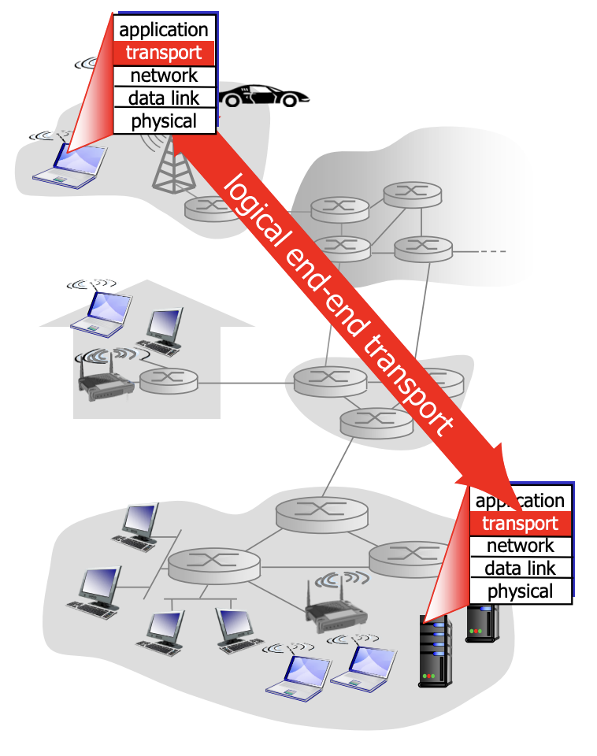
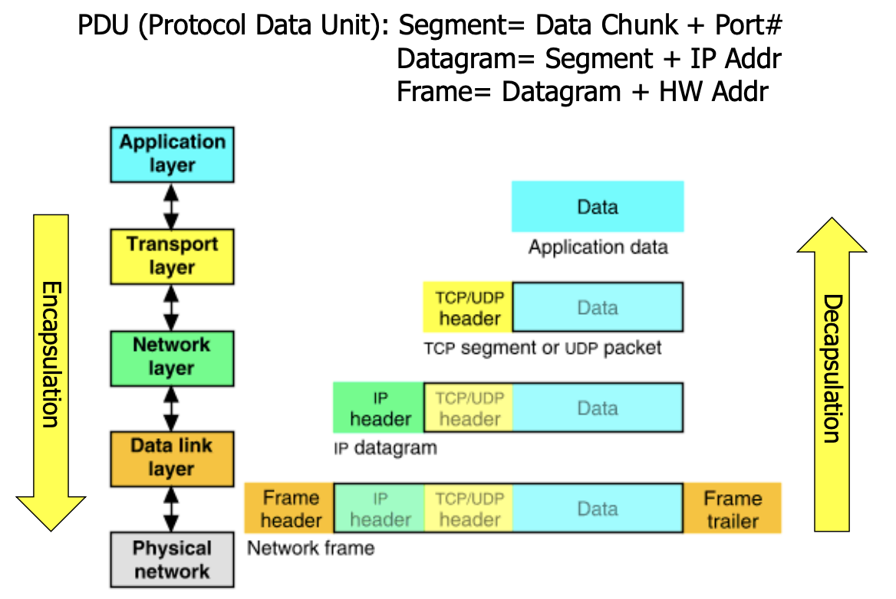
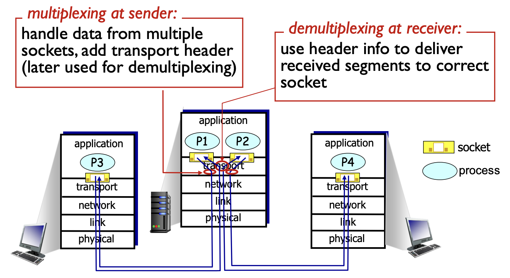
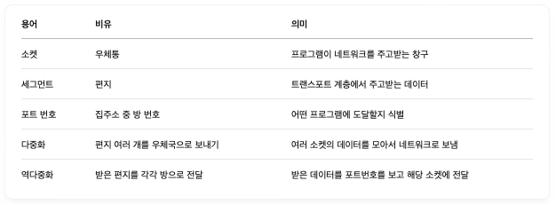
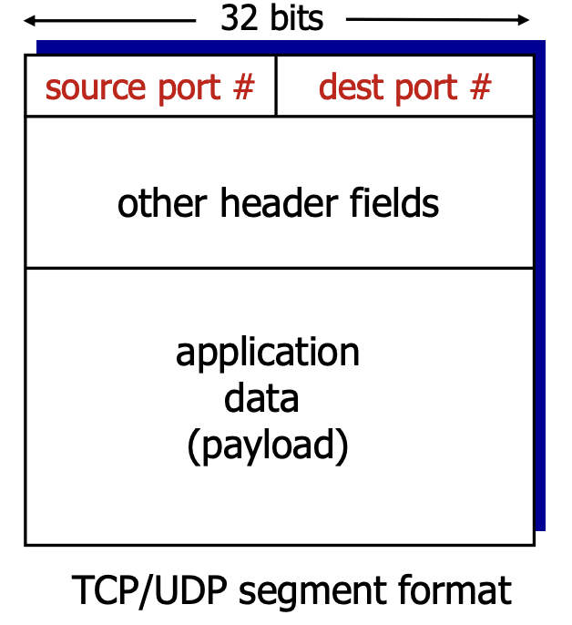
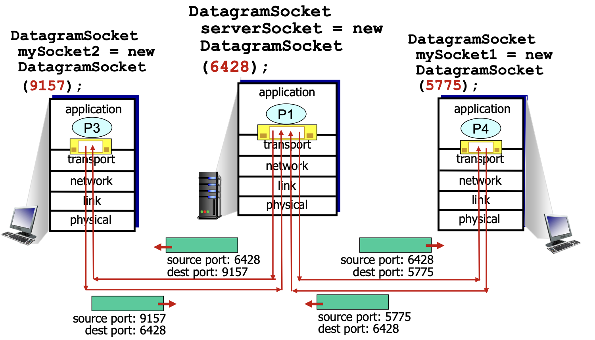
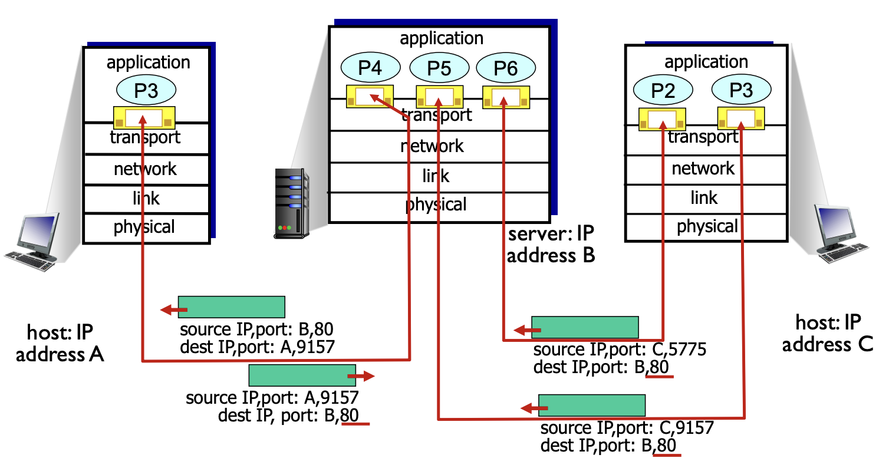


본 내용은 컴퓨터 네트워크 - 하향식 접근 책을 바탕으로 정리하였습니다.

## <strong>Transport Layer</strong>

### <strong>1. 트랜스포트 계층 서비스와 프로토콜</strong>

트랜스포트 계층 프로토콜은 서로 다른 호스트에서 동작하는 애플리케이션 프로세스들 간의 논리적 통신(logical communication)을 제공한다.

논리적 통신이란 애플리케이션의 관점에서 보면 프로세스들이 동작하는 호스트들이 직접 연결된 것처럼 보인다는 것을 의미한다.

(실제 호스트들은 수많은 라우터와 다양한 형태의 링크를 통해 연결되어 지구상의 서로 다른 지역에 있음)



트랜스포트 계층 프로토콜은 네트워크 라우터가 아닌! end system에서 구현된다.

- 송신 측의 트랜스포트 계층은 송신 애플리케이션 프로세스로부터 수신한 메시지를 세그먼트(segment)인 트랜스포트 계층 패킷으로 변환한다.
  - 애플리케이션 메시지를 작은 조각으로 분할하고, 헤더를 추가하면 세그먼트로 변환된다.
- 트랜스포트 계층은 송신 end system으로 세그먼트를 전달한다.
  - 세그먼트는 네트워크 계층 패킷 안에 캡슐화되어 목적지로 전달된다.
- 수신 측에서, 네트워크 계층은 데이터그램으로부터 트랜스포트 계층 세그먼트를 추출하고, 트랜스포트 계층으로 세그먼트를 보낸다.
- 이후에 트랜스포트 계층은 수신 애플리케이션에서 세그먼트 내부의 데이터를 이용할 수 있도록 수신된 세그먼트를 처리한다. (reassembles)

### <strong>2. 트랜스포트 계층과 네트워크 계층 사이의 관계</strong>

네트워크 계층: 호스트들 사이의 논리적 통신 제공

트랜스포트 계층: 서로 다른 호스트에서 동작하는 프로세스들 사이의 논리적 통신 제공

-&gt; 네트워크 계층은 딱 호스트까지! 그 다음은 트랜스포트 계층이!

예를 들어, A가 B에게 우편물을 보냈다고 하면 우편 서비스는 A와 B의 집과 집까지만 운송을 해준다. 여기까지는 네트워크 계층. 반면에 B의 아빠가 우편물을 받고 B에게 가져다 준다! 이게 바로 트랜스포트 계층!

### <strong>3. 인터넷 트랜스포트 계층의 개요</strong>

TCP(Transmission Control Protocol)

- 신뢰적이고 연결지향형 서비스 제공

UDP(User Datagram Protocol)

- 비신뢰적이고 비연결형인 서비스 제공
- 최선형 전달 서비스(best-effort delivery service): IP가 통신하는 호스트들 간에 세그먼트를 전달하기 위해서 최대한 노력하지만, 어떠한 보장도 하지 않는다는 것을 의미.
- IP는 세그먼트 내부 데이터의 무결성(integrity)를 보장하지 않음.

### <strong>4. 캡슐화</strong>



캡슐화(encapsulation)

- 애플리케이션 계층에서 트랜스포트 계층으로 데이터를 보낼 때 포트 넘버를 같이 보낸다. -&gt; 이걸 segment라고 한다!
  - 근데 이때 트랜스포트 계층에서는 데이터를 청크로 나눈다.
- 트랜스포트 계층에서 네트워크 계층으로 보낼 때 IP 주소를 같이 보낸다. -&gt; 이걸 Datagram이라고 한다!
- 네트워크 계층에서 데이터 링크 계층으로 보낼 때 하드웨어 주소를 같이 보낸다. -&gt; 이걸 Frame이라고 한다!

### <strong>5. 다중화와 역다중화</strong>



네트워크 애플리케이션의 한 부분으로서 프로세스가 소켓을 가지고 있음! 이를 통해 네트워크에서 프로세스로 데이터를 전달하며, 프로세스로부터 네트워크로 데이터를 전달하는 출입구 역할을 한다. -&gt; 수신 측 호스트의 트랜스포트 계층은 실제로 데이터를 프로세스에 직접 전달하지 않는다!

수신 측 호스트가 수신한 트랜스포트 계층 세그먼트를 어떻게 적절한 소켓으로 향하게 할까?

- 각각의 트랜스포트 계층 세그먼트는 필드 집합을 가지고 있다.
- 수신 측의 트랜스포트 계층은 수신 소켓을 식별하기 위해 이들 필드를 검사한다.
- 그리고 이 세그먼트를 해당 소켓으로 보낸다.

=&gt; 이 과정을 역다중화(demultiplexing)이라고 한다!

출발지 호스트에서 소켓으로부터 데이터를 모으고, 이에 대한 세그먼트를 생성하기 위해서 각 데이터에 헤더 정보로 캡슐화하고, 그 세그먼트들을 네트워크 계층으로 전달하는 작업을 다중화(multiplexing)라고 한다!

---

이해가 잘 안 가서 지피티한테 물어봄!

## 📨 1. 수신 측의 "역다중화(demultiplexing)"란?

- <strong>세그먼트</strong> = 편지 봉투 (트랜스포트 계층에서 보내는 데이터 조각)
- 각 세그먼트에는 <strong>받는 사람 주소</strong>가 적혀 있어 (→ 포트 번호)
- 컴퓨터에는 여러 개의 **소켓(socket)**이 있고, 이건 각각의 프로그램들이 네트워크와 소통하는 통로야 (예: 크롬, 메신저 등)
- 수신 측 트랜스포트 계층은 세그먼트를 받으면, 그 안에 있는 <strong>포트 번호 등</strong>을 보고, **어느 소켓(=어느 프로그램)**으로 이걸 전달할지 결정해
- 이게 <strong>역다중화(demultiplexing)</strong> = 도착한 데이터를 적절한 프로그램에게 넘겨주는 과정!

---

## 📦 2. 출발지의 "다중화(multiplexing)"란?

- 반대로, 데이터를 보낼 때는 <strong>여러 개의 프로그램</strong>이 데이터를 네트워크로 보내려고 해
- 트랜스포트 계층은 이 다양한 프로그램들(소켓들)로부터 데이터를 받아서,
- 각 데이터에 <strong>보내는 사람 주소, 받는 사람 주소</strong> 같은 정보를 담은 <strong>헤더</strong>를 붙이고 세그먼트를 만들어
- 그리고 이걸 <strong>하나의 네트워크 연결</strong>로 모아서 보내는 거야
- 이게 <strong>다중화(multiplexing)</strong> = 여러 프로그램의 데이터를 하나의 네트워크 연결로 모아 보내는 과정

---

## 🔁 비유로 다시 정리



### <strong>6. TCP/UDP segment format</strong>



트랜스포트 계층 다중화의 요구사항

1. 소켓은 유일한 식별자를 가진다.
2. 각 세그먼트는 세그먼트가 전달될 적절한 소켓을 가리키는 특별한 필드를 가진다.
   - 출발지 포트 번호 필드(source port number field)
   - 목적지 포트 번호 필드(destination port number field)
   - 각 필드에 16비트 씩 할당됨. 0~1023까지의 포트 번호는 잘 알려진 포트 번호라고 하여 사용이 제한됨.

각 소켓은 포트 번호를 할당받고, 세그먼트가 호스트에 도착하면 트랜스포트 계층은 세그먼트 안의 목적지 포트 번호를 검사하고 이에 상응하는 소켓으로 세그먼트를 보내게 된다. 그럼 세그먼트의 데이터는 소켓을 통해 해당하는 프로세스로 전달된다.

### <strong>7. 비연결형 다중화와 역다중화</strong>

UDP는 connectionless 즉, "연결이 없는" 프로토콜이다. TCP처럼 송수신자 간에 연결을 설정하지 않고, 데이터를 바로 보내버리는 구조!

DatagramSocket 생성 예시

```java
DatagramSocket mySocket1 = new DatagramSocket(12534);
```

- 이 코드는 포트 번호 12534를 사용하는 UDP 소켓을 만든 거
- 이 포트 번호는 host-local port number이다. 즉, 이 컴퓨터에만 유효한 포트 번호!

수신 시 UDP 동작 (demultiplexing)

호스트가 UDP 세그먼트를 받으면 다음을 한다.

1. UDP 헤더에 있는 destination port 번호 확인
2. 그 포트 번호를 사용하는 소켓을 찾음 -&gt; 세그먼트 전달

즉, 포트 번호가 일종의 주소 역할을 함! 여러 소켓이 있을 때, 어디에 전달할지 결정하는 기준. =&gt; demultiplexing

송신 시 UDP 데이터를 보낼 때는

- 목적지 IP 주소
- 목적지 포트 번호

이 두 가지를 꼭 지정해줘야 함!



### <strong>8. 연결지향형 다중화와 역다중화</strong>

TCP: Connection-Oriented Demux란?

- Demux (Demultiplexing): 여러 개의 데이터 흐름 중에서 받은 패킷을 어떤 소켓으로 전달할지 결정하는 과정
- 왜 Connection-oriented인가?
  - TCP는 데이터를 보내기 전에 먼저 연결을 설정함!
  - 이 연결은 4개의 정보(4-tuple)로 고유하게 식별됨.

TCP 소켓과 UDP 소켓 사이의 다른 점 - TCP 소켓은 4개 요소들의 튜플에 의해 식별된다.

- Source IP (보낸 쪽의 IP)
- Source Port (보낸 쪽의 포트)
- Destinatioin IP (받는 쪽의 IP)
- Destination Port (받는 쪽의 포트)

Demux 과정

- 서버가 TCP 세그먼트를 받으면
- 이 4-tuple 값을 보고 어떤 소켓에 연결된 데이터인지 식별해서 전달해줌
- 같은 포트 번호라고, 나머지 값이 다르면 다른 연결로 인식할 수 있음!



상황

- 서버(B)는 여러 클라이언트(호스트 A, B)로부터 동일한 목적지 포트 80을 통해 요청을 받는다.
- 하지만 각 클라이언트의 요청은 다른 소켓으로 전달돼야 함!
- TCP는 <strong>연결 기반</strong>이기 때문에, 단순히 "포트 번호"만으로는 누구의 요청인지 알 수 없음.

