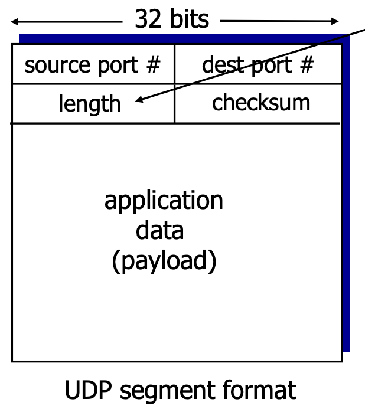
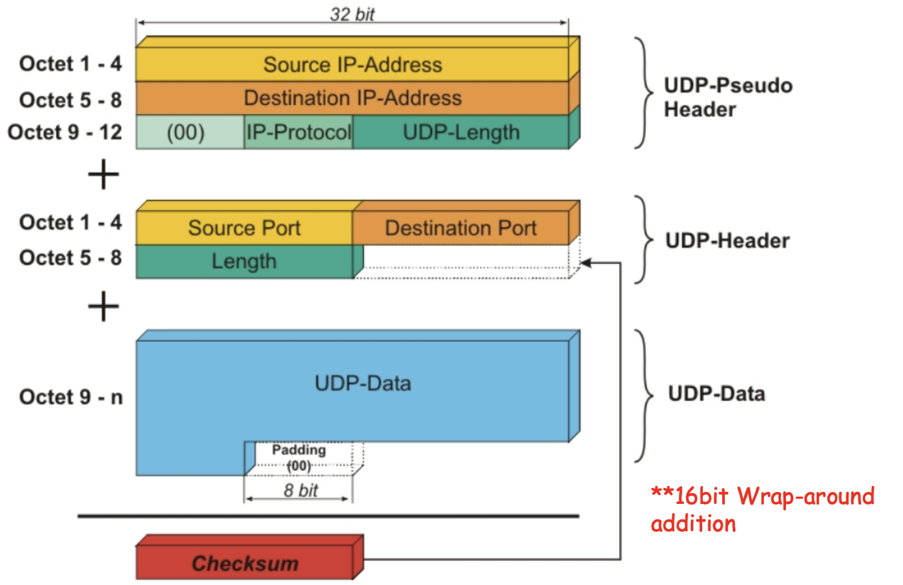


본 내용은 컴퓨터 네트워크 - 하향식 접근 책을 바탕으로 정리하였습니다.

## <strong>connectionless transport: UDP</strong>

### <strong>1. UDP(User Datagram Protocol)</strong>

- 비연결형 전송 계층 프로토콜
- 주요 특징
  - 단순성 - "no frills", "bare bones" =&gt; 불필요한 기능 없이 간단한 구조
  - 신뢰성 X - Best-effort delivery =&gt; 손실, 순서 변경 가능
  - 연결 X - Connectionless =&gt; TCP처럼 handshake(3-way) 없음
  - 독립 처리 - 각 세그먼트는 독립적으로 처리됨
- 어떤 일이 발생할 수 있을까?
  - 세그먼트가 유실될 수 있음
  - 세그먼트의 순서가 뒤바뀔 수 있음
  - 수신자가 도착 여부를 알 수 없음
- 왜 UDP를 쓸까?
  - 스트리밍 앱 -&gt; 약간의 손실은 괜찮지만 지연이 생기면 안 됨 (속도 중요)
  - DNS (도메인 이름 조회) -&gt; 빠른 요청/응답이 중요함, handshake 필요 없음
  - SNMP, RIP -&gt; 간단한 관리/라우팅 메시지에 적합함
- 신뢰성 보장이 필요한 경우
  - UDP 자체는 신뢰성을 제공하지 않지만, 애플리케이션 계층에서 직접 처리 가능!
  - checksum, 재전송, 응답 확인 등

### <strong>2. UDP 세그먼트 구조</strong>

UDP 세그먼트 구조는 RFC 768에 정의되어 있다.

- 애플리케이션 데이터는 UDP 데이터그램의 데이터 필드에 위치한다.
- 데이터 필드에는 질의 메시지나 응답 메시지를 포함한다.
- UDP 헤더는 2바이트씩 구성된 4개의 필드를 가진다.
- 체크섬(checksum)은 세그먼트에 오류가 발생했는지를 검사하기 위해 수신 호스트에 의해 사용된다.
- 체크섬은 UDP 세그먼트 이외에 IP 헤더의 일부 필드도 계산한다.

### <strong>3. UDP checksum</strong>

세그먼트가 출발지로부터 목적지로 이동했을 때 UDP 세그먼트 안의 비트에 대한 변경사항이 있는지 검사하는 것이다.

예를 들어 3개의 16비트 워드가 있다고 하자!

0110011001100000 -&gt; 1

0101010101010101 -&gt; 2

1000111100001100 -&gt; 3

1과 2의 합

1011101110110101

1과 2의 합에 3을 더하면

0100101011000010 =&gt; 오버플로우가 발생하여 가장 왼쪽 비트가 사라져버렸다! 이건 가장 오른쪽 비트에 +1 한다.

에 1의 보수는

1011010100111101

이것이 checksum이 된다! 송신자는 이걸 checksum 필드에 넣는다!

수신자에서는 체크섬을 포함한 4개의 모든 16비트 워드들을 더하고, 만약 패킷에 어떤 오류도 있지 않다면 1111111111111111이 될 것이다.

만약 비트 중에 하나라도 0이 있다면 패킷에 오류가 발생했음을 알 수 있다!

하지만 체크섬이 같다고 해서 완벽히 오류가 없다는 건 아니다 -&gt; 아주 드물게 에러가 감지되지 않을 수도 있음!

- UDP-Pseudo Header -&gt; 실제 전송은 안 되지만 체크섬 계산을 위해 사용
- UDP Header -&gt; 실제 UDP 헤더
- UDP Data -&gt; 실제 데이터 부분
- 위 세 부분을 전부 16비트 단위로 나눈 다음, 체크섬을 구함. 이 값을 UDP 헤더의 체크섬 필드에 저장해서 보냄!

