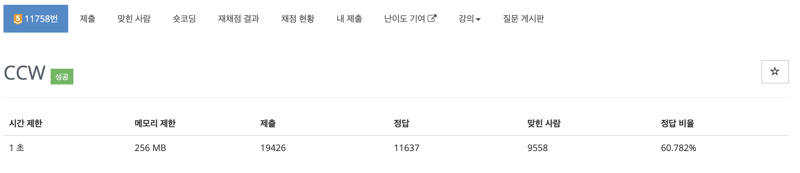


<https://www.acmicpc.net/problem/11758>



### <strong>문제</strong>

2차원 좌표 평면 위에 있는 점 3개 P1, P2, P3가 주어진다. P1, P2, P3를 순서대로 이은 선분이 어떤 방향을 이루고 있는지 구하는 프로그램을 작성하시오.

### <strong>입력</strong>

첫째 줄에 P1의 (x1, y1), 둘째 줄에 P2의 (x2, y2), 셋째 줄에 P3의 (x3, y3)가 주어진다. (-10,000 ≤ x1, y1, x2, y2, x3, y3 ≤ 10,000) 모든 좌표는 정수이다. P1, P2, P3의 좌표는 서로 다르다.

### <strong>출력</strong>

P1, P2, P3를 순서대로 이은 선분이 반시계 방향을 나타내면 1, 시계 방향이면 -1, 일직선이면 0을 출력한다.

---

### <strong>코드</strong>

```python
def ccw(x1, y1, x2, y2, x3, y3):
    return (x2 - x1) * (y3 - y1) - (x3 - x1) * (y2 - y1)

p = []
for _ in range(3):
    p.append(list(map(int, input().split())))

result = ccw(p[0][0], p[0][1], p[1][0], p[1][1], p[2][0], p[2][1])

if result == 0:
    print(0)
elif result > 0:
    print(1)
else:
    print(-1)
```

### <strong>풀이</strong>

ccw(A, B, C)=(x2 ​− x1​)(y3 ​− y1​) − (y2 ​− y1​)(x3 ​− x1​) 이 값의 부호에 따라 방향을 판별

- 결과 &gt; 0 : 반시계 방향 (CCW)
- 결과 &lt; 0 : 시계 방향 (CW)
- 결과 = 0 : 일직선 (세 점이 일직선상에 있음)

