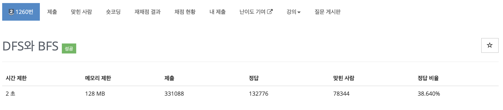


<https://www.acmicpc.net/problem/1260>



### <strong>문제</strong>

그래프를 DFS로 탐색한 결과와 BFS로 탐색한 결과를 출력하는 프로그램을 작성하시오. 단, 방문할 수 있는 정점이 여러 개인 경우에는 정점 번호가 작은 것을 먼저 방문하고, 더 이상 방문할 수 있는 점이 없는 경우 종료한다. 정점 번호는 1번부터 N번까지이다.

### <strong>입력</strong>

첫째 줄에 정점의 개수 N(1 ≤ N ≤ 1,000), 간선의 개수 M(1 ≤ M ≤ 10,000), 탐색을 시작할 정점의 번호 V가 주어진다. 다음 M개의 줄에는 간선이 연결하는 두 정점의 번호가 주어진다. 어떤 두 정점 사이에 여러 개의 간선이 있을 수 있다. 입력으로 주어지는 간선은 양방향이다.

### <strong>출력</strong>

첫째 줄에 DFS를 수행한 결과를, 그 다음 줄에는 BFS를 수행한 결과를 출력한다. V부터 방문된 점을 순서대로 출력하면 된다.

---

### <strong>코드</strong>

```python
from collections import deque

n, m, v = map(int, input().split())
arr = [[] for _ in range(n+1)]

for _ in range(m):
    a, b = map(int, input().split())
    arr[a].append(b)
    arr[b].append(a)

for i in range(1, n + 1):
    arr[i].sort()

def bfs(graph, start, visited):
    queue = deque([start])
    visited[start] = True
    while queue:
        v = queue.popleft()
        print(v, end=' ')
        for i in graph[v]:
            if not visited[i]:
                queue.append(i)
                visited[i] = True

def dfs(graph, v, visited):
    visited[v] = True
    print(v, end=' ')
    for i in graph[v]:
        if not visited[i]:
            dfs(graph, i, visited)

visited = [False] * (n+1)
dfs(arr, v, visited)

print()

visited = [False] * (n+1)
bfs(arr, v, visited)
```

