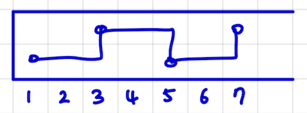
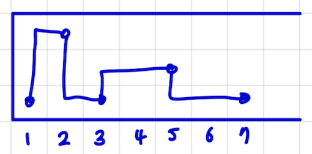
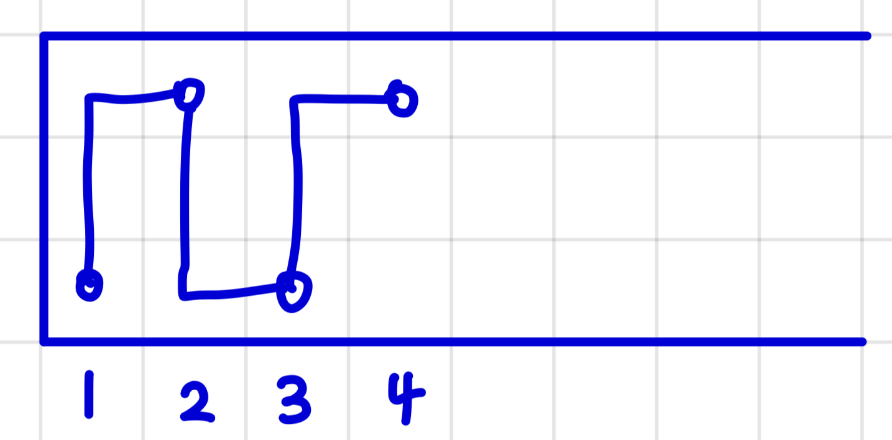


<https://www.acmicpc.net/problem/1783>


### <strong>문제</strong>

병든 나이트가 N × M 크기 체스판의 가장 왼쪽아래 칸에 위치해 있다. 병든 나이트는 건강한 보통 체스의 나이트와 다르게 4가지로만 움직일 수 있다.

1. 2칸 위로, 1칸 오른쪽
2. 1칸 위로, 2칸 오른쪽
3. 1칸 아래로, 2칸 오른쪽
4. 2칸 아래로, 1칸 오른쪽

병든 나이트는 여행을 시작하려고 하고, 여행을 하면서 방문한 칸의 수를 최대로 하려고 한다. 병든 나이트의 이동 횟수가 4번보다 적지 않다면, 이동 방법을 모두 한 번씩 사용해야 한다. 이동 횟수가 4번보다 적은 경우(방문한 칸이 5개 미만)에는 이동 방법에 대한 제약이 없다.

체스판의 크기가 주어졌을 때, 병든 나이트가 여행에서 방문할 수 있는 칸의 최대 개수를 구해보자.

### <strong>입력</strong>

첫째 줄에 체스판의 세로 길이 N와 가로 길이 M이 주어진다. N과 M은 2,000,000,000보다 작거나 같은 자연수이다.

### <strong>출력</strong>

병든 나이트가 여행에서 방문할 수 있는 칸의 개수중 최댓값을 출력한다.

---

### <strong>코드</strong>

```python
n, m = map(int, input().split())

if n == 1 or m == 1:
    print(1)
elif n == 2:
    if m >= 7:
        print(4)
    else:
        print((m + 1) // 2)
else:
    if m >= 7:
        print(5 + m - 7)
    elif m >= 4:
        print(4)
    else:
        print(m)
```

### <strong>풀이</strong>

1. 가로 세로 길이가 (1, 1)인 경우 방문할 수 있는 칸이 출발점밖에 없으므로 답은 1.

{: start="2"}
2. 세로가 2인 경우 (1칸 위로, 2칸 오른쪽) 또는 (1칸 아래로, 2칸 오른쪽) 만 가능한데 이럴 경우 최대 4개의 칸만 방문할 수 있으므로 가로가 7 이상인 경우 답은 4, 아닐 경우 (m + 1) // 2.



{: start="3"}
3. 세로가 2보다 큰 경우 세로의 제약은 없으므로 가로가 7이면 아래와 같다.



{: start="4"}
4. 가로가 7보다 크면 5 + (m - 7)

{: start="5"}
5. 가로가 4와 6 사이면 최대 4개의 칸만 방문할 수 있으므로 4.



{: start="6"}
6. 가로가 4보다 작으면 m.

