
본 내용은 컴퓨터 네트워크 - 하향식 접근 책을 바탕으로 정리하였습니다.

## <strong>1. 신뢰성 있는 데이터 전송의 원리(rdt)</strong>

자세한 내용 전 한 가지 가정 - 보내어진 패킷은 일부 손실될 수도 있겠지만 보내어진 순서대로 전달될 것임! 즉, 하부 채널은 패킷의 순서롤 바꾸지 않음.

- rdt_send(): 프로토콜의 송신 측은 이 호출에 의해 위의 계층에 의해서 호출됨. (call: 위에서 아래로)
- rdt_rcv(): 패킷이 채널의 수신 측으로부터 도착했을 때 호출됨. (callback: 아래에서 위로)
- deliver_data(): 수신자 측이 데이터를 반대로 넘길 때 호출됨.
- udt_send(): 비신뢰적인 데이터 전송으로써, 송신/수신 측이 패킷을 양방향으로 전달할 때 사용됨.

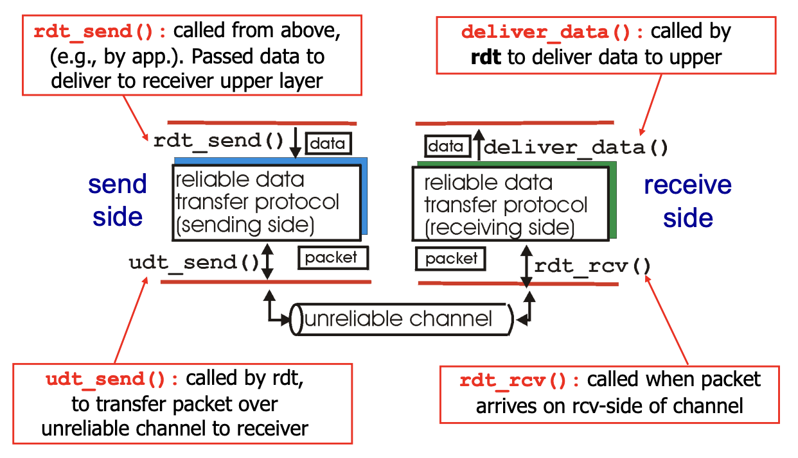

### <strong>신뢰적인 데이터 전달 프로토콜의 구축</strong>

#### <strong>완벽하게 신뢰적인 채널 상에서의 신뢰적인 데이터 전송: rdt1.0</strong>

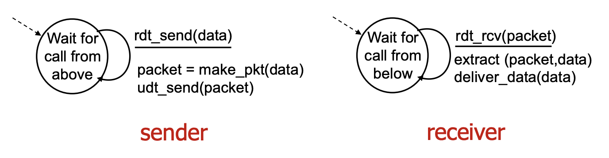
*유한상태 머신(finite-state machine, FSM) - 송신자의 동작 정의, 수신자의 동작 정의*

- sender - 상위로부터의 호출을 기다림
  - rdt_send(data) 이벤트에 의해 상위 계층으로부터 데이터를 받아들이고, 데이터를 포함한 패킷 생성(make_pkt(data))
  - 패킷을 채널로 송신
- receiver - 하위로부터의 호출을 기다림
  - rdt_rcv(packet) 이벤트에 의해 하위의 채널로부터 패킷을 수신하고, 패킷으로부터 (extract(packet, data)) 데이터를 추출
  - 데이터를 상위 계층으로 전달(deliver_data(data))

#### <strong>비트 오류가 있는 채널 상에서의 신뢰적 데이터 전송: rdt2.0</strong>

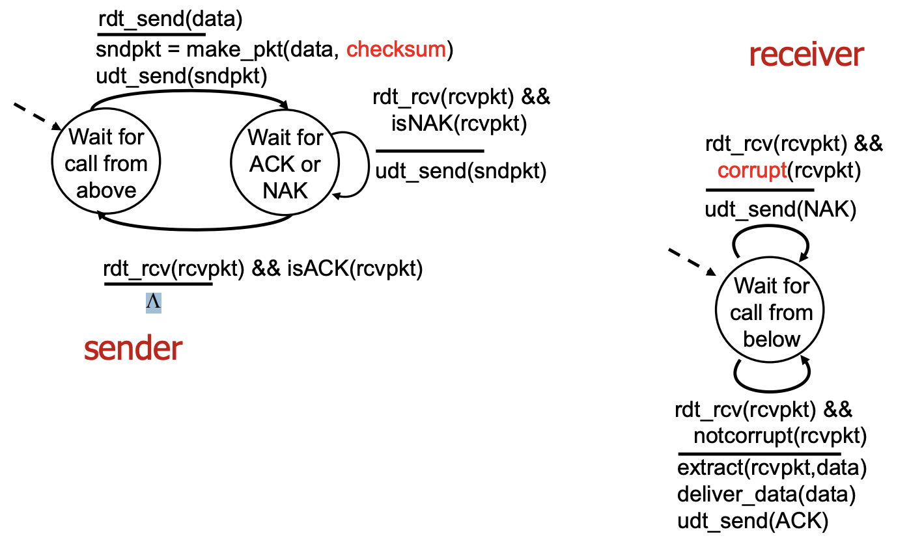

- 메세지 받아쓰기 프로토콜은 긍정 확인응답(positive acknowledgment, ACKs)과 부정 확인응답(negative acknowledgment, NAKs)을 둘 다 사용함.
- 재전송을 기반으로 하는 신뢰적인 데이터 전송 프로토콜 → 자동 재전송 요구(Automatic Repeat reQuest, ARQ) 프로토콜
  1. 오류 검출: 비트 오류가 발생했을 때 수신자가 검출할 수 있어야 함.
  2. 수신자 피드백: ACK, NAK 패킷 전송
  3. 재전송: 오류를 가지고 수신된 패킷은 송신자가 재전송
- sender
  - 상위 계층으로부터 데이터가 전달되기를 기다림
    - rdt_send(data) 이벤트가 발생하면, 송신자는 패킷 체크섬과 함께 전송될 데이터를 포함하는 패킷을 생성하고, 그 패킷을 udt_send(sndpkt)을 통해 전송함.
  - 수신자로부터 ACK 또는 NAK 패킷을 기다림
    - ACK 패킷이 수신된다면 → 송신자는 정확하게 수신됨을 알게 되고, 상위 계층으로부터 데이터를 기다리는 상태로 돌아감.
    - NAK 패킷이 수신된다면 → 마지막 패킷을 재전송하고 재전송된 데이터 패킷에 대한 응답으로 수신자에 의해 응답되는 ACK 또는 NAK 를 기다림.
    - 이 상태에는 상위 계층으로부터 더 이상의 데이터를 전달받을 수 없음! ⇒ rdt2.0과 같은 프로토콜은 <strong>전송-후-대기 프로토콜</strong>로 알려져 있음!
- receiver
  - 하위 계층으로부터 호출을 기다림
    - 패킷이 도착했을 때, 수신된 패킷이 손상되었는지 아닌지에 따라 ACK, NAK으로 응답함.
- 문제점 - ACK, NAK 패킷이 손상될 수 있다는 가능성!
  - 현재 데이터 패킷을 재전송 → 중복 패킷(duplicated packet)
  - 데이터 패킷에 새로운 필드를 추가하고 이 필드 안에 순서번호(sequence number)를 삽입하는 방식 - 데이터 패킷에 송신자 번호를 붙임

#### <strong>rdt2.0의 수정 버전: rdt2.1</strong>

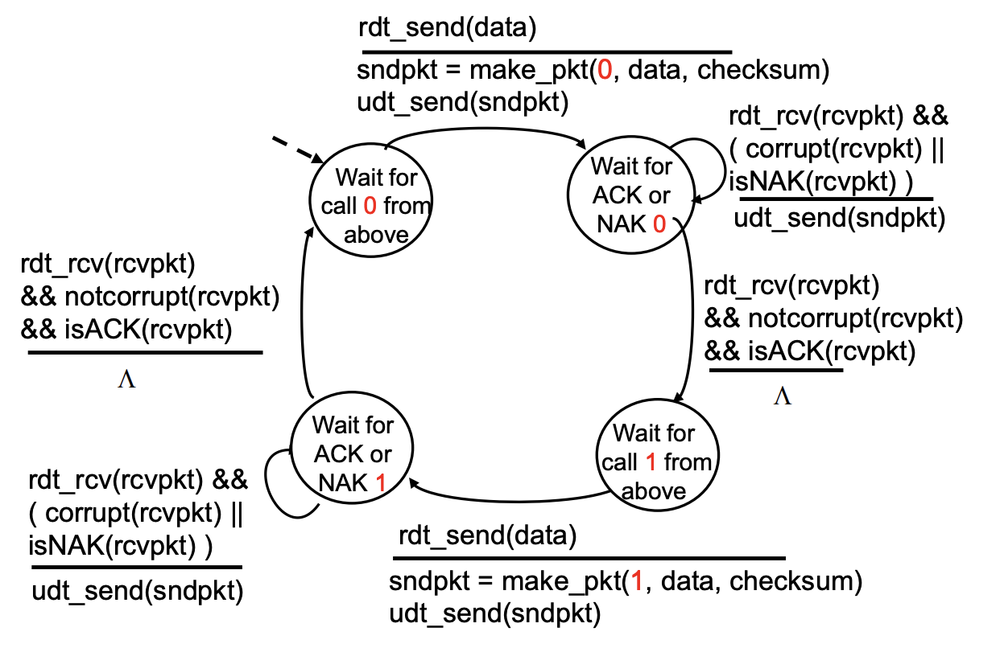
*rdt2.1 송신자*

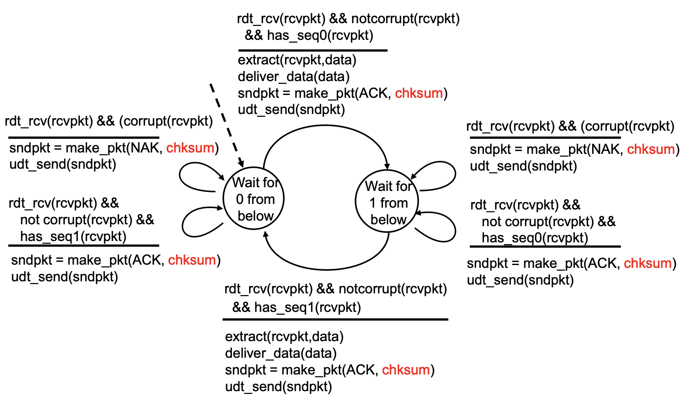
*rdt2.1 수신자*

- 수신자로부터 송신자까지의 ACK, NAK을 모두 포함함.
- 순서가 바뀐 패킷이 수신되면, 수신자는 이미 전에 수신한 패킷에 대한 ACK를 전송함. 손상된 패킷이 수신되면, NAK을 전송함.
- sender
  - 각 패킷에 시퀀스 번호(seq #) 추가 → 수신자가 중복된 패킷인지 판단할 수 있게 해줌
  - 왜 0과 1이면 충분? → 하나의 패킷을 보내고 응답을 기다리는 Stop-and-Wait 방식 사용. 동시에 1개의 패킷만 전송하므로, 0과 1 두 개의 번호만 번갈아 사용해도 중복 구분 가능
  - ACK/NAK 손상 여부 확인 필요
    - ACK나 NAK가 손상되면, 송신자는 정확히 어떤 응답인지 알 수 없음.
    - 따라서 수신자의 응답이 손상됐을 때를 대비한 재전송 로직 필요
  - 상태(state)가 두 배로 증가
    - 송신자는 현재 어떤 시퀀스 번호의 패킷을 전송할 차례인지 기억해야 함.
    - 즉, 상태가 “다음은 seq#0”, “다음은 seq#1” 로 나뉨.
- receiver
  - 중복 패킷인지 확인해야 함
    - 수신자는 이전에 수신했던 패킷이 재전송된 것인지 아닌지를 판단해야 함. → 이를 위해 시퀀스 번호 기억
  - 마지막 ACK가 송신자에게 전달되었는지 모름
    - 수신자는 자신이 보낸 ACK가 손상되었는지, 손실되었는지 알 수 없음.
    - 그래서 송신자가 같은 데이터를 다시 보낼 수 있음 → 이 경우 중복 패킷임을 인식하고 다시 ACK만 전송함.

#### <strong>NAK 없는 신뢰성 전송 프로토콜 (NAK-free Protocol): rdt2.2</strong>

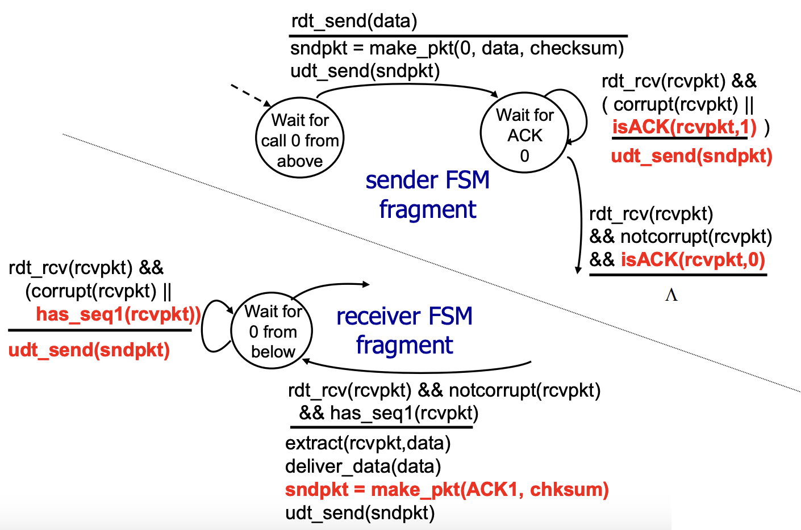

- NAK 대신 마지막으로 성공적으로 받은 패킷의 ACK를 다시 보냄. (어떤 패킷에 대한 ACK인지 명시적으로 시퀀스 번호 포함)
- 송신자는 수신한 ACK의 시퀀스 번호가 기대값보다 낮으면 중복된 ACK으로 판단해서 현재 패킷을 재전송함.
- 수신자
  - 정상 패킷 수신 시 → 데이터 전달 + ACK 전송
  - 오류 패킷 수신 시 → 마지막으로 받은 정상 패킷에 대한 ACK만 다시 전송

#### <strong>비트 오류와 손실 있는 채널 상에서의 신뢰적 데이터 전송: rdt3.0</strong>

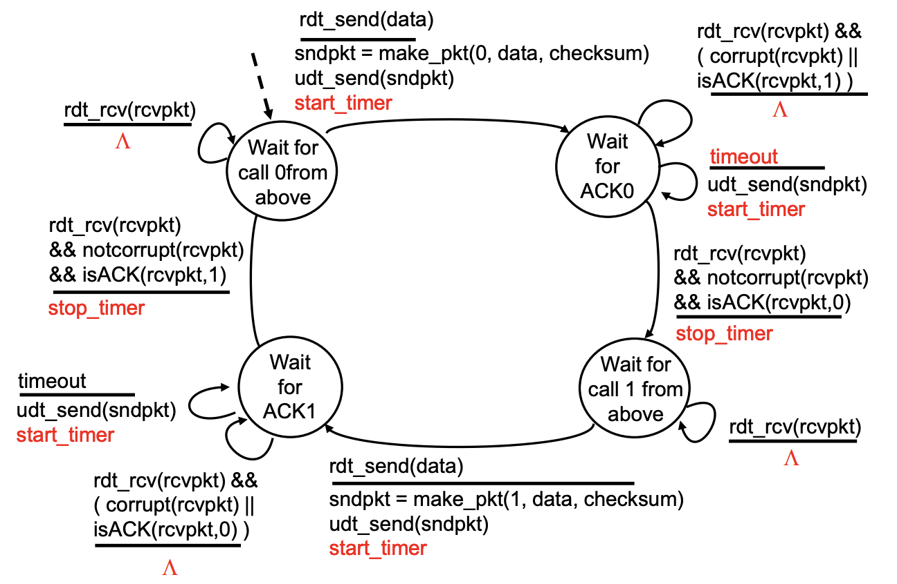
*rdt3.0 송신자*

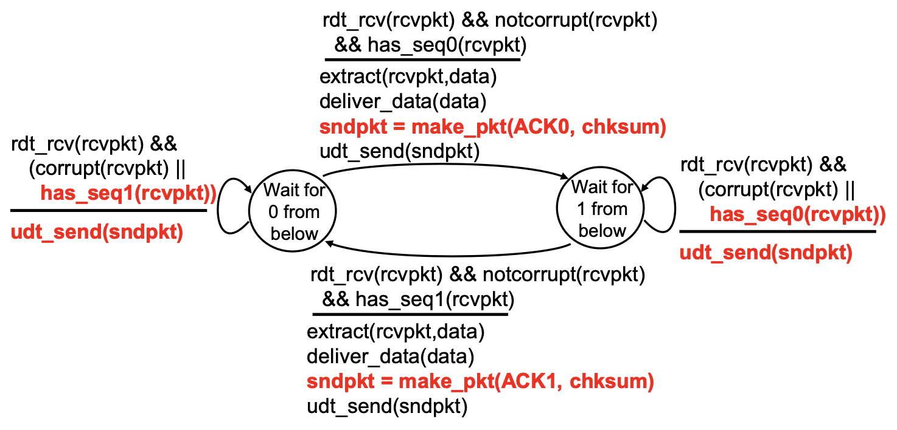
*rdt3.0 수신자*

- 전제 조건
  - rdt2.x에서는 오류만 고려했지만, rdt3.0은 패킷 손실도 발생할 수 있는 상황을 다룸. → <strong>데이터 패킷뿐 아니라 ACK도 손실 가능</strong>
- 타이머 도입 (Countdown Timer) → 송신자는 패킷 전송 후 일정 시간(합리적인 시간) 동안 ACK을 기다림. 정해진 시간 안에 못 받으면 재전송
- 중복 전송 처리 → 정상적으로 도착했지만 ACK이 늦은 경우도 있음.
  - 이 경우는 송신자는 중복 전송하지만, 수신자는 시퀀스 번호를 통해 중복 여부를 판단하고 무시함.
- 시퀀스 번호와 체크섬 유지
  - seq#와 체크섬을 통해 오류 및 중복 판단
  - ACK에도 시퀀스 번호를 포함하여 어떤 데이터에 대한 응답인지 명시

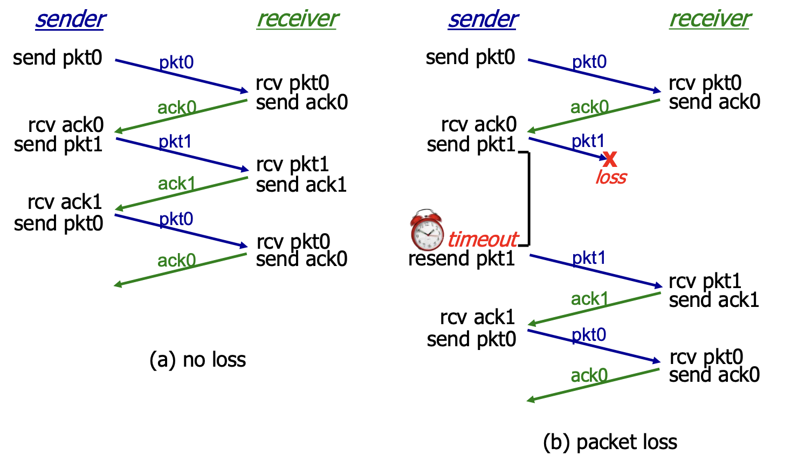
*(a) 무손실 동작, (b) 패킷 손실*

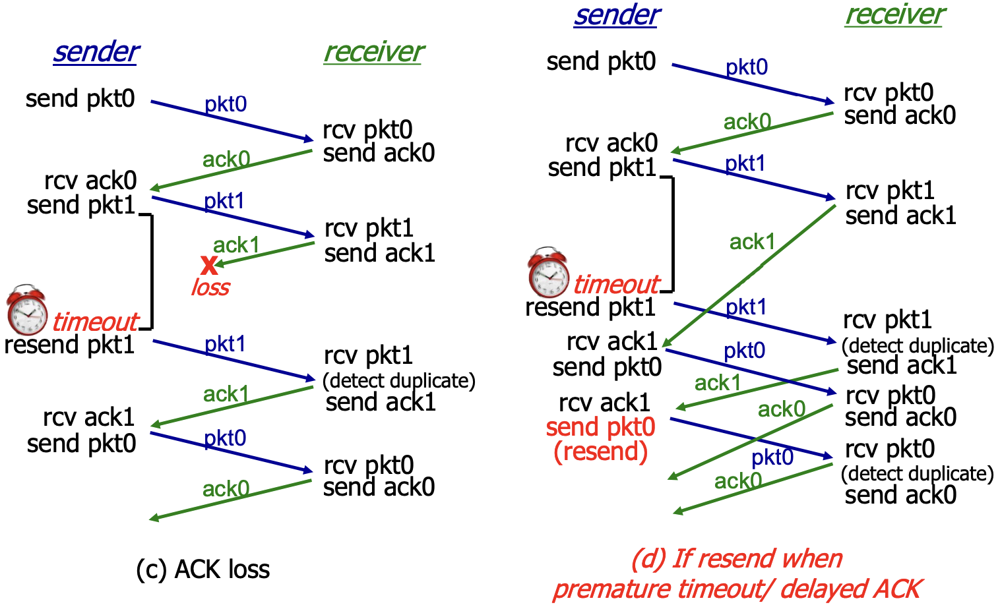
*(c) ACK 손실, (d) 조급한 타임아웃*

- 얼터네이팅 비트 프로토콜(alternation-bit protocol)
  - 패킷의 순서번호가 0과 1이 번갈아 일어나므로 rdt3.0을 이렇게도 부름

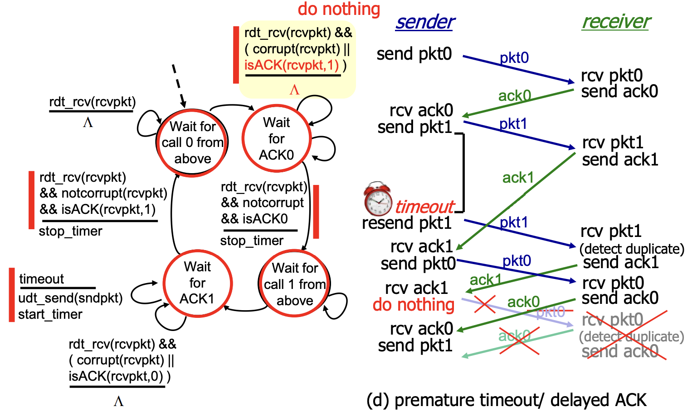

- ack1을 기다리고 있는데 timeout이 걸린 상황 → 패킷1 재전송
- 위에서 호출이 와서 패킷0 전송 → ack0을 기다리고 있었는데 ack1이 옴 ⇒ do nothing(재전송 하지 마삼) → ack0이 오고 문제없이 빠져나감

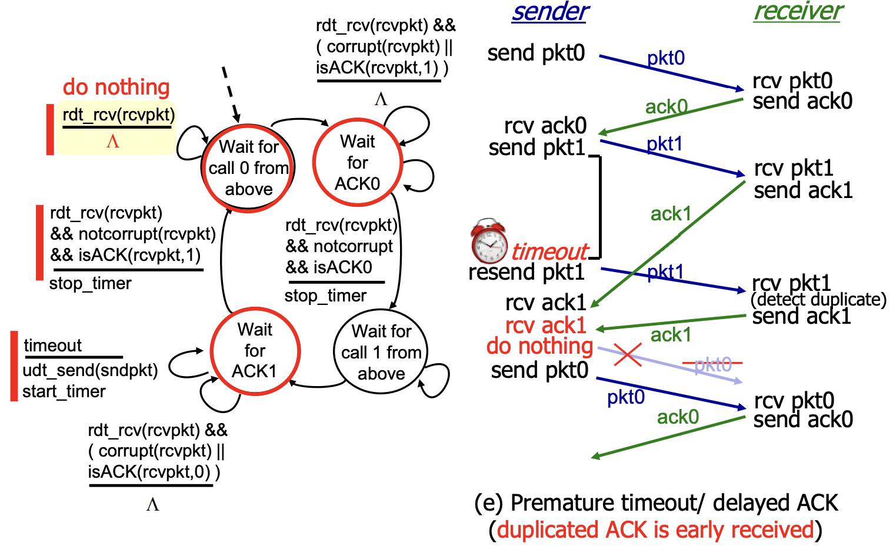

- 위에서 호출을 기다리고 있는데 ack1이 옴 ⇒ do nothing(뭐가 오면 무시해라) → 다시 새롭게 시작

## <strong>2. 파이프라인된 신뢰적 데이터 전송 프로토콜</strong>

- rdt3.0 성능을 알아보자!
  - 하나의 호스트는 미국 서부, 다른 하나는 동부에 위치한 두 종단 호스트를 생각해보자. 두 종단 시스템 사이의 RTT는 대략 30msec.
  - 이것들이 1 Gbps(초당 $10^9$ 비트) 전송률(R)을 가진 채널에 의해 연결돼있다고 가정, 패킷당 1000바이트(8000비트)의 패킷 크기(L)를 가지고 1 Gbps 링크로 패킷을 실제로 전송하는 시간

- 송신자가 채널을 통해 실제적으로 비트를 전송하는데만 걸린 시간을 송신자의 이용률(utilizatioin) 수식으로 정의하면

#### <strong>Pipelined protocols</strong>

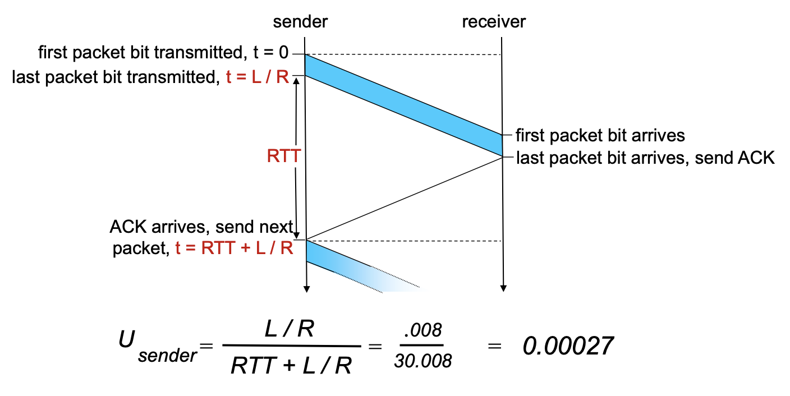
*이건 넘 비효율적*

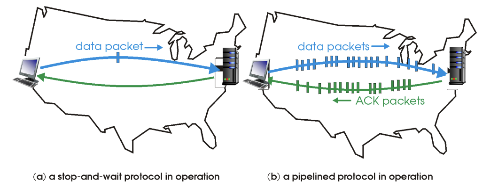

- Pipelining: 확인응답을 기다리지 않고 여러 패킷을 전송하는 것을 허용.

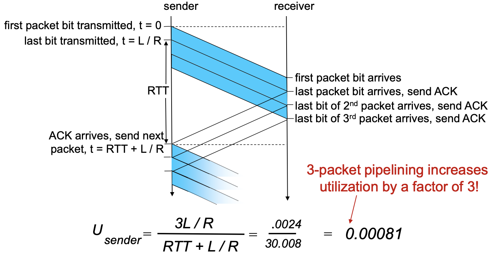

- ACK을 기다리지 않고 여러 패킷을 전송하도록 허용하고 3개의 패킷을 전송한다면 이용률은 3배가 됨!

## <strong>3. N부터 반복(Go-Back-N, GBN)</strong>

- GBN 프로토콜
  - 송신자는 ACK을 기다리지 않고 여러 패킷을 전송할 수 있지만, 파이프라인에서 ACK이 안 온 패킷의 최대 허용 수 N보다 크지 않아야 한다.

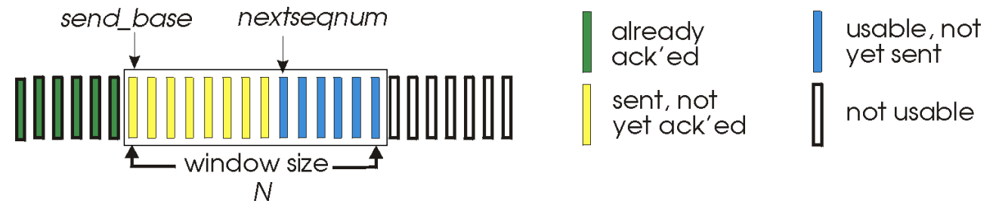
*ACK를 받으면 윈도우가 옆으로 한 칸 씩 이동함*

- 슬라이딩 윈도우 프로토콜(sliding-window protocol)이라고도 부름.
- k가 순서번호 필드의 비트 수라면 패킷의 순서번호의 범위는 [0, $2^k$-1]이 됨.

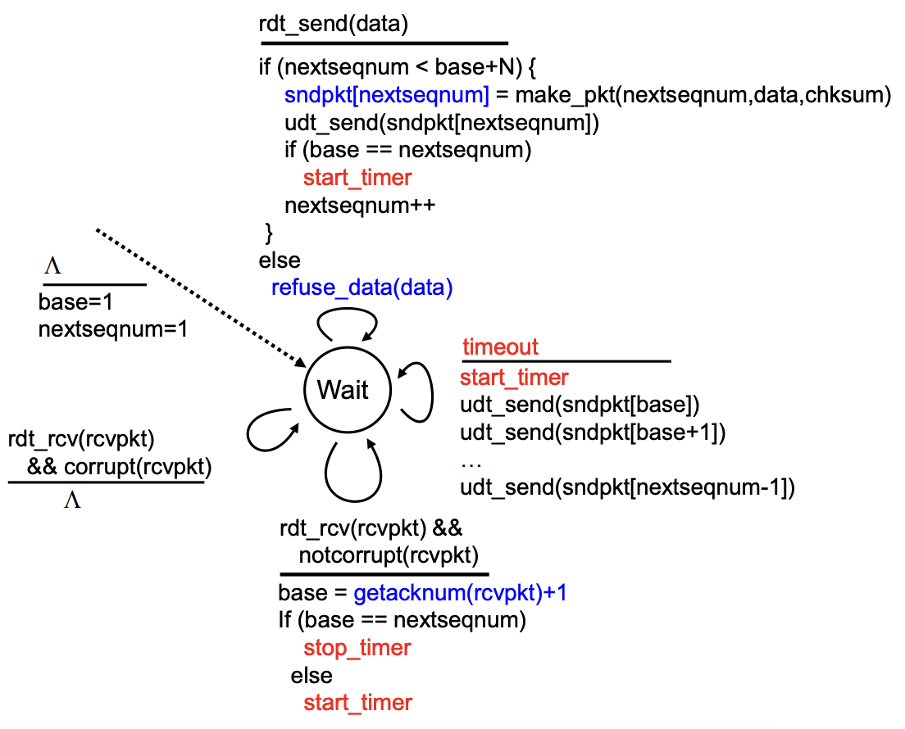
*GBN 송신*

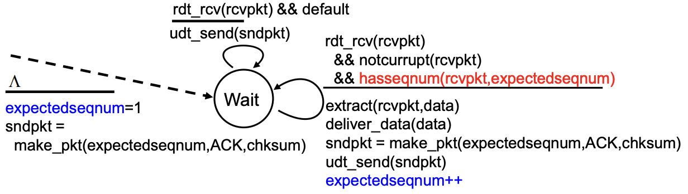
*GBN 수신*

- sender
  - 상위로부터 호출 - rdt_sent()가 위로부터 호출되면, 윈도우가 가득 찼는지, 즉 N개의 아직 확인응답 되지 않은 패킷이 있는지 확인한다. 만약 윈도우가 가득 차 있지 않다면 → 패킷이 생성되고 송신된다. 그리고 변수들이 적절하게 갱신된다. 만약 윈도우가 가득 차 있다면 → 송신자는 윈도우가 가득 차 있다는 것을 가리키는 함축적인 의미로 단지 데이터를 상위 계층으로 반환한다. ⇒ 상위계층은 나중에 다시 시도
  - ACK의 수신 - GBN 프로토콜에서 순서번호 n을 가진 패킷에 대한 ACK는 누적확인응답(cumulative acknowledgment)로 인식된다.
  - 타임아웃 이벤트 - 전송-후-대기 프로토콜에서와 같이, 타이머는 손실된 데이터 또는 손실된 확인응답 패킷으로부터 회복하는 데 사용된다. 만약 타임아웃이 발생했다면 → 송신자는 이전에 전송되었지만 아직 확인응답 되지 않은 모든 패킷을 다시 송신한다. 만약 아직 확인응답 안 된 패킷이 없다면 → 타이머는 멈춘다.
- receiver
  - ACK 송신 순서번호 n을 가진 패킷이 오류 없이 순서대로 수신되면 → 패킷 n에 대한 ACK를 송신하고, 상위 계층에 패킷의 데이터 부분을 전달한다. 그 외의 경우 → 그 패킷을 버리고 가장 최근에 제대로 수신된 순서의 패킷에 대한 ACK를 재전송
  - 수신자는 단지 다음에 기대하는 expectedseqnum만 기억하면 됨.

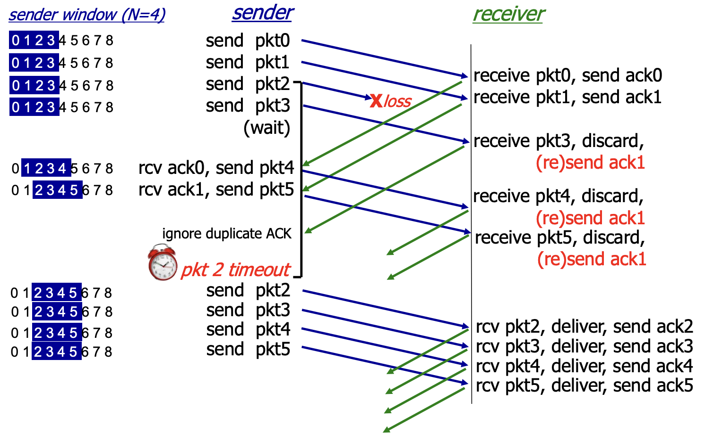

## <strong>4. 선택적 반복(Selective Repeat, SR)</strong>

- 수신자에서 오류(손실/변조)가 발생한 패킷을 수신했다고 의심되는 패킷만을 송신자가 다시 전송하므로 불필요한 재전송을 피함.
- 윈도우 크기 N은 파이프라인에서 아직 확인응답이 안 된 패킷 수를 제한하는 데 사용됨.

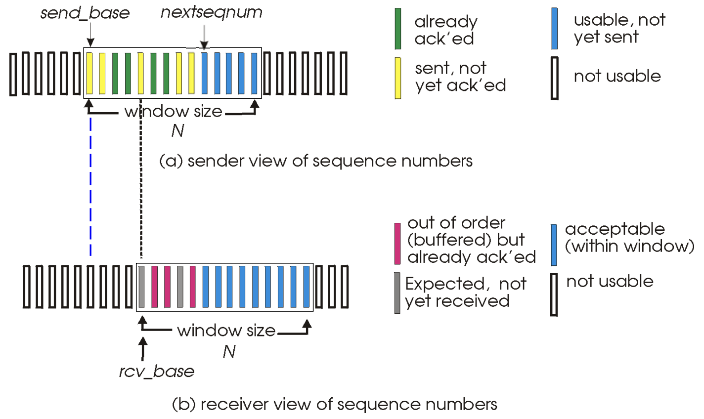

- sender
  - 상위로부터 데이터를 받음
    - 순서번호가 송신자 윈도우 내에 있으면 → 데이터는 패킷으로 송신됨
    - 그렇지 않으면 → GBN처럼 버퍼에 저장되거나 나중에 전송하기 위해 상위 계층으로 되돌려짐
  - 타임아웃
    - 패킷 n만 재전송하고 타이머는 다시 시작
  - ACK(n) 수신
    - n이 현재 윈도우 범위 내에 있다면 → 해당 패킷을 받았다고 표시
    - n이 가장 앞쪽 미확인 패킷이면 → sendbase를 앞으로 당김
- receiver
  - [rcv_base, rcv_base+N-1] 내의 순서번호를 가진 패킷은 손상 없이 수신됨
    - 윈도우 범위 안에 있는 패킷이면 → ACK(n) 전송 순서 맞으면 → 바로 전달, 버퍼에 있던 순차적 패킷도 함께 전달 순서 안 맞아도 버퍼에 저장
  - pkt n in [rcv_base-N, rcv_base-1]
    - 이미 받은 오래된 패킷 → 중복 ACK(n)만 전송
  - 그 외
    - 패킷 무시

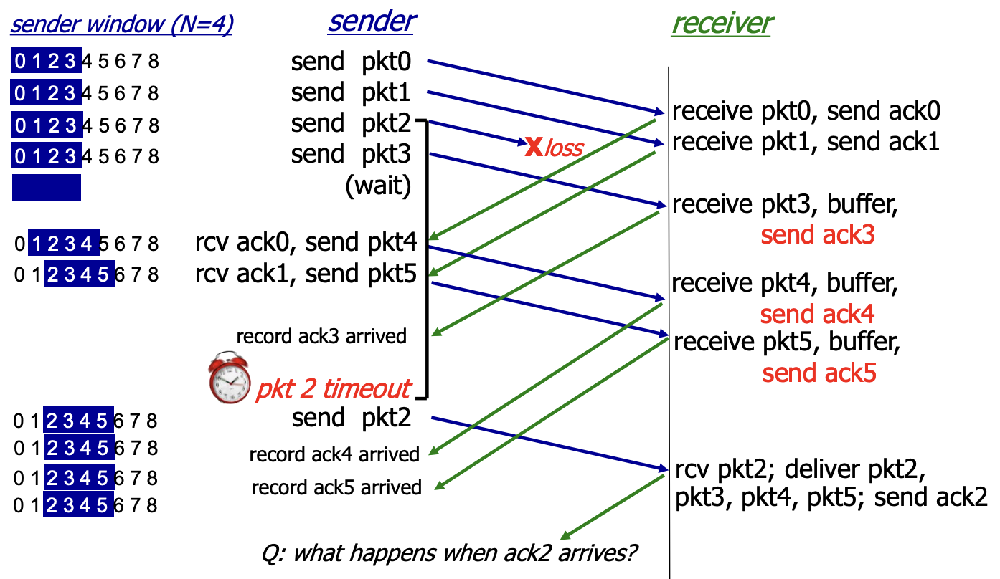

- SR의 딜레마

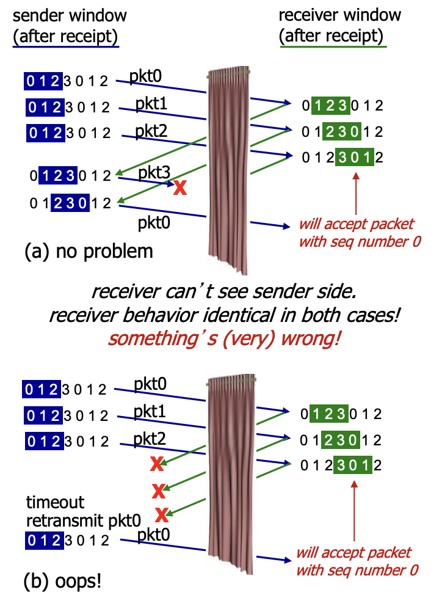

- seq#가 0, 1, 2, 3이고, window size가 3일 때
  - 수신자는 송신자의 행동을 볼 수 없으므로, 5번째 패킷의 원래 전송과 첫번째 패킷의 재전송을 구별할 방법은 없음.

