
본 내용은 컴퓨터 네트워크 - 하향식 접근 책을 바탕으로 정리하였습니다.

## <strong>1. TCP 연결</strong>

- Point-to-point
  - 하나의 송신자와 하나의 수신자 사이에서만 통신함.
- 연결지향형(Connection-oriented)
  - 신뢰성있는 전송
  - 순차적인 바이트 스트림(In-order byte stream) - 중간에 메세지 경계 개념이 없음.
  - 헨드셰이킹(Handshaking)
- Pipelined(파이프라인화된 전송)
  - TCP는 데이터를 하나씩 보내고 기다리는 방식이 아니라, 여러 개의 세그먼트를 연속적으로 보내는 파이프라인 방식으로 동작함 ⇒ window size
  - 흐름 제어 - 수신자의 처리 속도보다 보내는 데이터 양이 많을 경우, 수신자가 감당할 수 있게 조절함.
  - MSS(Maximum Segment Size) - 하나의 TCP 세그먼트에 담을 수 있는 최대 데이터 크기
- full duplex data
  - 양방향 데이터 흐름을 동시에 지원함

## <strong>2. TCP 세그먼트 구조</strong>

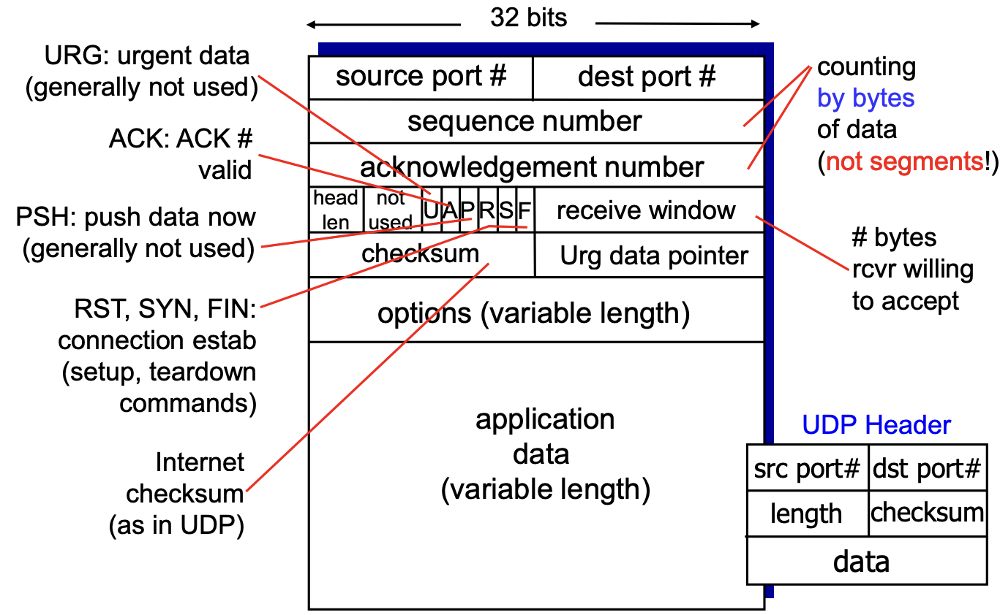

- 헤더 → 출발지(source)와 목적지(destination)의 포트 번호
- 32비트 순서번호 필드(sequence number field)와 32비트 확인응답번호 필드(acknowledgement number field)
- 16비트 수신 윈도우(receive window) 필드 ⇒ 흐름제어에 사용
- 4비트의 헤더 길이(header length) 필드
- 옵션(option) 필드 ⇒ 최대 세그먼트 크기(MSS)를 협상하거나, 고속 네트워크에서 사용하기 위한 윈도우 확장 요소로 이용
- 플래그(flag) 필드(6비트).
  - ACK: 확인응답 필드에 있는 값이 유용함을 가리키는 데 사용
  - RST, SYN, FIN: 연결 설정과 해제에 사용
  - PSH: 이 비트가 설정되면 수신자가 데이터를 상위 계층에 즉시 전달해야 한다는 것을 가리킴
  - URG: 이 세그먼트에서 송신 측 상위 계층 개체가 긴급으로 표시하는 데이터임을 나타냄
- 16비트의 긴급 데이터 포인터 필드(urgent data pointer field) ⇒ TCP는 긴급 데이터가 존재할 때 수신 측 상위 계층 개체에게 통지해야 하고 긴급 데이터의 끝에 대한 포인터를 전달함.
- 체크섬(checksum) 필드

## <strong>3. 순서번호와 확인응답 번호</strong>

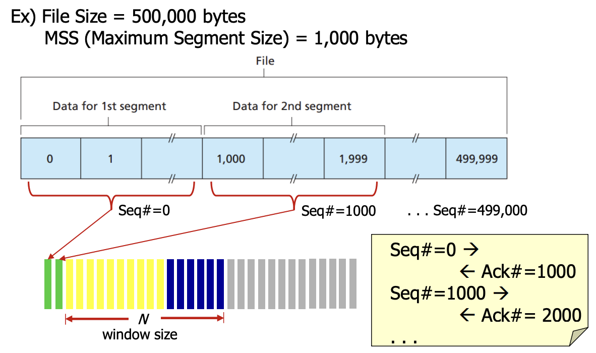

- TCP는 데이터를 구조화되어 있지 않고, 단지 순서대로 정렬된 바이트 스트림으로 본다.
- 세그먼트에 대한 순서 번호 → 세그먼트에 있는 첫 번째 바이트의 바이트-스트림 번호
- 수신자의 확인응답 번호 → 송신자로부터 기대하는 다음 바이트의 순서번호

## <strong>4. 텔넷(Telnet): 순서번호와 확인번호 사례 연구</strong>

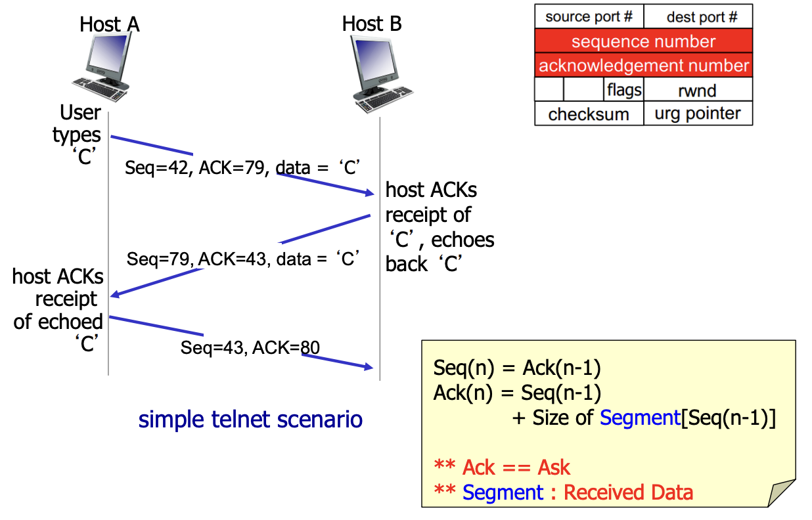

- 사용자(클라이언트에서)가 입력한 각 문자는 원격 호스트에게 송신될 것이다. 원격 호스트는 각 문자의 복사본을 송신자에게 반송하여 텔넷 사용자의 화면에 표시되게 할 것이다.
  - 이 “반송(echo back)”은 텔넷 사용자가 보는 문자가 이미 원격 사이트에 수신되고 처리되었음을 나타냄.
- 위 사진과 같은 확인 응답은 “서버 대 클라이언트” 데이터 세그먼트 상에서 피기백(piggy-backed)된다고 말한다.

#### <strong>신뢰적인 데이터 전달</strong>

- TCP는 신뢰성 없는 IP 위에서 동작한다. 그래서 IP가 데이터를 잃거나 순서가 뒤바뀌더라도, TCP는 이를 감지하고 복구할 수 있도록 설계된다. ⇒ TCP는 IP 위에 신뢰성 있는 rdt (reliable data transfer)서비스를 제공함
- 주요 기능
  - Pipelined Segments
    - 한 번에 여러 세그먼트를 보낼 수 있음. ⇒ 대역폭 활용이 더 효율적
  - Cumulative ACKs
    - 수신자가 받은 가장 마지막 연속된 바이트의 순서 번호를 ACK로 보냄
    - 중간에 빠진 세그먼트가 있어도, 그 이후의 세그먼트를 계속 받더라도 ACK는 그 빠진 세그먼트까지만 보냄
  - 단일 재전송 타이머(Single retransmission timer)
    - TCP는 모든 미확인 데이터 중에서 가장 오래된 세그먼트 하나에만 타이머를 걺. 타이머가 만료되면 해당 세그먼트를 재전송.

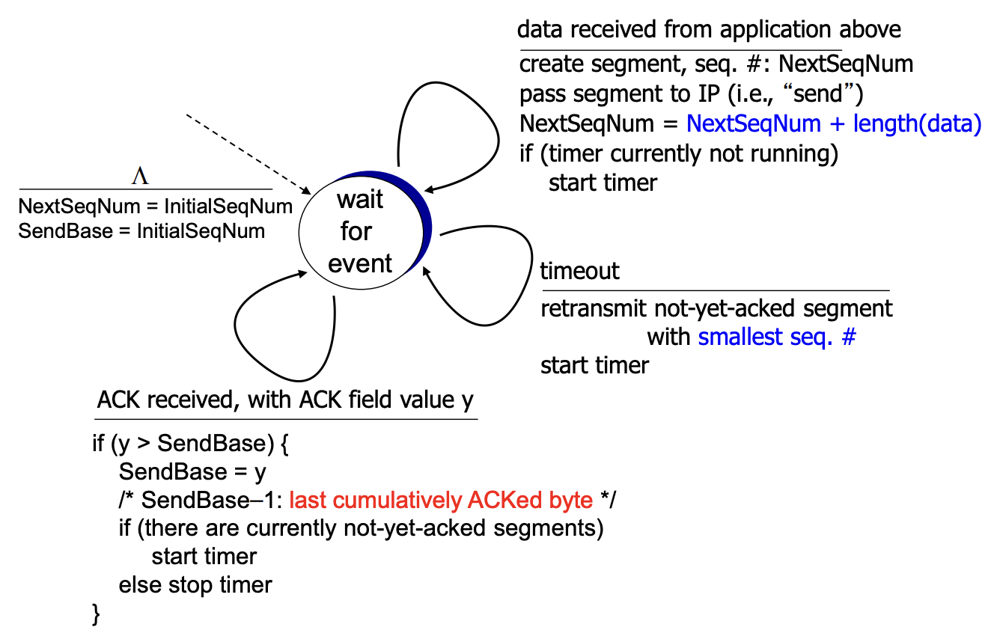
*간소화된 TCP 송신자*

1. 애플리케이션이 데이터를 보내면 TCP는 (data rcvd from app)

- 세그먼트 생성: 데이터에 순서 번호(seq #)를 붙여서 세그먼트 생성
  - 이 순서 번호는 바이트 단위임. 즉, 세그먼트에 포함된 첫 번째 바이트의 번호.
- 타이머 시작
  - 아직 실행 중인 타이머가 없다면, 타이머를 시작함.
  - 이 타이머는 가장 오래된 미확인(ACK되지 않은) 세그먼트에 대해 작동.
  - 타이머의 간격 = TimeOutInterval

1. 타임아웃 발생 (timeout)

- 정해진 시간(TimeOutInterval)이 지났는데도 ACK를 못 받으면, TCP는:
  - 타임아웃이 발생한 세그먼트를 재전송
  - 타이머 재시작

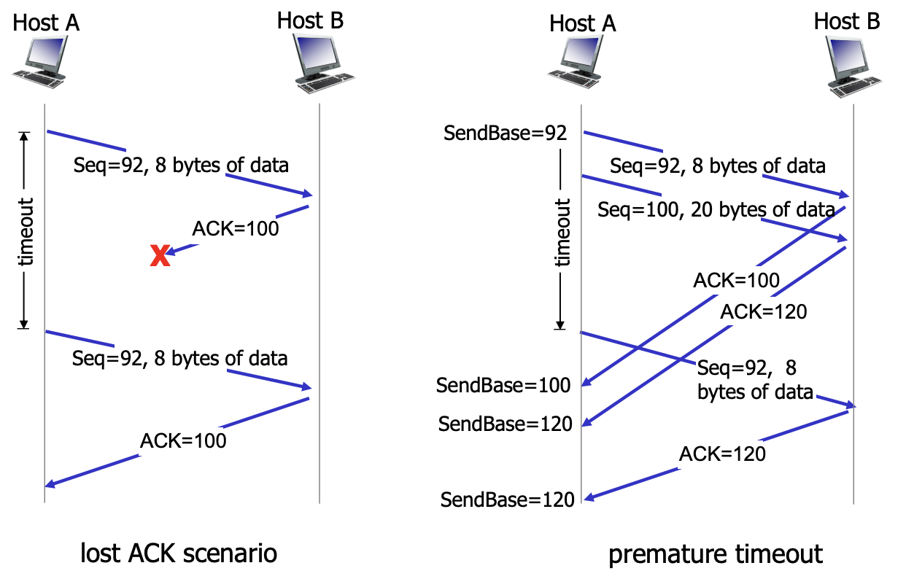

- 첫 번째 세그먼트가 수신되었음에도 불구하고 B→A의 ACK가 손실
  - 타임아웃이 일어나고 호스트A는 동일한 세그먼트를 B에게 재전송함.
  - 호스트B는 재송신된 세그먼트 바이트를 버릴 것.
- 호스트A가 연속해서 두 세그먼트 전송. 호스트A에서 첫 번째 세그먼트 타임아웃 이전에 ACK를 수신하지 못함.
  - 타임아웃 이벤트가 발생했을 때, 호스트A는 순서번호 92로 첫 번째 세그먼트를 재전송하고 타이머를 다시 시작함.
  - 새로운 타임아웃 이전에 두 번째 세그먼트에 대한 ACK가 도착하면 두 번째 세그먼트는 재전송을 하지 않음.

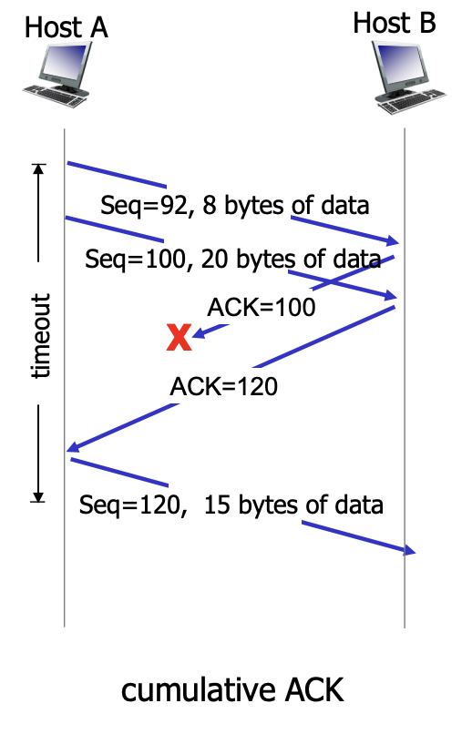

- 호스트A가 2개의 세그먼트를 전송했고, 첫 번째 세그먼트의 ACK이 네트워크에서 분실됨.
  - 첫 번째 타임아웃 전에 호스트A가 ACK120을 수신하면, 호스트A는 호스트B가 119바이트까지 모든 데이터를 수신했다는 것을 알게 됨. ⇒ 호스트A는 어느 것도 재전송X

- 빠른 재전송
  - TCP는 손실을 타임아웃으로 감지하는데, 타이머는 비교적 길게 설정돼있음 → 네트워크 지연 발생
  - <strong>ACK 3번 연속으로 똑같은 게 오면 손실로 간주하고 즉시 재전송!</strong>

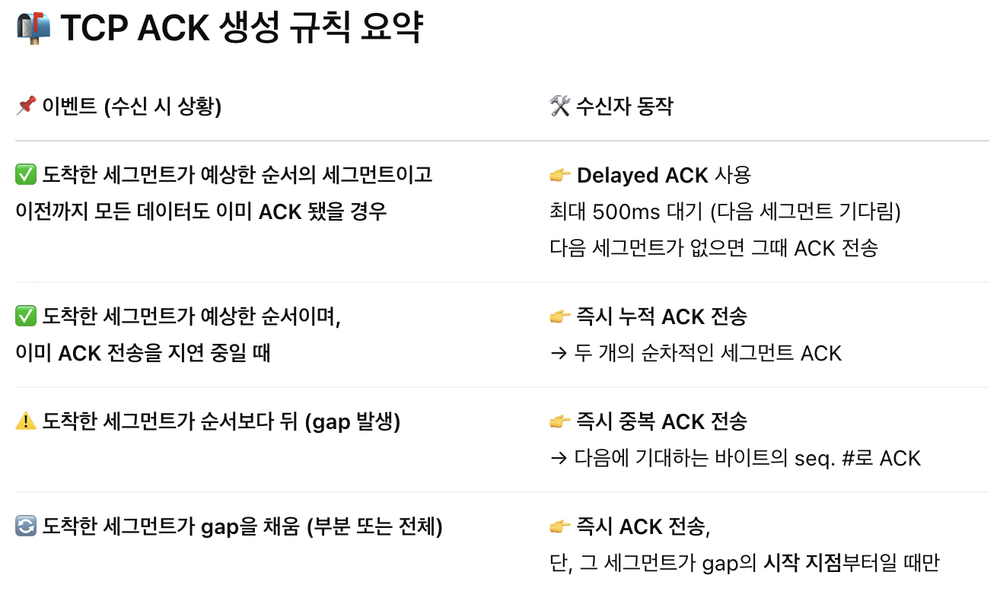
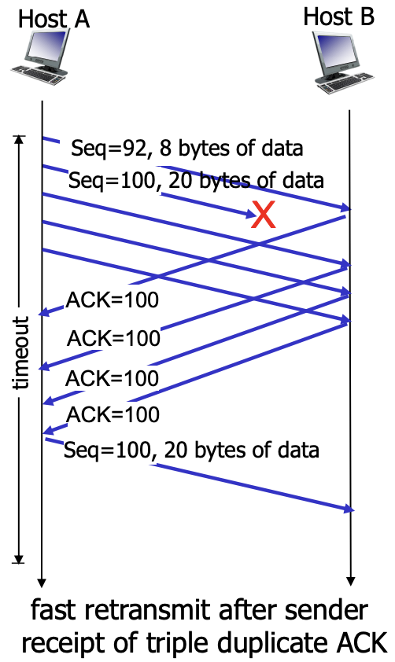

#### <strong>TCP round trip time, timeout</strong>

- 데이터를 보냈는데 도착하지 않을 때 얼마나 더 기다려야 하는가?
- 정상적이라면 최소한 round trip time(RTT) 이내엔 에크가 옴
- RTT보다 짧게 타임 아웃을 정하면 안 됨 → premature timeout을 안 생기게 하기 위해
- RTT는 항상 일정하진 않음 - 라우터에서 처리하는 성능이 트래픽이 많아지면 우선순위가 밀리면서 늦어짐 → 중구난방~
- SampleRTT:
  - estimated RTT: 과거의 데이터를 반영

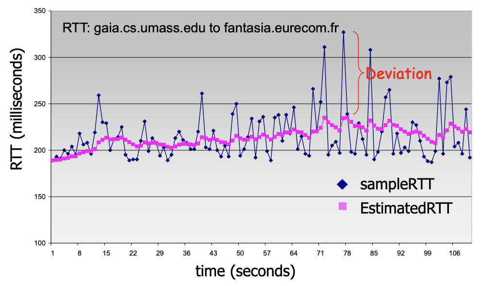

- estimated RTT는 계속 순환
- 알파값은 보통 0.125! 1/8만큼 현재 값 반영하고 7/8은 과거의 값을 가져온다는 뜻 → 중구난방이 smooth 해짐
  - exponential weighted moving average
- Deviation 편차가 크면 safety margin을 더함

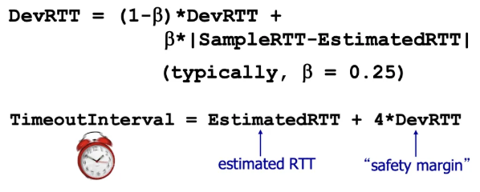

- 과거 값을 3/4 반영, 편차를 1/4 반영
- 그리고 DevRTT를 4곱해서 더함

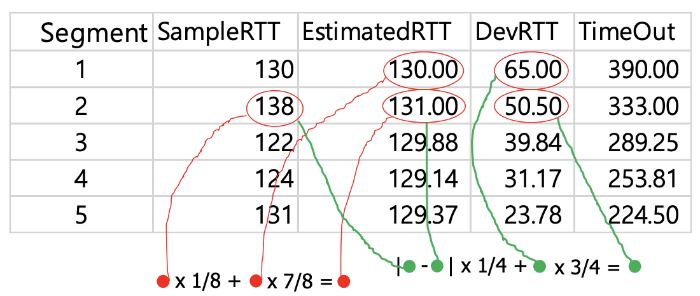

- 제일 처음 EstimatedRTT는 SampleRTT의 처음 값! 과거가 없기 때문에.
- 제일 처음 DevRTT는 SampleRTT의 절반

#### <strong>TCP flow control</strong>

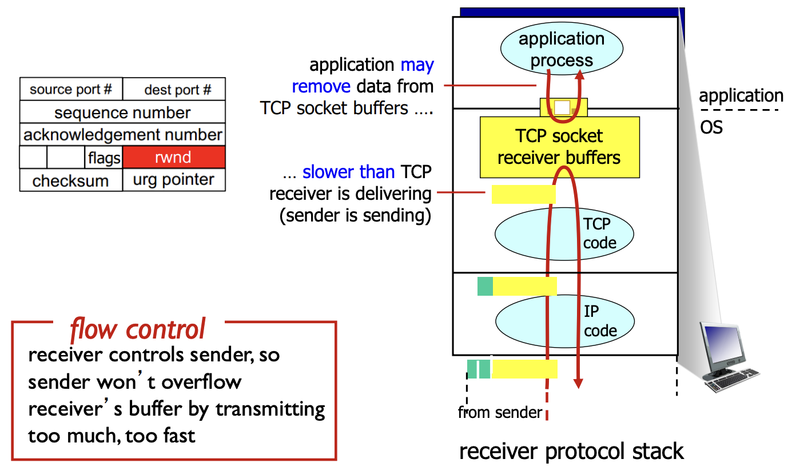

- 송신 쪽에서 수신 쪽을 고려해서 보내는 양을 조절하는 것을 말함 → 수신 쪽의 역량을 알아야 함. → rwnd(receive window)
- 버퍼에서 꺼내가는 속도가 버퍼에 갖다주는 속도보다 느리면?
  - 유실!!
  - 센더가 무시하고 계속 보내면 오버플로우 → flow control이 필요하다!
- 센더가 리시버의 버퍼를 넘치지 않도록 하는것! (버퍼의 오버플로우 방지를 위한 제어) 센더에게는 단지 내가 받을 수 있는 여유 공간을 알려주는 것.

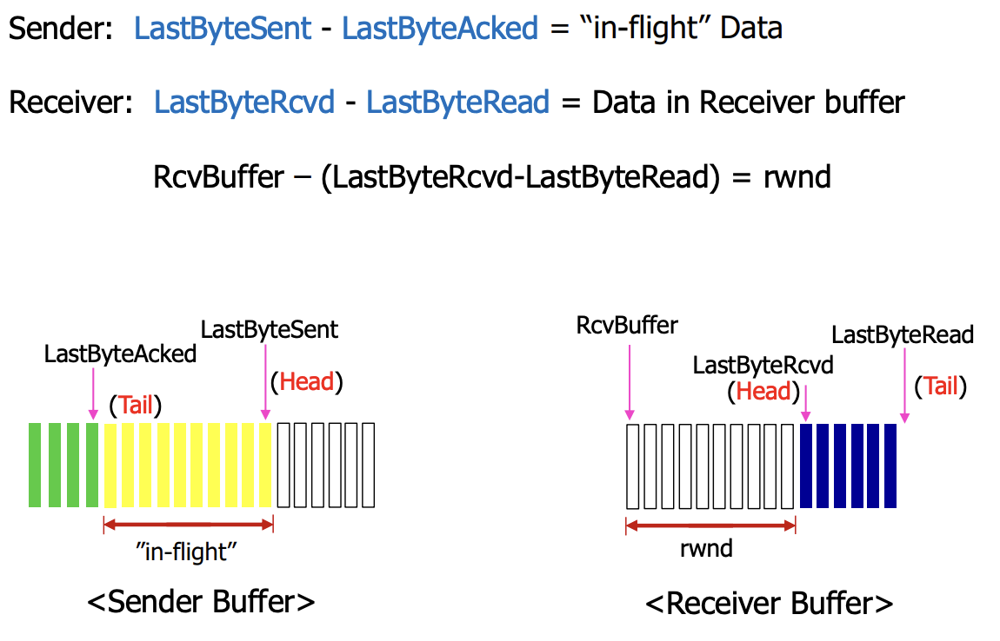

- receiver
  - rwnd(LastByteRcvd - LastByteRead)값으로 수신 버퍼의 여유 공간을 송신자에게 알려줌
  - 이 값은 TCP 헤더에 포함되어 수신자→송신자 방향의 세그먼트로 전달됨
- sender
  - 보내는 데이터의 양을 제한함
  - LastByteSent − LastByteAcked ≤ rwnd
  - 이를 통해 수신자가 처리할 수 있는 양만큼만 데이터 전송 → 수신 버퍼 오버플로우 방지
- rwnd = 0
  - 수신자의 버퍼가 가득 찼다는 의미로, 송신자는 더 이상 데이터를 보낼 수 없음.
  - 이때 sender가 recevier에게 1바이트 데이터로 세그먼트를 계속해서 전송함 → 버퍼가 비워져서 0이 아닌 rwnd값을 확인함

#### <strong>Connection Management</strong>

<strong>3-Way Handshake</strong>

1. Client → Server (SYN)
   - 클라이언트가 연결을 요청
     - SYN flag = 1
     - Seq# = client_isn (클라이언트 초기 시퀀스 번호)
     - 데이터는 없음⇒ 나 연결하고 싶어. 내 시퀀스 번호는 이거야!
2. Server → Client (SYN-ACK)
   - 서버가 SYN을 수신하고, 연결 요청 수락
     - SYN flag = 1, ACK flag = 1
     - ACK# = client_isn + 1 (클라이언트가 시퀀스를 인식했다는 의미)
     - Seq# = server_isn (서버의 초기 시퀀스 번호)
     - 서버는 버퍼 및 변수 초기화⇒ 좋아, 연결 수락! 내 시퀀스 번호는 이거야. 네 것도 잘 받았어.
3. Client → Server (ACK)
   - 클라이언트가 SYN-ACK 수신 후 ACK 전송
     - SYN flag = 0, ACK flag = 1
     - ACK# = server_isn + 1
     - 클라이언트도 버퍼 및 변수 초기화
     - 이 시점부터 데이터 전송 가능⇒ 연결 완료! 이제 데이터 보낼게.

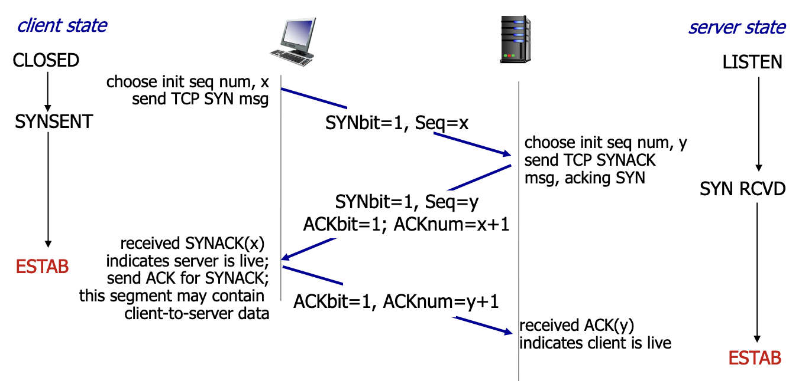
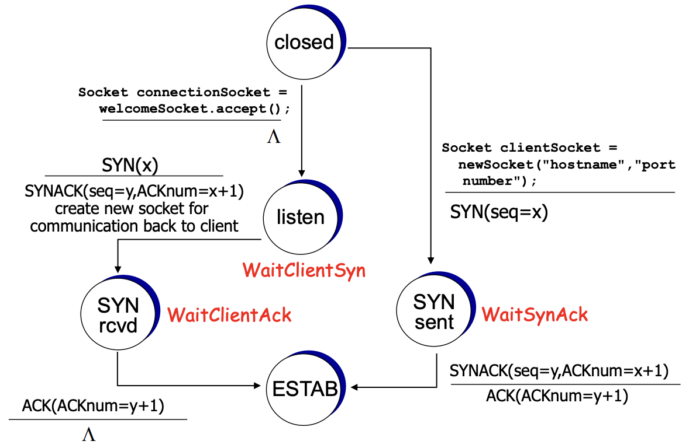

#### <strong>TCP: closing a connection</strong>

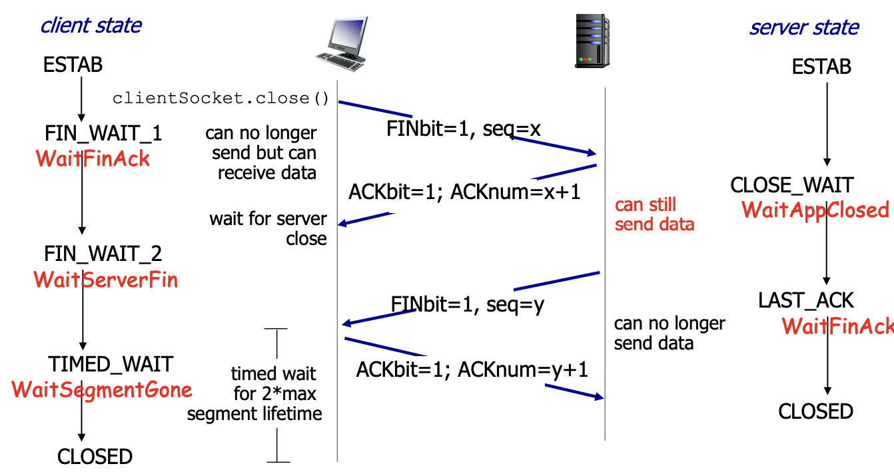

- Client 상태 전이
  1. ESTAB
     - 연결 상태 유지 중
  2. clientSocket.close() 호출
     - 클라이언트는 더 이상 데이터를 보내지 않음 (receive는 가능)
     - FIN, seq=x 전송
  3. → FIN_WAIT_1
  4. 서버가 ACK 응답
     - ACK, ACKnum = x + 1 수신
  5. → FIN_WAIT_2
  6. 서버도 종료 의사 전달 (FIN)
  7. → 클라이언트는 FIN, seq=y 수신
  8. ACK, ACKnum = y + 1 전송 후
     - 2 * 최대 세그먼트 생존 시간만큼 대기
     - 지연된 패킷 제거를 위한 안전 대기
  9. → TIMED_WAIT
  10. CLOSED
      - 완전한 종료

- Server 상태 전이
  1. ESTAB
  2. → 연결 유지 중
  3. 클라이언트의 FIN 수신
     - 서버는 여전히 데이터 전송 가능
  4. → CLOSE_WAIT
  5. 서버도 종료 요청 (FIN 전송)
     - FIN, seq=y 전송
  6. → LAST_ACK
  7. 클라이언트의 ACK 수신
     - 완전한 종료
  8. → CLOSEDServer 상태 전이

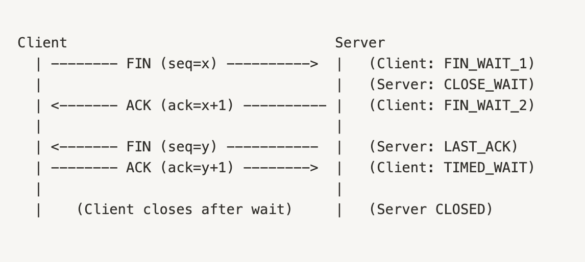
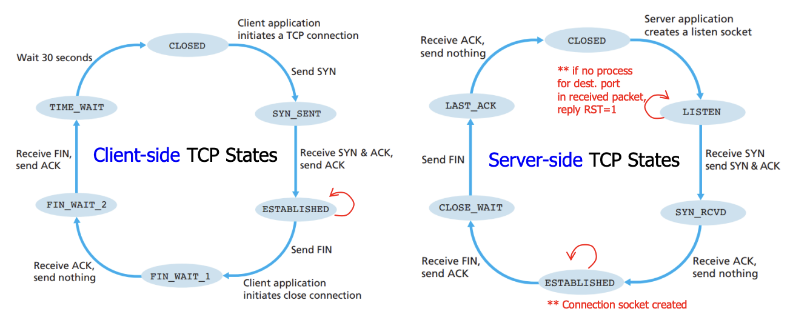

#### <strong>SYN Flood Attack</strong>

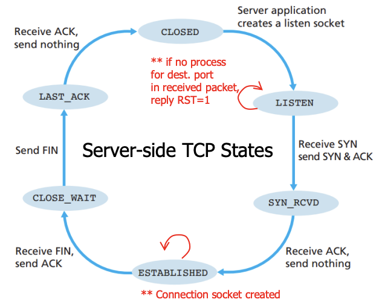

- Hacker - SYN Flooding 공격
  - SYN 패킷만 반복적으로 전송하고, ACK는 보내지 않음
  - TCP 연결은 3-way handshake 중 1단계(SYN)에서 멈춤
  - 결과적으로 서버는 Half-open connection을 계속 유지하게 됨⇒ 서버의 연결 대기 큐가 가득 참, 정상 사용자의 연결 시도는 무시됨 → 서비스 거부(DoS) 공격이 발생
- Server Solution - SYN Cookie 방식
  - 목표 - 공격자가 ACK를 보내지 않는 한 리소스를 낭비하지 않도록 함
  1. SYN 수신 (클라이언트 → 서버)
     - 서버는 아직 리소스 할당 안 함. 대신 바로 SYN-ACK 응답
     - 이 때, 서버 Initial Sequence Number(ISN)는
       - ISN = Hash(src IP + dst IP + src port + dst port + Secret Key)
  2. ACK 수신 (클라이언트 → 서버)
     - 서버는 ACK의 ACK#을 확인
     - →만약 ACK#이 위에서 만든 Hash + 1이면 → 정상 클라이언트로 간주, 리소스 할당 및 연결 완료
     - 아니면 → 무시

