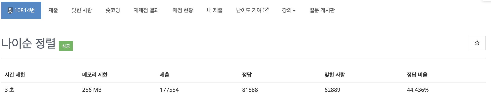


<https://www.acmicpc.net/problem/10814>



### <strong>문제</strong>

온라인 저지에 가입한 사람들의 나이와 이름이 가입한 순서대로 주어진다. 이때, 회원들을 나이가 증가하는 순으로, 나이가 같으면 먼저 가입한 사람이 앞에 오는 순서로 정렬하는 프로그램을 작성하시오.

### <strong>입력</strong>

첫째 줄에 온라인 저지 회원의 수 N이 주어진다. (1 ≤ N ≤ 100,000)

둘째 줄부터 N개의 줄에는 각 회원의 나이와 이름이 공백으로 구분되어 주어진다. 나이는 1보다 크거나 같으며, 200보다 작거나 같은 정수이고, 이름은 알파벳 대소문자로 이루어져 있고, 길이가 100보다 작거나 같은 문자열이다. 입력은 가입한 순서로 주어진다.

### <strong>출력</strong>

첫째 줄부터 총 N개의 줄에 걸쳐 온라인 저지 회원을 나이 순, 나이가 같으면 가입한 순으로 한 줄에 한 명씩 나이와 이름을 공백으로 구분해 출력한다.

---

### <strong>코드</strong>

```python
n = int(input())

dict = {}
for _ in range(n):
    age, name = input().split()
    age = int(age)
    if age not in dict:
        dict[age] = []
    dict[age].append(name)

sorted_dict = sorted(dict.keys())

for k in sorted_dict:
    for v in dict[k]:
        print(k, v)
```

### <strong>풀이</strong>

1. 나이와 이름을 입력받고, 딕셔너리 키에 해당 나이가 없으면 추가한다.

{: start="2"}
2. 해당 나이 키에 값으로 이름을 추가한다.

{: start="3"}
3. 키를 기준으로 정렬하고 출력한다.

3-1 기말고사 공부한다고 알고리 공부를 한 달 쉬었더니 감을 다 잃어버림... 실버5도 겨우 푸는 상태가 됨

1일 1백준 다시 시작함!!! 💪🏻💪🏻💪🏻

블로그도 일주일에 3-4번 꼭 써야지.

