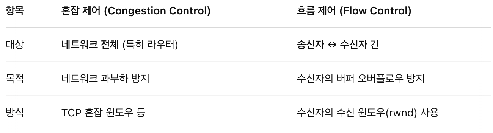
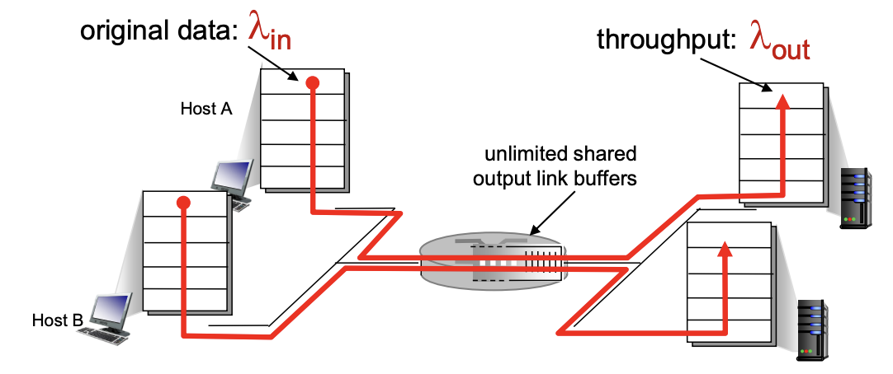
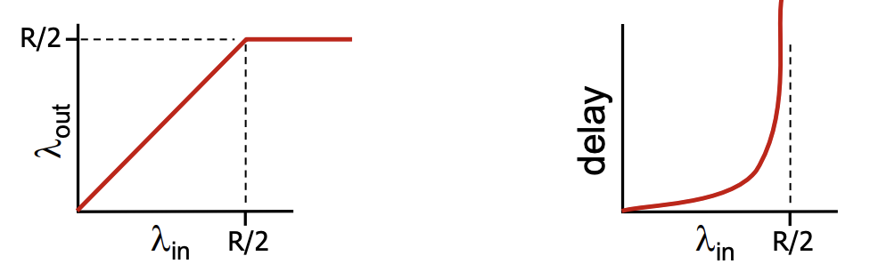
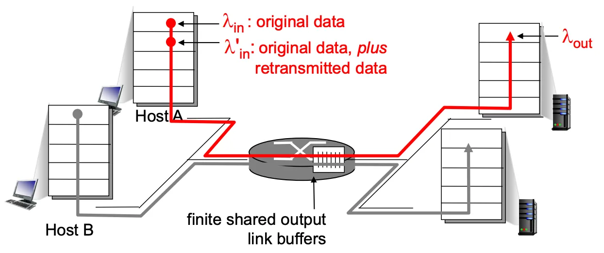
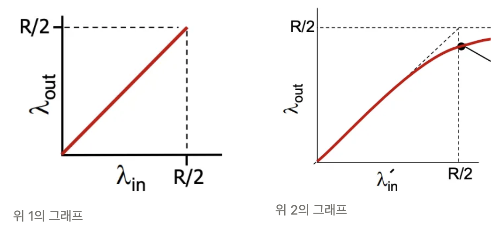
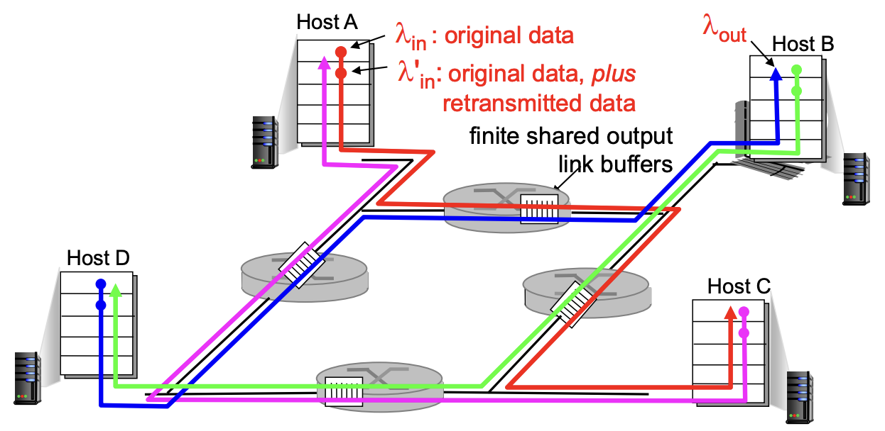
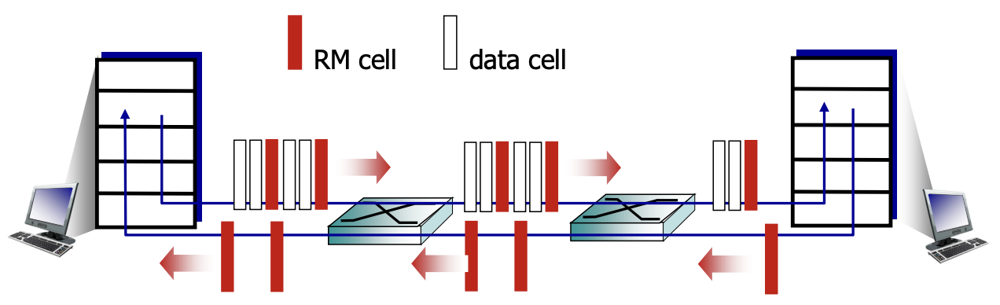


본 내용은 컴퓨터 네트워크 - 하향식 접근 책을 바탕으로 정리하였습니다.

## <strong>principles of congestion control</strong>

- Congestion
  - 너무 많은 송신자들이 너무 빠르게 데이터를 보내서 네트워크가 감당하지 못하는 상태
- 흐름 제어와 다름!

- 주요 현상
  - 패킷 손실 - 라우터의 버퍼가 가득 차서 패킷을 버림
  - 긴 지연 시간 - 라우터에 패킷이 대기열에 길게 줄 서게 됨
- 혼잡 제어는 인터넷의 핵심 기술 중 하나로, 실제로 “Top-10 networking problems” 에 선정됨!

### <strong>혼잡의 원인과 비용</strong>

#### <strong>시나리오 1: 2개의 송신자와 무한 버퍼를 갖는 하나의 라우터</strong>

- 두 호스트 A, B는 <strong>λ(in)</strong> 바이트/초의 속도로 라우터에게 제공하고, 그에 대한 서버의 처리량은 **λ(out)**이 되겠다.
- 이 경우 A, B가 보낼 수 있는 최대 속도로 전송을 해도, 라우터의 버퍼는 무한대이기 때문에 보내는 족족 언젠가는 다 오게 돼있다. 덕분에 재전송도 X

*왼쪽 그래프: 연결당 처리량, 오른쪽 그래프: 연결당 지연*

- 연결당 처리량
  - 두 개의 호스트가 동시에 보내므로, 출력 링크의 가능한 출력량 R을 2로 나눈 값이 올바른 전송률이 되며, 전송률이 R/2 이상일 때, 처리량은 단지 R/2가 될 뿐이다. (성능 그대로)
- 연결당 지연
  - 라우터의 버퍼가 무한대라고 가정했기 때문에 빠른 속도로 계속 보내면 라우터의 버퍼에 무한대로 쌓이게 되며, 위 그래프처럼 딜레이가 아주 크게 증가하게 된다.

- goodput: 시나리오 1처럼 R/2만큼의 출력이 수신되는 아주 좋은 처리량을 의미!

#### <strong>시나리오 2: 2개의 송신자, 유한 버퍼를 가진 하나의 라우터</strong>

- 이 경우 버퍼의 오버플로우가 발생할 수 있으며, 만약 오버플로우 발생 시 재전송이 필요하다.

1. 호스트가 라우터의 버퍼가 비어 있는지 아닌지를 알고, 버퍼가 비어 있을 때만 패킷을 송신한다
   → 이 경우 시나리오 1처럼 어떠한 손실도 발생하지 않고 처리랑은 **λ(in)**과 같다.
2. 호스트는 패킷이 손상된 것을 알았을 때만 재전송한다.
   → 이 경우 라우터에서 버려진 패킷에 대해서만 재전송을 하고 처리되기 때문에 점차 R/2에 가까워지는 구조이다.
3. 유실을 모르고, 타임아웃을 통해서 알게 된다.
   → 이 경우 타임아웃에 따른 지연으로 인해 송신자의 불필요한 재전송이 생기면서 처리량이 줄어든다. (수신측에서 중복된 패킷이 버려지게 되고, 처리량이 감소하게 됨!)

#### <strong>시나리오 3: 4개의 송신자와 유한 버퍼를 가지는 가우터, 그리고 멀티홉 경로</strong>

- 가장 현실적인 시나리오로, 여러 개의 호스트와 멀티홉이 존재하는 경우이며, 4개의 호스트는 겹쳐지는 홉 경로를 통해 패킷을 전송한다. → 이때 타임아웃/재전송 방식을 사용한다고 가정
- 만약 A→C, B→D로 각각 패킷을 전송한다고 했을 때, 서로 같은 멀티홉을 지나가는 순간이 존재하기 때문에 서로의 경로에 영향을 받게 된다. ⇒ 즉, 너무 많은 패킷을 보내려다가 둘 다 못 보낼 수 있다는 뜻!
- 해결방안
  1. 종단 간의 혼잡 제어
     - IP 계층이 네트워크 혼잡에 관해서 종단 시스템에게 어떠한 피드백도 제공하지 않으므로 TCP가 수행해야 함.
     - 타임아웃, 딜레이가 나타날 때 TCP 세그먼트의 손실은 네트워크 혼잡 발생으로 생각할 수 있음.
     - 추가로 TCP는 그에 따라서 윈도 크기를 줄임.
  2. 네트워크 지원 혼잡 제어
     - 라우터가 송신자에게 직접적인 피드백을 제공.
     - ex. ATM ABR, ECN, SNA

### <strong>ATM ABR Congestion Control</strong>

- 탄력적 서비스(elatic service) - 사용 가능한 대역폭을 최대한 활용하는 서비스
- 경로가 과부하가 아니면
  - 송신자는 가능한 대역폭만큼 자유롭게 전송 가능
- 경로가 혼잡하면
  - 송신자는 최소 보장 속도로 속도를 줄여야 함

#### <strong>RM 셀 (Resource Management Cells)</strong>

- ABR 흐름 제어에서 사용되는 제어용 셀 - 데이터 셀 사이에 섞여서 전송됨
- 주요 비트 (혼잡 제어 정보 포함)
  - NI (No Increase) - 전송 속도 증가 금지 (경로에 약간의 혼잡 존재)
  - CI (Congestion Indication) - 혼잡 신호 (경로가 혼잡함)

- ER 필드 (Explicit Rate)
  - RM 셀 안에 포함된 2바이트 필드 (송신자가 따라야 할 최대 전송 속도)
  - 혼잡 스위치의 역할
    - RM 셀을 지나갈 때, 혼잡한 스위치가 ER 값을 낮출 수 있음
    - 경로 상 여러 스위치가 ER을 조정하며, 가장 낮은 ER 값이 송신자에게 전달
  - 결과
    - 송신자는 ER 값 이하로 전송 속도 제한
    - 즉, ER은 <strong>네트워크가 허용할 수 있는 최대 속도</strong> 역할
- ERCI 비트 (Explicit Forward Congestion Indication)
  - 데이터 셀 내에 존재하는 혼잡 알림 비트
  - 스위치가 혼잡하면 해당 비트를 1로 설정

