
본 내용은 컴퓨터 네트워크 - 하향식 접근 책을 바탕으로 정리하였습니다.

## <strong>Network layer</strong>

### <strong>4.1 introduction</strong>

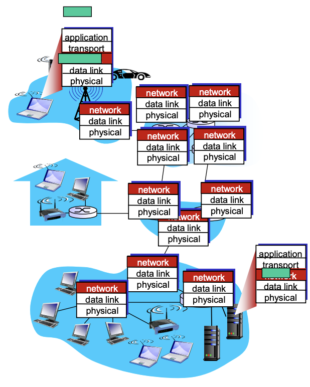

- 송신 측 호스트에서 보낸 트랜스포트 세그먼트를 받아서 수신 호스트에 전달해줌
- 세그먼트를 encapsulate해서 datagram으로 만듦
- 수신 측에서는 datagram을 받아서 뜯고 segment를 transport layer에 전달함
- network layer protocol은 모든 호스트, 라우터에 있음

#### <strong>Two key network-layer functions</strong>

- forwarding: 라우터의 링크 중 몇 번 링크에 보내주는 과정
- routing: 링크 중 몇 번 링크에 보낼지 정하는 과정

#### <strong>Interplay between routing and forwarding</strong>

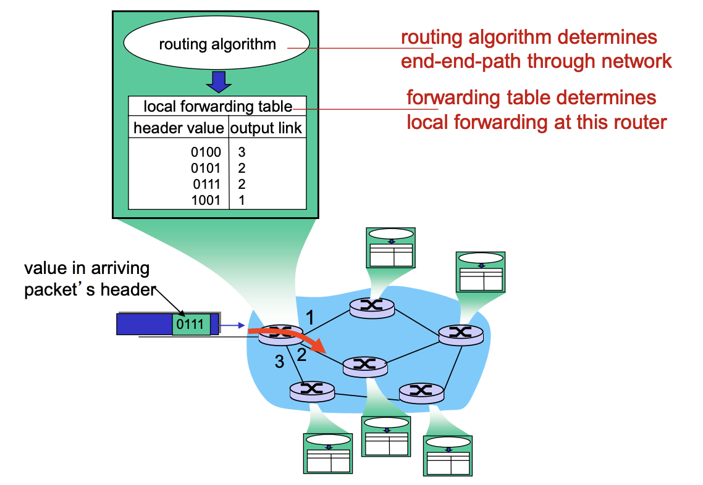

- routing을 하면 table이 만들어짐 (위 테이블은 0100이면 3으로 가라, 0101이면 2로 가라 이런 뜻!)
- 패킷의 헤더를 보고 0111이므로 2번 링크로 보내는 것이 forwarding
- routing algorithm이 end-end-path를 결정함

#### <strong>Connection setup</strong>

- 중요한 네트워크 아키텍쳐
  - ATM(bit rate를 보장해주면서 congestion 정보도 주면서 안정적으로 전송), frame relay, X.25
- virtual connection
- network layer, transport layer의 connection service
  - network: host 간의 connection
  - transport: process 간의 connection

#### <strong>Network service model</strong>

- 각각의 datagram들을 위한 서비스
  - 보장된 전달
  - 40 msec보다 적은 딜레이
- datagram의 흐름을 위한 서비스
  - 순서대로 전달되는 datagram
  - 보장된 minimun bandwidth
  - 패킷과 패킷 사이의 space가 일정해야 함

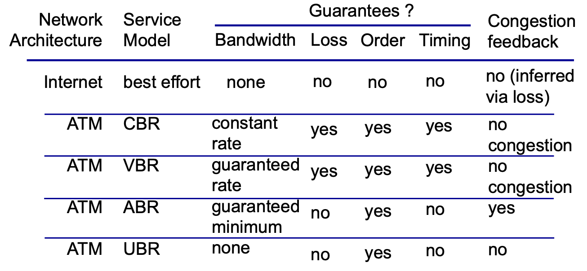

### <strong>4.2 virtual circuit and datagram networks</strong>

#### <strong>Connection, connection-less service</strong>

- datagram은 network layer에 connectionless 서비스를 제공함
- virtual-circuit은 network layer에 connection 서비스를 제공함
- Network-layer vs. Transport-layer(ex: Internet)

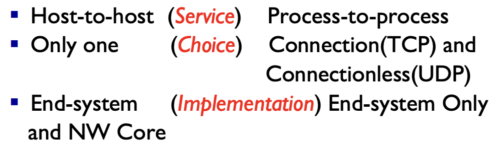

#### <strong>Virtual circuits</strong>

- “source-to-dest” 전화 회선처럼 동작함.
- call setup: 데이터 전송을 시작하기 전에 가상 경로를 미리 설정하는 과정
- VC identifier 을 통해 라우팅 (패킷은 destination을 가지고 라우팅)
- 모든 라우터는 state를 가지고 있어야 함 (패킷은 state X)
- dedicated resources = predictable service

#### <strong>VC implementation</strong>

1. 목적지까지의 path
2. VC number(각 링크에서 넘버를 정해줌)
3. forwarding table

- 최종 목적지로 라우팅 X, VC number로 라우팅

#### <strong>VC forwarding table</strong>

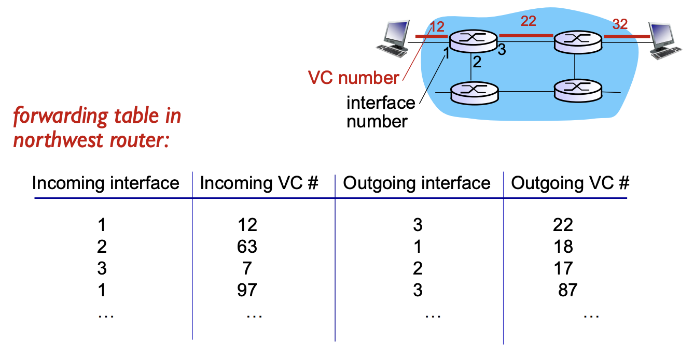

⇒ VC 라우터는 connection state 정보를 항상 기억하고 있음!

#### <strong>Virtual circuits: signaling protocols</strong>

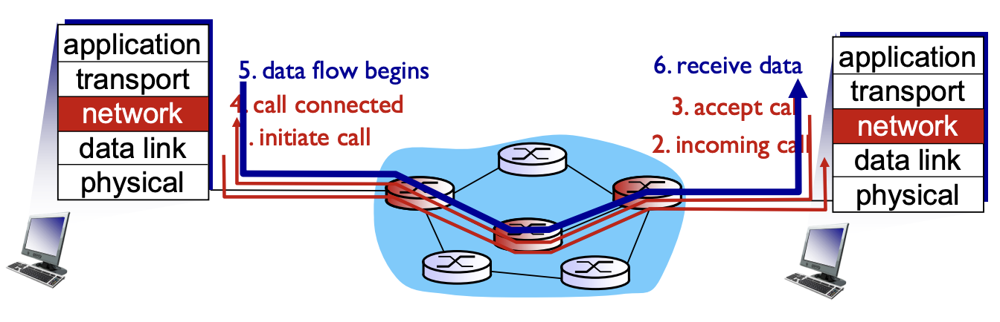

1. (왼) initiate call
2. (오) incoming call
3. (오) accept call
   - 지금 온 path를 그대로 쓰겠다~ 이거로 connection 맺자~
4. (왼) call connected
5. (왼) data flow begins
6. (오) receive data

#### <strong>Datagram networks</strong>

- call setup을 안 함
- 라우터가 state를 갖고 있지 않음
- 목적지의 주소를 가지고 forward 함

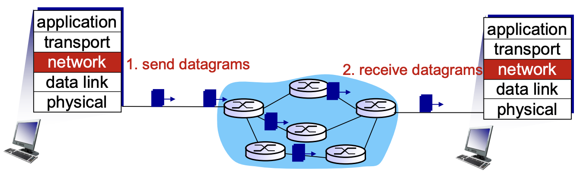

#### <strong>Datagram forwarding table</strong>

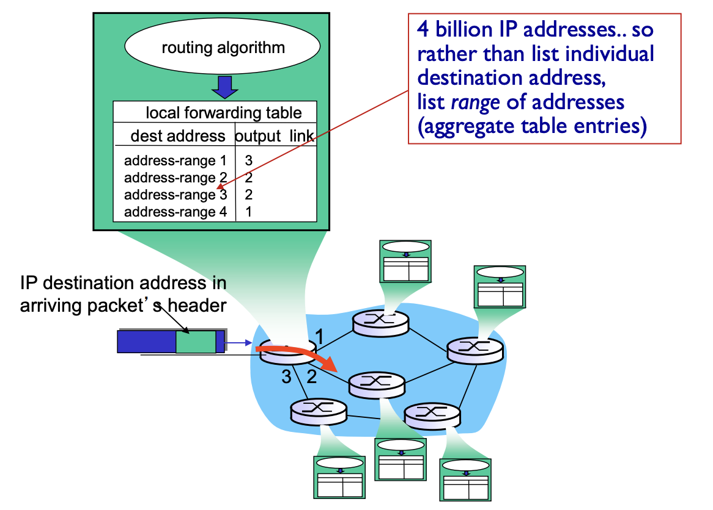

#### <strong>Longest prefix matching</strong>

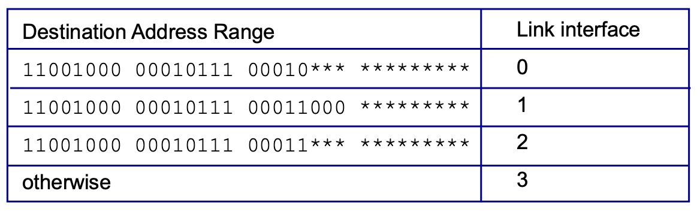

- 목적지 ip주소의 "가장 긴 접두사"를 찾아 각 링크 인터페이스에 보내는 방법

#### <strong>Datagram or VC network: why?</strong>

- Internet (datagram)
  - 컴퓨터 간의 데이터 교환
    - 탄력적인 서비스, 엄격한 타이밍 요구사항 없음
  - 다양한 링크 유형
    - 다양한 특성
    - 각 서비스에 맞춤
  - smart end system
    - 적응, 제어, error recovery를 할 수 있음
    - 단순한 내부 네트워크, 엣지에서 복잡함
- ATM (VC)
  - 전화 통신에서 진화함
  - 인간 대화
    - 엄격한 타이밍, 신뢰성 요구
    - 보장된 서비스
  - dumb end system
    - 전화
    - 네트워크 내부의 복잡성

### <strong>4.3 what’s inside a router</strong>

#### <strong>Router architecture overview</strong>

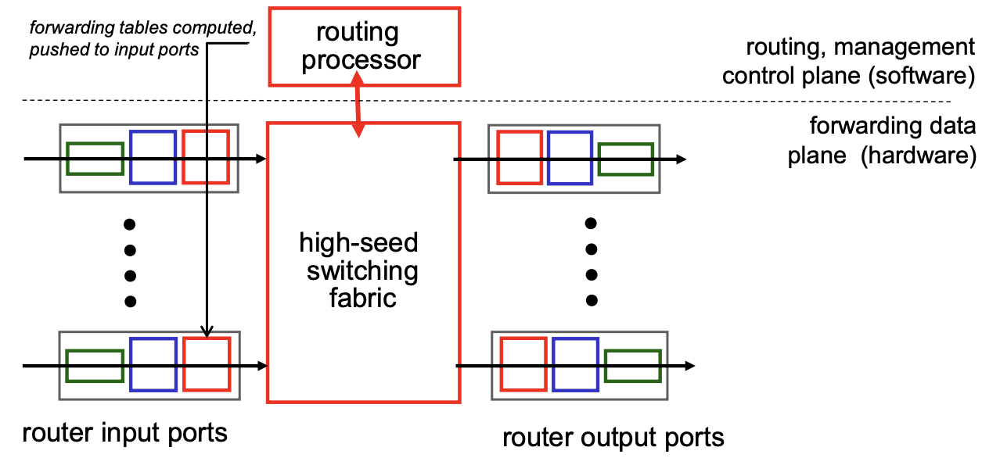

- 라우터의 기능
  - 라우팅 알고리즘/프로토콜 실행
    - RIP, OSPF, BGP
  - 데이터그램 포워딩
- high-seed switching fabric은 빠르게 switch 해야하므로 하드웨어로 구현

#### <strong>Input port functions</strong>

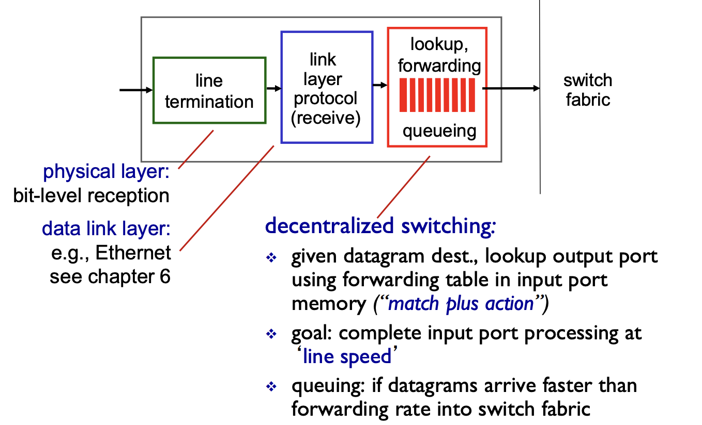

- line termination
  - 케이블로부터 온 전기 신호를 소프트웨어적으로 바꾸는 장치가 들어 있음
  - 비트 신호를 받음
- link layer protocol
  - ex. 이더넷
- lookup, forwarding queueing
  - 네트워크 layer
  - decentralized switching
    - 검색과 포워딩은 앞에서 본 것처럼 최장 접두사 매칭을 포워딩 테이블에서 찾음
  - 목표
    - line speed 로 보내는 것
  - queuing
    - 큐잉은 데이터그램 도착이 스위칭보다 빠른 경우 데이터그램을 큐에 쌓는 일
- switch fabric

#### <strong>Switching fabrics</strong>

- 컴퓨터로 만들어 저장하는 것

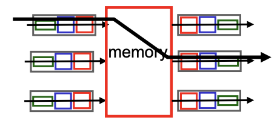

- bus

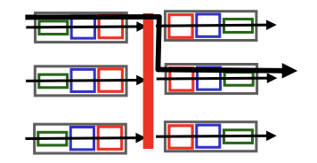

- crossbar

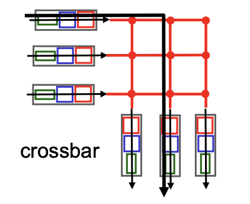

- switching rate
  - N개의 인풋 → N times line rate

#### <strong>Switching via memory</strong>

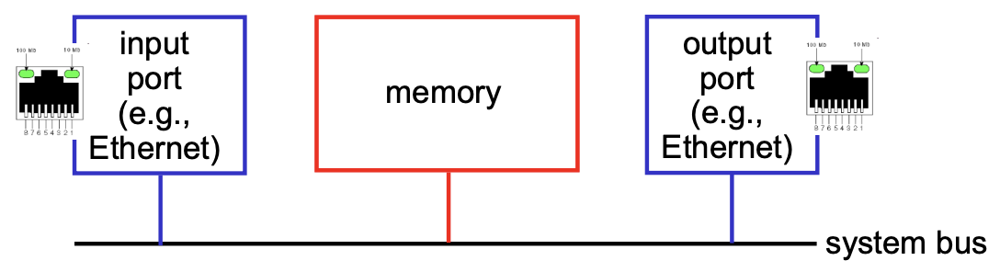

- 버스를 2번 써야 함 → 느림

#### <strong>Switching via a bus</strong>

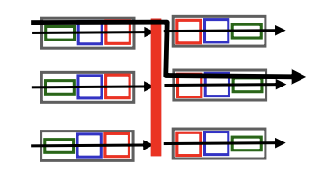

- bus contention: 버스를 어디에서 쓰고 있으면 다른 애가 못 씀. 버스 경쟁!

#### <strong>Switching via interconnection network</strong>

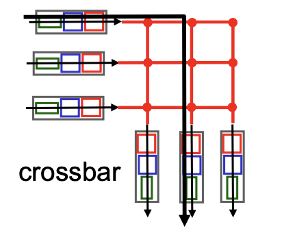

- 버스가 여러 개 있는 것
- 인풋과 아웃풋이 정해지면 그 모서리의 스위치가 on
- 똑같은 인풋과 똑같은 아웃풋이 아니면 크로스바 통과 가능 → 3배

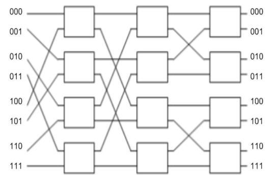

- Banyan Network
  - 돈이 덜 듦
  - 8x8 일 때 원래는 64개의 스위치 필요 → 12개로 줄어듦
  - 3번을 거쳐 가므로 속도가 위에보단 떨어질 수 있음

#### <strong>Output ports</strong>

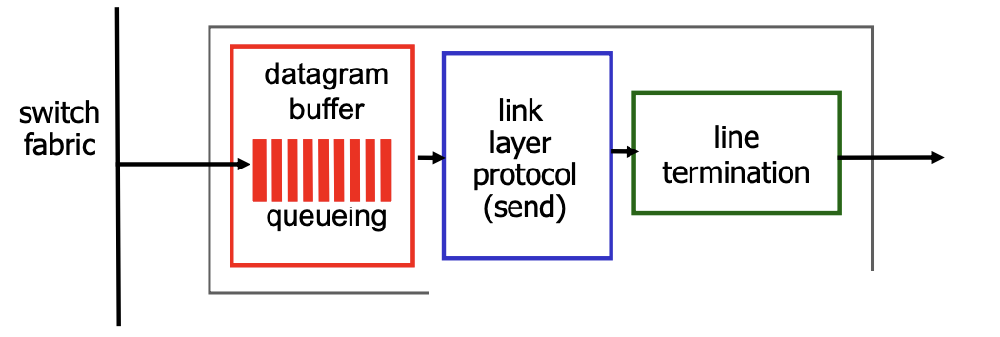

- buffering
  - datagram이 전송률보다 더 빨리 fabric 으로 도착했을 때
  - 버퍼에서 패킷을 다 못 담기 때문에 lost 될 수 있음
- scheduling discipline
  - 전송률을 위헤 queue 안의 datagram 중 고르는 것
  - Priority scheduling 이라고도 불림, 망 중립성(network neutrality)

#### <strong>Output port queueing</strong>

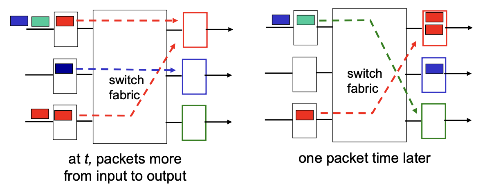

- 스위치를 통한 도착률이 line speed를 초과할 때 버퍼링
- 출력 포트 버퍼 오버플로로 인핸 queueing 지연 및 손실이 일어남

#### <strong>How much buffering?</strong>

- C = 처리해야 하는 용량
- N = 플로우 개수

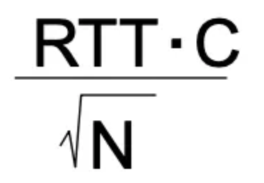

#### <strong>Input port queuing</strong>

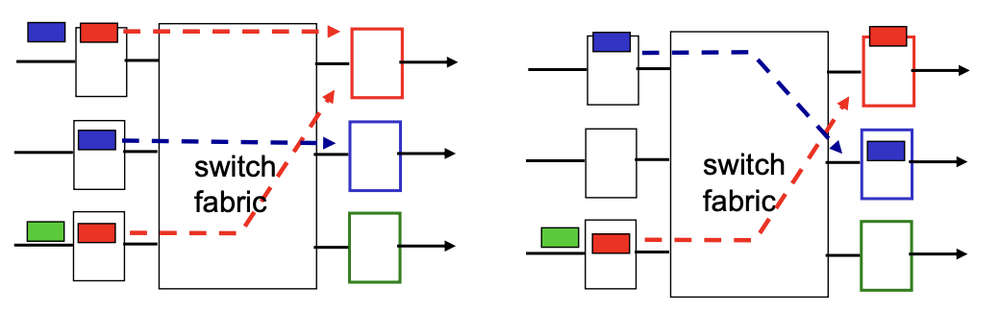

- Head-of-the-Line (HOL) blocking
  - 맨 앞에 있는 패킷(데이터그램)이 지연되면서, 뒤에 있는 다른 패킷들까지 전달되지 못하게 되는 현상

