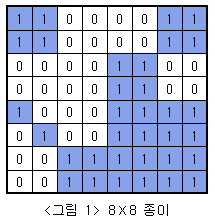
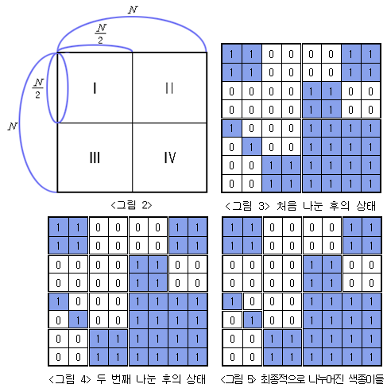


<https://www.acmicpc.net/problem/2630>


### <strong>문제</strong>

아래 &lt;그림 1&gt;과 같이 여러개의 정사각형칸들로 이루어진 정사각형 모양의 종이가 주어져 있고, 각 정사각형들은 하얀색으로 칠해져 있거나 파란색으로 칠해져 있다. 주어진 종이를 일정한 규칙에 따라 잘라서 다양한 크기를 가진 정사각형 모양의 하얀색 또는 파란색 색종이를 만들려고 한다.



전체 종이의 크기가 N×N(N=2k, k는 1 이상 7 이하의 자연수) 이라면 종이를 자르는 규칙은 다음과 같다.

전체 종이가 모두 같은 색으로 칠해져 있지 않으면 가로와 세로로 중간 부분을 잘라서 &lt;그림 2&gt;의 I, II, III, IV와 같이 똑같은 크기의 네 개의 N/2 × N/2색종이로 나눈다. 나누어진 종이 I, II, III, IV 각각에 대해서도 앞에서와 마찬가지로 모두 같은 색으로 칠해져 있지 않으면 같은 방법으로 똑같은 크기의 네 개의 색종이로 나눈다. 이와 같은 과정을 잘라진 종이가 모두 하얀색 또는 모두 파란색으로 칠해져 있거나, 하나의 정사각형 칸이 되어 더 이상 자를 수 없을 때까지 반복한다.

위와 같은 규칙에 따라 잘랐을 때 &lt;그림 3&gt;은 &lt;그림 1&gt;의 종이를 처음 나눈 후의 상태를, &lt;그림 4&gt;는 두 번째 나눈 후의 상태를, &lt;그림 5&gt;는 최종적으로 만들어진 다양한 크기의 9장의 하얀색 색종이와 7장의 파란색 색종이를 보여주고 있다.



입력으로 주어진 종이의 한 변의 길이 N과 각 정사각형칸의 색(하얀색 또는 파란색)이 주어질 때 잘라진 하얀색 색종이와 파란색 색종이의 개수를 구하는 프로그램을 작성하시오.

#### <strong>입력</strong>

첫째 줄에는 전체 종이의 한 변의 길이 N이 주어져 있다. N은 2, 4, 8, 16, 32, 64, 128 중 하나이다. 색종이의 각 가로줄의 정사각형칸들의 색이 윗줄부터 차례로 둘째 줄부터 마지막 줄까지 주어진다. 하얀색으로 칠해진 칸은 0, 파란색으로 칠해진 칸은 1로 주어지며, 각 숫자 사이에는 빈칸이 하나씩 있다.

#### <strong>출력</strong>

첫째 줄에는 잘라진 햐얀색 색종이의 개수를 출력하고, 둘째 줄에는 파란색 색종이의 개수를 출력한다.

---

### <strong>코드</strong>

```python
import sys
input = sys.stdin.readline

n = int(input())

paper = []
for _ in range(n):
    paper.append(list(map(int, input().split())))

cnt_w = 0
cnt_b = 0

def check_paper(x, y, size):
    global cnt_w, cnt_b
    blue = 0
    white = 0

    for i in range(y, y + size):
        for j in range(x, x + size):
            if not paper[i][j]:
                blue = 1
            elif paper[i][j]:
                white = 1

    if not blue:
        cnt_b += 1
    elif not white:
        cnt_w += 1
    else:
        if size >= 2:
            check_paper(x, y, size // 2)
            check_paper(x, y + size // 2, size // 2)
            check_paper(x + size // 2, y, size // 2)
            check_paper(x + size // 2, y + size // 2, size // 2)

check_paper(0, 0, n)
print(cnt_w)
print(cnt_b)
```

