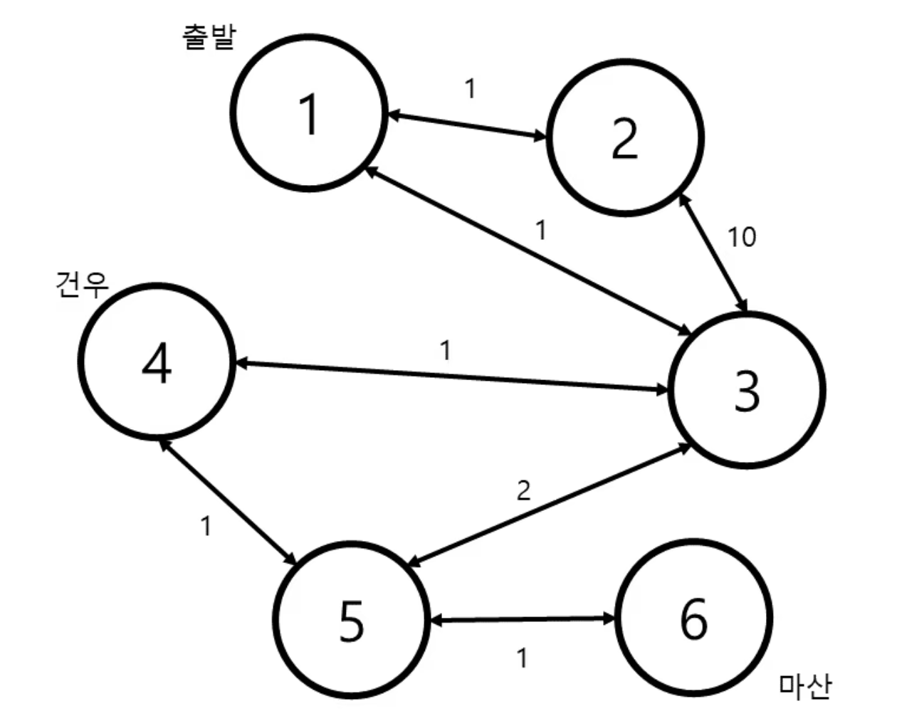


<https://www.acmicpc.net/problem/18223>


### <strong>문제</strong>

종강을 맞은 민준이는 고향인 마산으로 내려갈 계획을 짜고 있었다. 늘 그랬듯, 마산으로 갈 버스를 예약하려던 순간 민준이는 집으로 가는 다른 방법이 떠올랐다. 그것은 직접 지도를 보고 고향으로 가는 가장 짧은 길을 찾는 것이다.

그때, 먼저 고향으로 내려갔던 친구인 건우에게 연락이 왔다. 건우는 고향으로 내려가던 중 알 수 없는 일에 휘말려 외딴곳에 혼자 남겨지게 되었다. 건우는 유일한 구세주인 민준이에게 도움을 청한 것이었다. 그러나 마산의 남자인 민준이에게는 마산이 먼저였다. 민준이는 처량한 건우를 무시한 채 고향으로 떠나려고 했지만, 만약 고향으로 가는 길에 건우가 있다면 겸사겸사 도움을 줄 수 있을 것 같았다.

지도는 양방향 그래프 형태로 되어있다. 출발지는 1번 정점 마산은 V번 정점이다. 정점은 1~V까지 있다. 건우는 P번 정점에 있다.
그리고 항상 1번 정점에서 P번과 V번 정점으로 갈 수 있는 경로가 존재한다.
중복되는 간선과 자기 자신을 가리키는 간선은 존재하지 않는다.

아래와 같은 그래프가 있을 때,



위의 경우는 최단 경로가 두 가지 있다.
1→3→4→5→6 또는 1→3→5→6 이다. 이것 중에서 건우가 있는 곳, 즉 4번 정점이 포함된 최단 경로가 있으므로 이 경우에는 민준이가 건우를 도울 수 있다.

민준이가 건우를 도와주는 경로의 길이가 최단 경로의 길이보다 길어지지 않는다면, 민준이는 반드시 건우를 도와주러 간다.

어쩌면 지킬 수도 있는 민준이의 우정을 위해 우리가 도와주자!

### <strong>입력</strong>

입력의 첫 번째 줄에 정점의 개수 V와 간선의 개수 E, 그리고 건우가 위치한 정점 P가 주어진다. (2 ≤ V  ≤ 5,000, 1 ≤ E ≤ 10,000, 1 ≤ P  ≤ V)

두 번째 줄부터 E개의 줄에 걸쳐 각 간선의 정보 a,b,c가 공백으로 구분되어 주어진다. 이는 a번 정점과 b번 정점 사이의 거리가 c임을 의미한다. (1 ≤ a,b ≤ V, 1 ≤ c  ≤ 10,000)

### <strong>출력</strong>

민준이가 찾은 최단 경로 위에 건우가 있다면 "SAVE HIM" 을 아니면 "GOOD BYE" 를 출력한다.

---

### <strong>코드</strong>

```python
import heapq

v, e, p = map(int, input().split())

adj = [[] for _ in range(v + 1)]
for _ in range(e):
    a, b, c = map(int, input().split())
    adj[a].append((b, c))
    adj[b].append((a, c))

INF = int(1e9)

def dijkstra(start):
    distance = [INF] * (v + 1)
    q = []

    heapq.heappush(q, (0, start))
    distance[start] = 0

    while q:
        dist, now = heapq.heappop(q)
        if distance[now] < dist:
            continue

        for nxt, w in adj[now]:
            cost = dist + w
            if cost < distance[nxt]:
                distance[nxt] = cost
                heapq.heappush(q, (cost, nxt))

    return distance

dist_from_start = dijkstra(1)
dist_from_p = dijkstra(p)

cost1 = dist_from_start[p]
cost2 = dist_from_start[v]
cost3 = dist_from_p[v]

if cost2 == cost1 + cost3:
    print("SAVE HIM")
else:
    print("GOOD BYE")
```

### <strong>풀이</strong>

1. 그래프의 간선 정보를 인접 리스트에 양방향으로 기록한다.

{: start="2"}
2. 다익스트라 함수

- 거리 정보를 저장할 distance를 INF로 초기화한다.
- 시작 노드의 번호와 dist(0)을 힙에 넣는다.
- 힙에서 거리(dist)와 노드 번호를 뺀다.
- 만약 현재 노드까지의 거리가 dist보다 작다면 아래 과정을 건너뛰고 다시 반복문을 실행한다.
- 현재 노드까지의 거리가 dist보다 크거나 같다면, 현재 노드와 연결된 노드들을 확인한다.
- 연결된 노드까지의 거리가 distance[연결된 노드]보다 작다면 최소 거리를 갱신하고 힙에 넣는다.
- 위 과정을 힙이 빌 때까지 반복한다.
- 힙이 비어 반복문을 빠져나오면 distance 리스트를 반환한다.

{: start="3"}
3. 시작점과 p부터 다익스트라를 2번 실행한다.

{: start="4"}
4. 시작점 ~ p 까지의 최소 거리 =&gt; cost1, 시작점 ~ v 까지의 최소 거리 =&gt; cost2, p ~ v 까지의 최소 거리 =&gt; cost3

{: start="5"}
5. cost2 가 cost1 + cost3과 같다면 최단 거리에 건우가 있다는 뜻이다.

