
이번 UMC 9기에 운영진을 맡게 되면서 협업이 처음인 동아리원들을 위해 원디랑 깃/깃허브 미미나를 준비해봤다!

준비하며 정리했던 내용들을 아래 작성 후 마지막에 미미나 후기를 짧게 써보겠다!!

## 1. 깃(Git)과 깃허브(GitHub) 관계

### Git 이란?

> Git은 <strong>분산 버전 관리 시스템(DVCS)</strong>으로, 파일의 변경 이력을 추적하고 여러 사람과 협력하여 작업할 수 있도록 돕는 도구이다.
>
> Git을 사용하면 프로젝트의 소스 코드나 문서 등의 변화를 기록하고, 언제든지 과거의 특정 시점으로 되돌릴 수 있다.
>
> 또한, 분산 저장소를 기반으로 하기 때문에, 모든 사용자는 프로젝트의 전체 히스토리를 로컬에 저장하고 있어 인터넷 연결 없이도 작업이 가능합니다.

### GitHub란?

> GitHub는 <strong>Git을 기반으로 한 웹 호스팅 서비스</strong>로, Git 저장소를 온라인에서 호스팅하고 관리할 수 있도록 도와준다.
>
> 개발자들은 GitHub를 사용해 코드 버전 관리를 쉽게 할 수 있으며, 전 세계 사람들과 협업하여 소프트웨어 프로젝트를 진행할 수 있다.

즉, 깃은 도구, 깃허브는 깃 저장소를 올려놓는 공간(클라우드)!

## 2. 로컬(Local)과 원격(Remote) 관계

### 레포지토리(repository)란?

> 프로젝트의 저장소! 코드, 커밋 히스토리, 브랜치 등 프로젝트 관련 버전 관리 정보가 들어있다.
> 크게 두 종류가 있는데, 로컬 레포지토리와 원격 레포지토리가 있다.
>
> - <strong>로컬 레포지토리(Local Repository)</strong> : 내 컴퓨터 안에 있는 저장소. 개발자가 실제로 코드를 작성/수정하는 공간이다. (내 PC) - <strong>원격 레포지토리(Remote Repository)</strong> : 깃허브같은 서버에 있는 저장소. 다른 사람과 공유하거나 백업하는 공간이다.
>
> 로컬과 원격은 연결되어 동기화할 수 있음!

### 깃허브에서 레포지토리 생성 후 로컬 환경과 연결하기

1. 깃허브 홈에서 New 버튼 클릭!

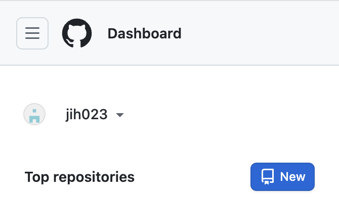

{: start="2"}
2. 레포지토리 이름 입력 후 아래 Create Repository 버튼 클릭

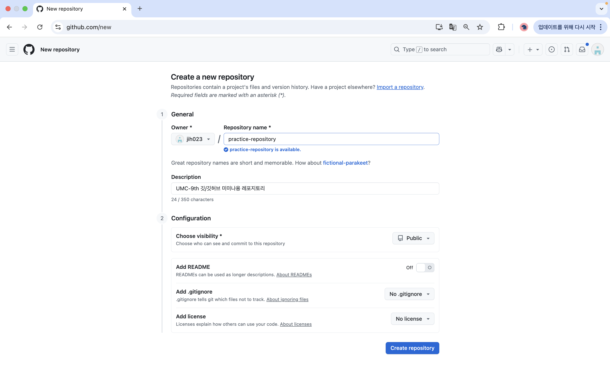

{: start="3"}
3. 첫 번째 명령어들을 전체 복사 한 뒤 vscode 또는 Intellij 터미널에 붙여넣기 해줍니다!

- 첫 번째 명령어 -&gt; 새 프로젝트를 만들고 처음부터 깃으로 관리할 때
- 두 번째 명령어 -&gt; 이미 로컬에서 깃을 쓰고 있는 프로젝트를 깃허브에 올릴 때

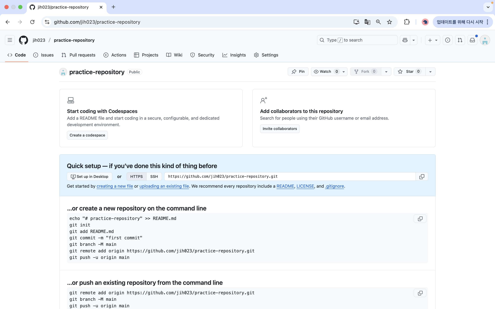
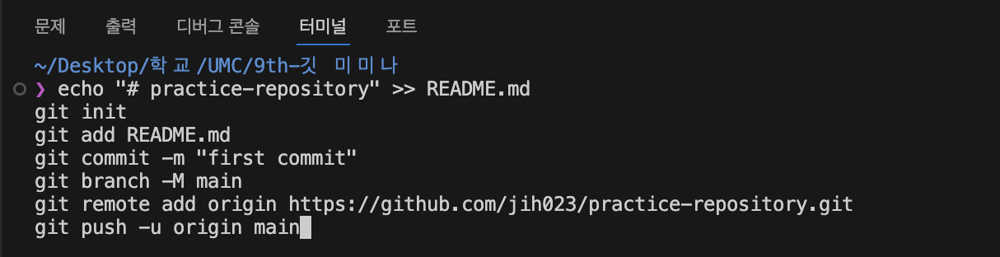

{: start="4"}
4. 이렇게 되면 연결 완료!

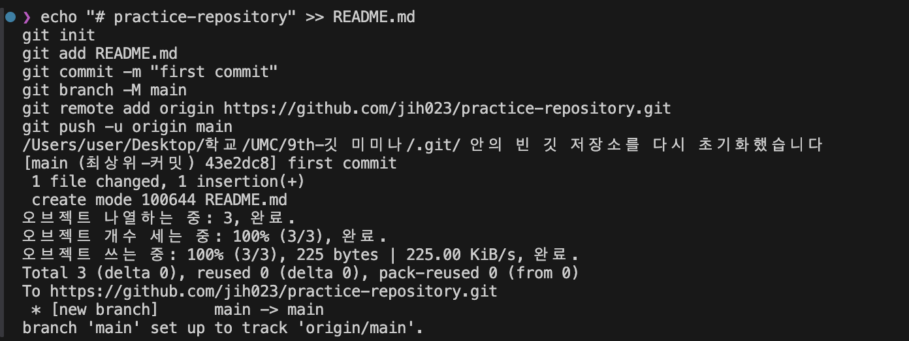
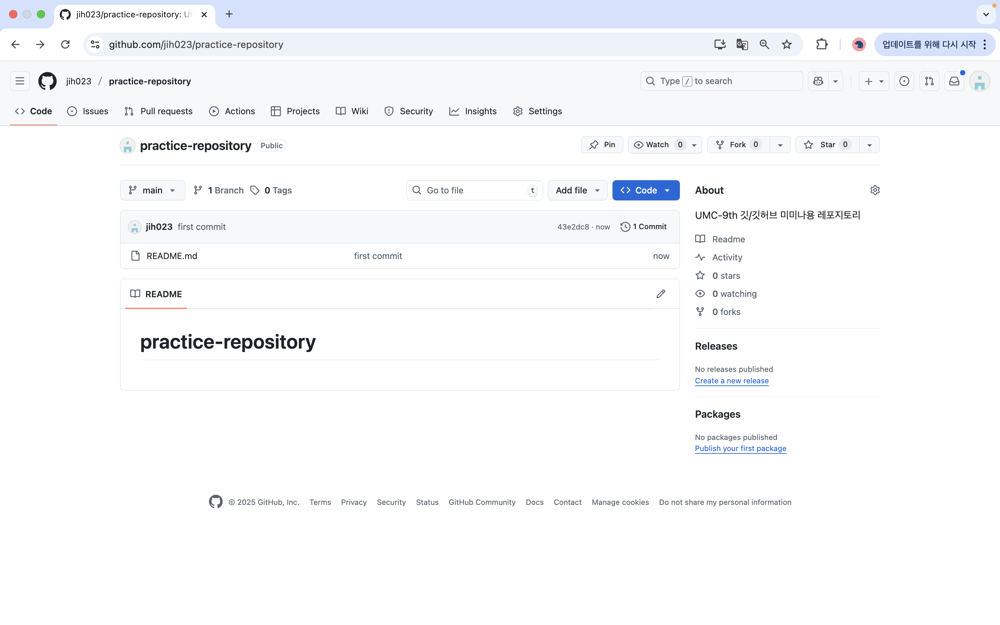

### 다른 사람이 이미 생성한 레포지토리 내 로컬과 연결하기

1. 위에서 한 것처럼 연결을 원하는 폴더에서 터미널을 접속해줍니다!

{: start="2"}
2. 연결할 깃허브 레포지토리에서 Code 버튼 클릭 후 웹 URL을 복사해줍니다.

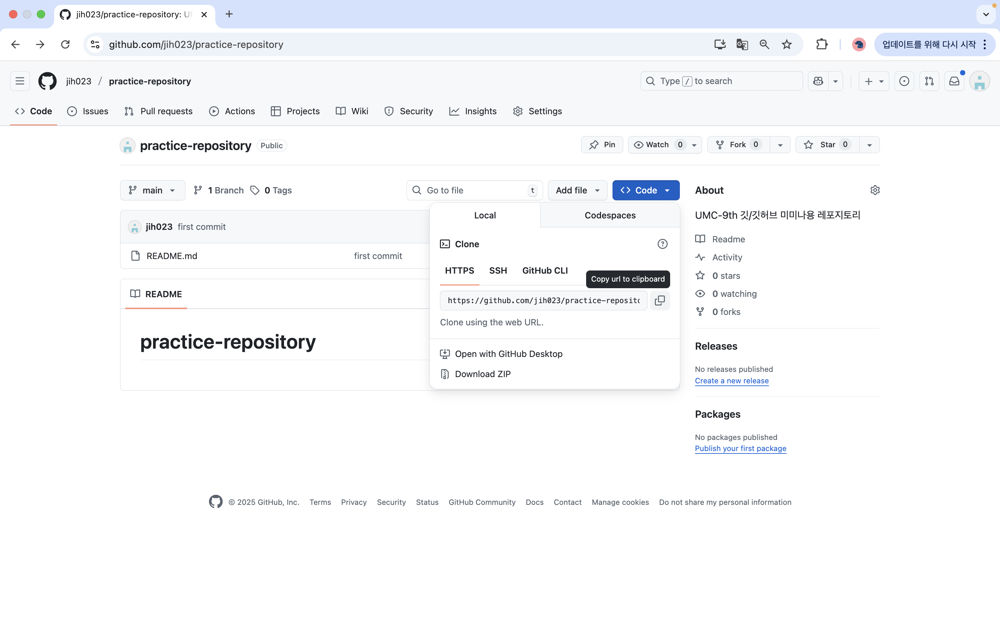

{: start="3"}
3. 터미널에 다음과 같이 명령어를 입력해주면 끝!

```bash
git clone (복사한 URL)
```

- 이 작업은 명령어 그대로 원격 레포지토리를 로컬 레포지토리로 clone(복제)한다고 생각하시면 됩니다 ~

## 3. 브랜치(branch)에 대해 알아보자

### 브랜치란?

> Git에서 <strong>독립적인 작업 공간</strong>을 의미한다.
>
> 브랜치는 <strong>서로 다른 작업을 병렬적으로 진행</strong>할 수 있도록 해주며, 각 브랜치는 기본적으로 main(주요) 브랜치로부터 분리되어 별도의 변경 사항을 기록할 수 있다.
>
> 브랜치를 사용하면 한 프로젝트에서 <strong>여러 가지 기능을 동시에 개발</strong>하거나, 실험적인 작업을 할 수 있으며, <strong>main 코드에 영향을 주지 않고 작업을 진행</strong>할 수 있다.

### 브랜치 생성하기

1. 이슈 페이지에서 New issue 버튼을 클릭해줍니다!

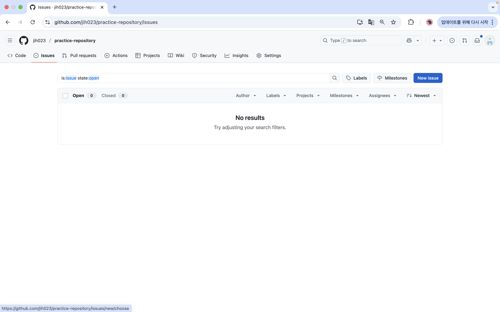

{: start="2"}
2. 이슈 내용을 작성해주세요! (ex. 개발하려는 기능, 발생한 버그 설명 등)

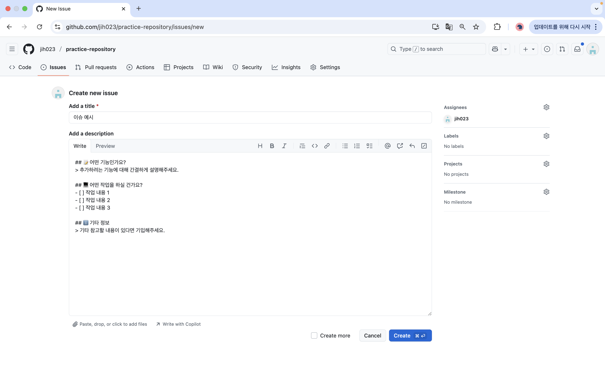

{: start="3"}
3. Create a branch 버튼을 누르고 브랜치 이름을 작성해줍니다. 이때 Branch source를 설정해주는데, 내가 지금 가져오고 싶은 내용을 갖고 있는 브랜치를 선택하면 됩니다!

- 즉, 이전에 브랜치1에서 작업했는데, 아직 main 브랜치에 merge가 되지 않은 상태고, 내가 지금 작업할 브랜치2에서는 브랜치1 작업 내용이 필요하다면, Branch source를 main 말고 브랜치1로 설정하시면 됩니다!
- 브랜치 이름은 팀원들과 프로젝트 시작 후에 결정하시면 됩니다~!

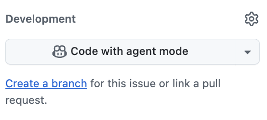
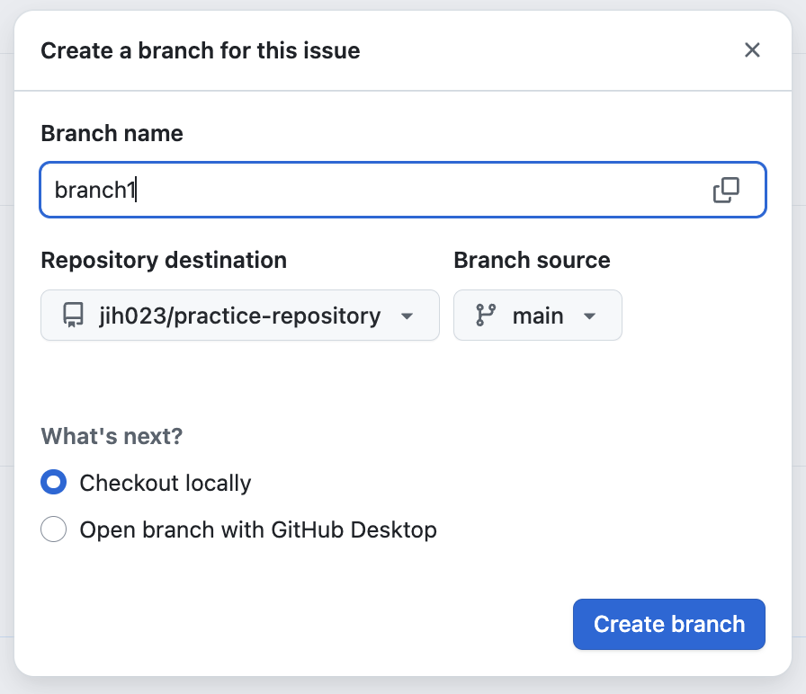

{: start="4"}
4. 브랜치를 생성하면 다음과 같이 명령어가 나옵니다! 이 명령어를 복사 후 로컬 터미널에 입력해주시면 됩니다! 그럼 끝!

- ls: 현재 디렉토리 안의 파일과 디렉토리를 알 수 있는 명령어
- cd (디렉토리 이름 또는 경로): 디렉토리를 이동하는 명령어
- git fetch origin: 원격 저장소에서 최신 정보를 가져오기
  - 원격에서 브랜치를 새로 생성했다면 자동으로 로컬에도 생성되지 않아요!
  - 이 명령어를 로컬에 입력해줘야 로컬에도 반영된답니다~!
- git checkout (브랜치 이름): 작업 브랜치를 이동하는 명령어
  - 다른 사람의 코드를 실행해보고 싶을 때도 많이 사용해요!

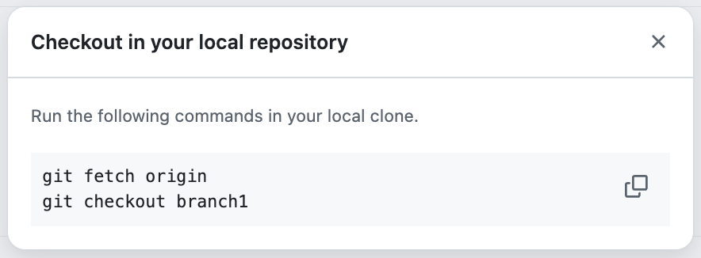
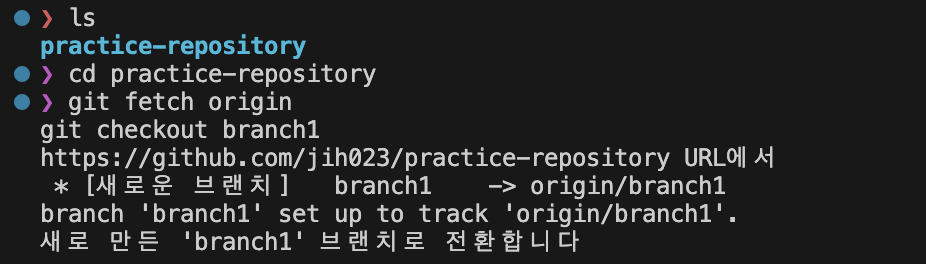

## 4. 로컬에서 수정하고 원격에 올리는 과정

### Commit이란?

> 현재까지 변경된 파일들을 하나의 버전(스냅샷)으로 기록하는 것.
>
> <strong>“이 시점에서 프로젝트 상태는 이렇게 생겼다”</strong>라고 남기는 체크포인트!
>
> 커밋에는 <strong>변경된 파일 내용 + 작성자 + 시간 + 커밋 메시지</strong>가 기록됩니다!
>
> ⇒ 즉, 프로젝트의 히스토리를 만드는 최소 단위

### PR(Pull Request)이란?

> PR(Pull Request)은 <strong>내가 작업한 코드 변경사항을 다른 사람에게 알리고, 프로젝트의 메인 브랜치에 병합(merge)해달라고 요청</strong>하는 것입니다.
>
> 혼자 코드를 짜고 바로 합치는 게 아니라, "제가 이런 코드를 짰는데 한번 검토해주시고 괜찮으면 반영해주세요"라고 동료들에게 공개적으로 <strong>리뷰를 요청하는 과정</strong>이라고 생각하면 이해되실 겁니다!

### 로컬 변경내용을 원격에 올리고 PR 남기기

1. 로컬에서 파일을 수정해줍니다!

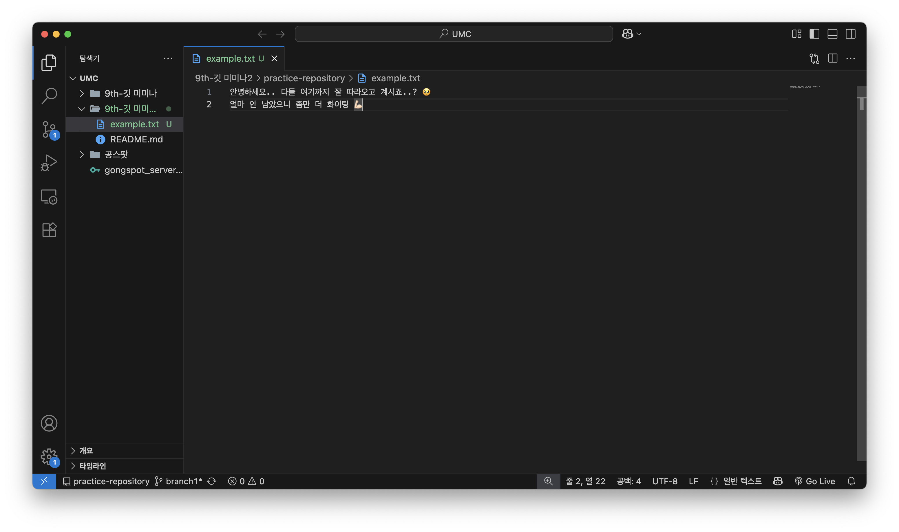

{: start="2"}
2. 터미널에서 다음 명령어를 순서대로 입력해줍니다.

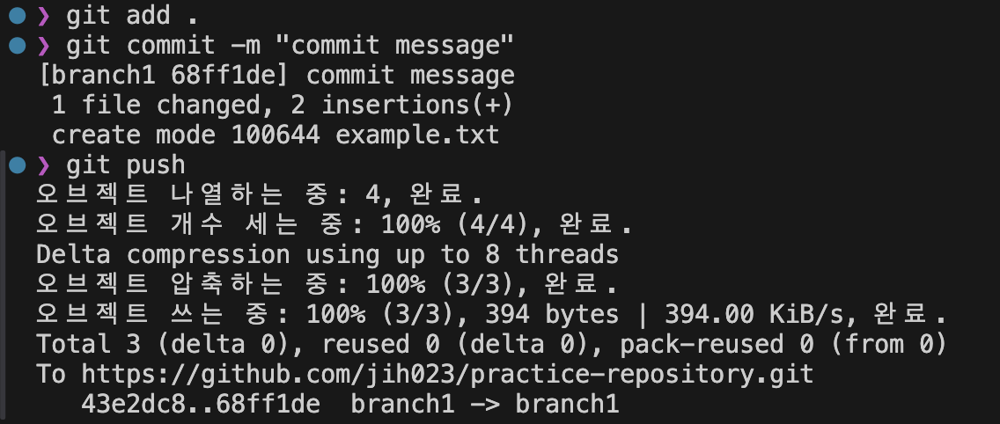

- git add .
  - Git에서 <strong>현재 디렉토리(및 그 하위 디렉토리) 내의 모든 변경된 파일을 스테이징(staging) 영역에 추가</strong>하는 명령어
  - 이렇게 하시면 현재 폴더의 모든 변경사항이 스테이징 됩니다!
  - 원하는 파일만 스테이징 하고싶다면 git add (파일명)
- git commit -m “커밋 메세지”
  - 버전 기록을 남기는 단계입니다!
  - 메세지는 “무엇을 왜 변경했는지” 간단히 쓰는 게 좋아요!
  - 브랜치 이름처럼 프로젝트 초기 단계에서 팀원들과 커밋 컨벤션도 정하게 되실 거예요!
- git push
  - 로컬 브랜치 → 깃허브 원격 브랜치로 업로드

{: start="3"}
3. PR 생성하기

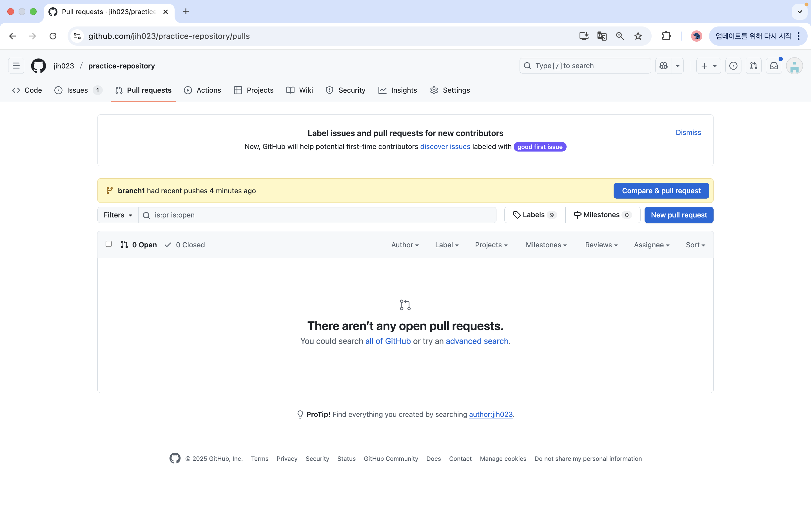

- 깃허브 페이지로 이동하면 Compare & Pull request 버튼이 뜹니다!
- 만약 뜨지 않는다면 New pull request 버튼을 누르고 base 브랜치(타켓 브랜치)와 compare 브랜치(내가 작업한 브랜치)를 설정해주고 Create pull request 버튼을 누르면 됩니다~!
- PR 제목과 내용 입력 후 Create pull request 버튼을 눌러줍니다! 그럼 끝!

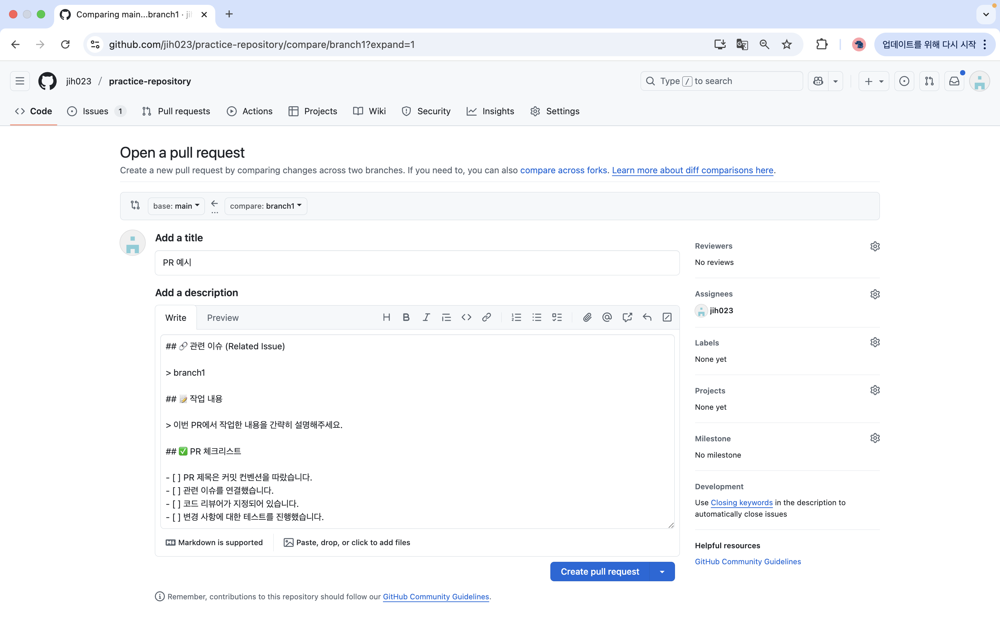

## 5. 마지막 단계! 머지(Merge)!

### 머지(Merge)

- 머지란 두 개의 브랜치의 변경 사항을 합치는 것을 말합니다!
- 머지 방법
  - 깃허브에서 머지
    - Merge Pull request -&gt; Confirm merge를 하면 자동으로 main에 반영됩니다!

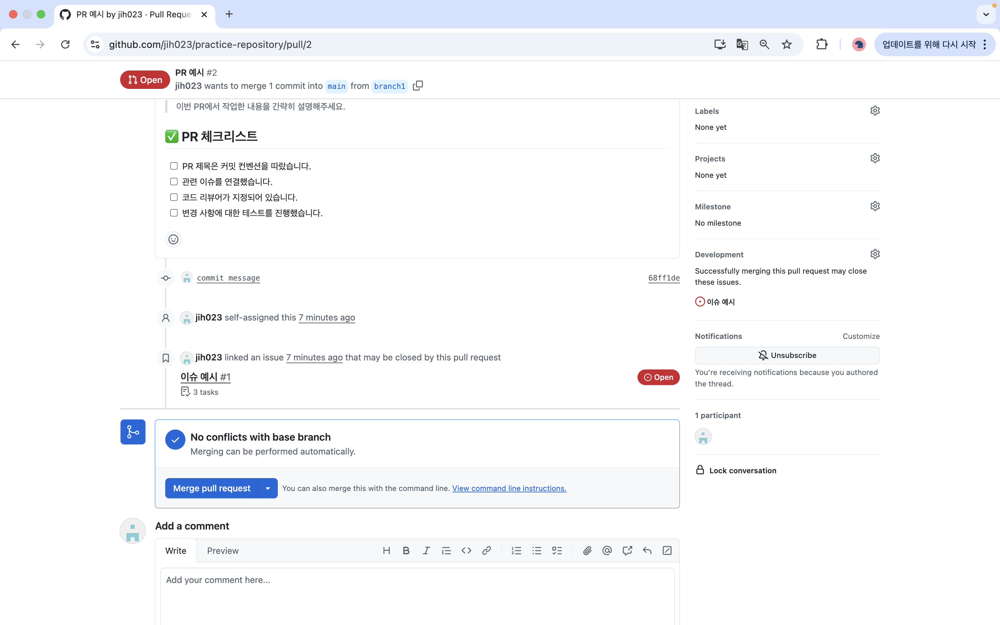

### 머지 시 발생할 수 있는 상황

1. Fast-forward merge (빠른 머지)
   - main이 다른 작업 없이 그대로일 때 → 브랜치 히스토리를 따라가듯 합쳐짐
2. 3-way merge
   - main도 바뀌고, 작업 브랜치도 바뀌었을 때 → 공통 조상(commit) 기준으로 두 개를 합침
3. Merge conflict (충돌)
   - 같은 파일의 같은 부분을 서로 다르게 수정했을 때 → Git이 자동으로 합치지 못해서 사람이 직접 수정해야 함 ⇒ 가끔 발생하니 당황하지 말고 충돌을 해결하시면 됩니다 !

#### 충돌 해결 방법

<strong>충돌이 발생한 파일 확인</strong>

```bash
git status
```

충돌이 발생한 파일들이 목록에 표시됩니다.

<strong>충돌 부분 편집</strong>

충돌이 발생한 파일을 열어보면, 다음과 같은 표시가 있습니다.

```bash
<<<<<<< HEAD
(현재 브랜치의 변경 내용)
=======
(병합하려는 브랜치의 변경 내용)
>>>>>>>
```

여기에서 두 변경 사항 중 하나를 선택하거나, 두 변경 사항을 수동으로 병합한 후, 파일을 저장합니다.

<strong>충돌 해결 후 스테이징</strong>

충돌을 해결한 후, 해당 파일을 스테이징해야 합니다.

```bash
git add (충돌 해결된 파일)
```

<strong>병합 완료</strong>

충돌이 해결되면 병합을 완료할 수 있습니다.

```bash
git commit
```

## 추가로 공부해보면 도움될 주제들!

- git amend
- git stash
- git rebase
- 깃의 스테이징 영역과 상태 정리

## 후기

여기까지가 열심히 준비했던 자료들이다! 우선 나는 깃과 깃허브를 사용해본지 이제 거의 2년이 되어가고 있어서, 위 내용들이 굉장히!! 익숙해서 다른 분들도 이정도 설명이면 다 잘 따라오실 줄 알았다! 근데 생각보다.. 중간중간 막히는 부분이 많았어서 예상한 미미나 시간보다 2배 정도 걸린 것 같다.. vscode에서 터미널을 못 찾는 분도 계셨고, 클론이 잘 안 되시는 분도 계셨다. 그래도 다 하고 나니 많은 분들께서 개념을 많이 익히신 것 같다고 하셔서 다행이었다 !!!

